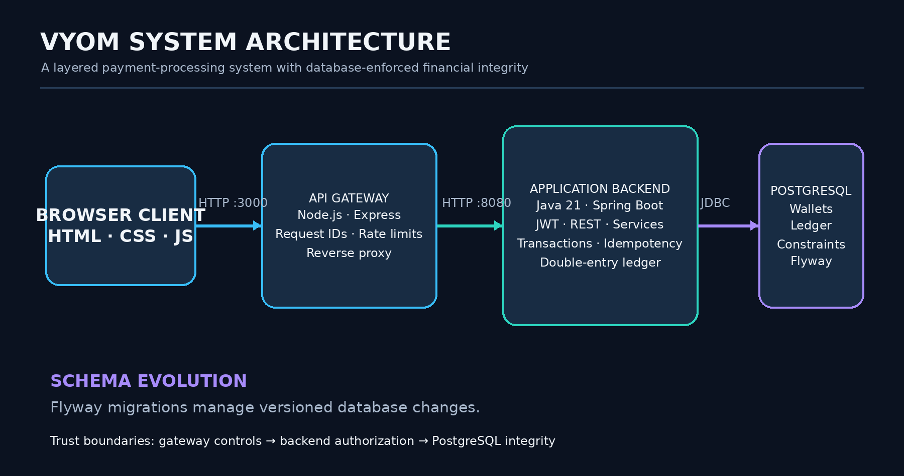
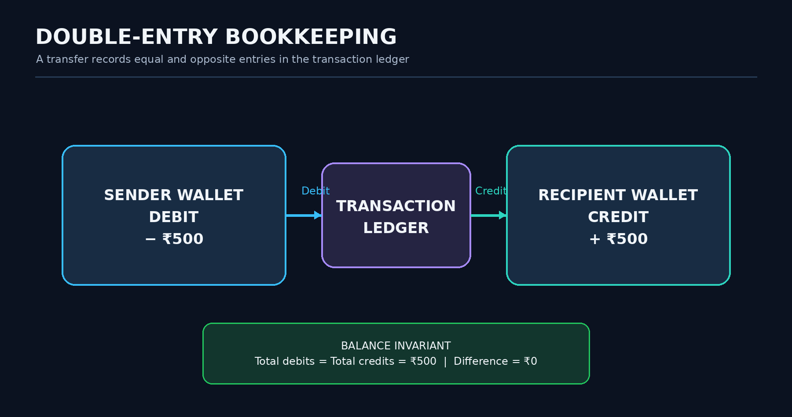
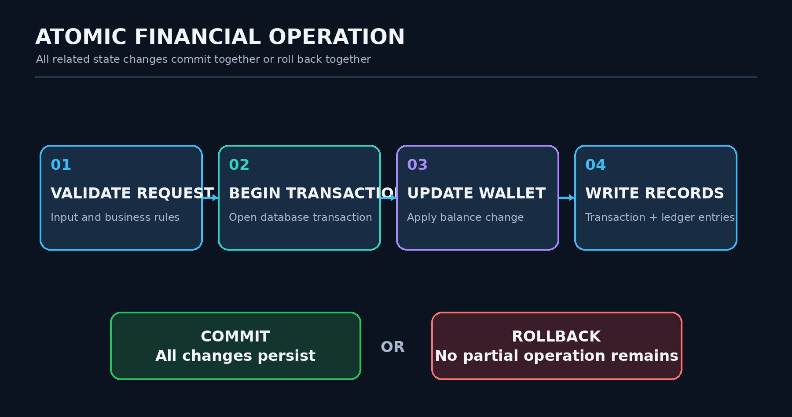
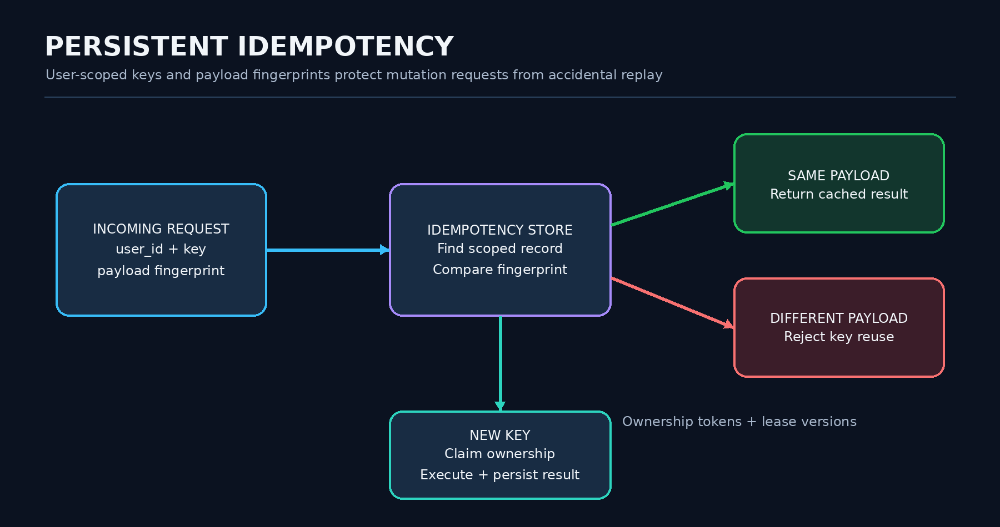
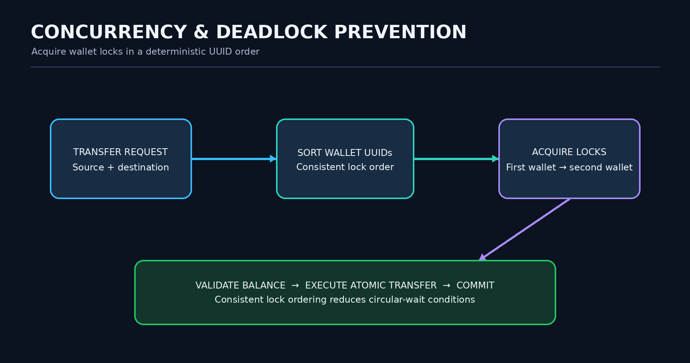
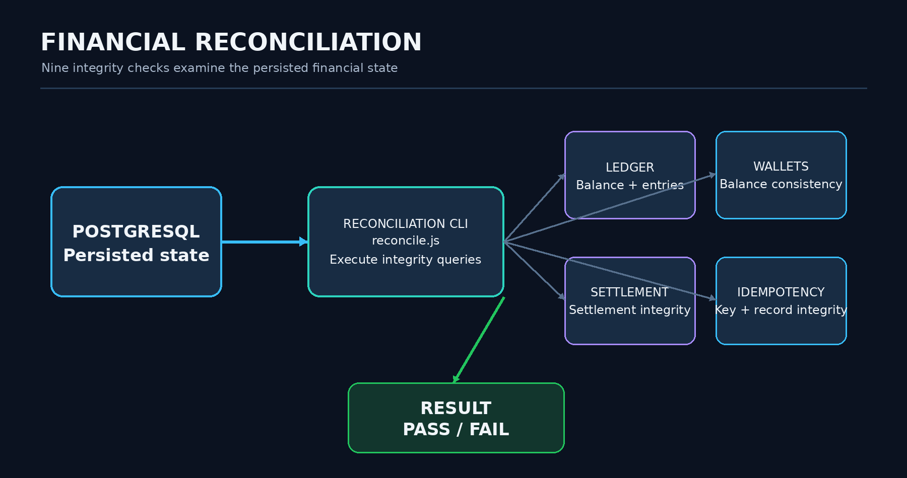

# VYOM (व्योम) — Digital Payments and Transaction Processing Platform

<div align="center">

**Virtual Yatra of Money**

*Every transaction. One trusted space.*

A simulated digital payments ledger, wallet engine, and API gateway built to demonstrate financial transaction integrity, concurrency safety, and reliable backend engineering.


</div>

---

## What is VYOM?

VYOM is an ACID-compliant simulated digital payments ledger, wallet engine, and API gateway built with **Java 21, Spring Boot 3.4.3, PostgreSQL, Flyway, Node.js/Express, and a native HTML5/CSS3/JavaScript frontend**.

The platform explores production-oriented financial engineering concepts, including:

- Double-entry bookkeeping and financial consistency.
- Atomic transaction processing and rollback safety.
- Persistent idempotency with ownership fencing.
- Concurrency control and deterministic wallet lock ordering.
- Database-enforced append-only ledger protection.
- Transactional outbox pattern and reliable merchant webhook delivery.
- Least-privilege database access and append-only audit protections.
- Financial reconciliation and integrity verification.

> [!NOTE]
> **Simulation Notice:** VYOM is an engineering simulation. It does not connect to real UPI switches, banking networks, external payment gateways, or real-money payment infrastructure.

---

## 01. System Architecture

The application follows a layered architecture. Browser requests pass through the Express gateway before reaching the Spring Boot backend, which coordinates financial operations with PostgreSQL.

<p align="center">
  
</p>

| Layer | Responsibility |
|---|---|
| Browser Client | User interface and HTTP/JSON requests |
| Express Gateway | Reverse proxying, request IDs, rate limiting, and static frontend hosting |
| Spring Boot Backend | Authentication, authorization, validation, transaction orchestration, financial logic, transactional outbox & reliable merchant webhook engine, and AES-256-GCM encryption with SSRF-shielded transport |
| PostgreSQL | Persistent storage, constraints, deferred triggers, Flyway migrations (V1 through V13), and database-enforced append-only protections for ledger entries and webhook delivery attempt audit logs |

### Request Flow

1. The browser sends an HTTP request to the Express gateway on port `3000`.
2. The gateway applies request handling, correlation IDs, and configured rate limits.
3. The backend receives the request on port `8080`.
4. Spring Security and application services validate the request and enforce ownership.
5. Financial operations execute within database transactions.
6. PostgreSQL persists the resulting state and enforces database-level invariants.

---

## 02. Financial Transaction Design

### Double-Entry Bookkeeping

Every finalized financial transaction must preserve the accounting invariant:

**Total Debits = Total Credits**

A transfer is not represented as an isolated balance update. It is represented through corresponding ledger entries, preserving the financial movement in a structured and auditable form.

<p align="center">
  
</p>

This design helps ensure that financial state can be independently checked rather than relying only on wallet balances.

### Atomic Transaction Processing

Wallet updates, transaction records, and ledger entries must succeed or fail together.

<p align="center">
  
</p>

The backend uses Spring transaction management and PostgreSQL transaction guarantees to prevent partially committed financial operations.

If an operation fails before commit, the database transaction rolls back instead of leaving an incomplete financial state.

### Core Financial Invariants

| Invariant | Enforcement |
|---|---|
| Non-negative customer balances | Service validation and database constraints |
| Balanced ledger transactions | Deferred database balance validation |
| Atomic financial operations | Spring transactions and PostgreSQL |
| Ledger immutability | Database trigger protection |
| Monetary precision | `BigDecimal`, integer-based `BigInt`, and fixed-precision numeric storage |
| Duplicate request prevention | Persistent, user-scoped idempotency |
| Consistent wallet locking | Deterministic UUID lock ordering |

---

## 03. Reliability and Concurrency

### Persistent Idempotency

A financial API must handle retries safely. A client may retry a request because of a timeout or lost response, even when the original operation has already reached the backend.

VYOM uses persistent, user-scoped idempotency records to prevent duplicate execution.

<p align="center">
  
</p>

Key design properties:

- Idempotency keys are scoped to the requesting user.
- Repeated requests with the same key and payload can return the stored response.
- Reusing a key with a different payload is rejected.
- Processing records support recovery through ownership tokens and lease versions.
- Stale workers cannot commit after losing ownership of a processing record.

### Concurrency Control

Concurrent financial operations can attempt to modify the same wallet simultaneously. Without coordination, this can lead to inconsistent updates or deadlocks.

<p align="center">
  
</p>

VYOM uses:

- Pessimistic database row locking.
- `SELECT ... FOR UPDATE` for critical wallet operations.
- Deterministic UUID-based wallet lock ordering.
- Transaction boundaries around financial state changes.

Consistent lock ordering reduces circular-wait conditions when two operations access the same pair of wallets in opposite directions.

### Security and Access Control

- BCrypt password hashing.
- Stateless JWT bearer authentication using HS256.
- Ownership verification and IDOR protection.
- Role-based authorization.
- Separate migration and application database roles.
- Database-enforced protection against unauthorized ledger updates and deletions.

---

## 04. Merchant Webhook Delivery & Reliability Engine

VYOM includes an enterprise-grade merchant webhook notification subsystem built for at-least-once delivery, strong cryptographic authenticity, and strict least-privilege security:

- **Transactional Outbox Fan-Out:** Outbox events (`order.paid`, `order.cancelled`, etc.) are written in the same atomic database transaction as financial balance mutations, eliminating distributed dual-write inconsistency.
- **Cluster-Safe Dispatch & Execution:** The background dispatcher and delivery workers poll using PostgreSQL `SELECT ... FOR UPDATE SKIP LOCKED` and claim-lease fencing, allowing seamless multi-instance horizontal scaling without central locks or single points of failure.
- **SSRF Shield & IP-Pinned Transport:** Destination URLs are evaluated against maintained IANA special-purpose registries (rejecting private, loopback, link-local, carrier NAT, cloud metadata, and non-global IPv6 destinations). Outbound HTTP requests connect to pre-validated pinned IPs while preserving SNI ClientHello and certificate hostname verification, neutralizing DNS rebinding attacks. Connection reuse is disabled and response bodies are bounded to 64 KB.
- **Authenticated Cryptography:** Merchant signing secrets are encrypted at rest using AES-256-GCM with fresh 12-byte IVs, 128-bit authentication tags, and AAD binding merchant ID, endpoint ID, and master key version. Secrets are revealed strictly once upon creation or rotation. Webhooks are signed via HMAC-SHA256 over exact canonical payload bytes and exposed via `Vyom-Signature: t={timestamp},v1={hmac}`.
- **Retry Policy & Crash Recovery:** Configurable exponential backoff with full jitter, compliant with remote `Retry-After` headers on HTTP 429/503. Client errors (4xx) fast-fail to `DEAD_LETTER`. Interrupted attempts from worker crashes are detected and safely audited on recovery.
- **Append-Only Attempt Auditing:** Delivery reservations and attempt outcomes are stored in dedicated immutable tables (`webhook_delivery_attempts` and `webhook_attempt_outcomes`) where the runtime application role has `INSERT` and `SELECT` privileges only.
- **Merchant RBAC & Anti-Enumeration:** Webhook registration, rotation, and pause/resume APIs enforce fine-grained merchant roles (`MERCHANT_OWNER`, `MERCHANT_ADMIN`, `MERCHANT_OPERATOR`, `MERCHANT_VIEWER`). Non-member access returns `404 Not Found` to prevent merchant and endpoint existence probing.
- **Operational Observability:** Micrometer metrics with bounded cardinality (`vyom.webhook.*`) and a custom Actuator `/actuator/health` indicator with automatic degradation tracking.

For complete API specifications, signature verification implementations (Node.js & Python), and operational configuration, see the [Merchant Webhooks Operational Guide](docs/merchant-webhooks.md).

---

## 05. Technology Stack

| Component | Technology |
|---|---|
| Backend Language | Java 21 |
| Backend Framework | Spring Boot 3.4.3 |
| Security | Spring Security 6.4.3 |
| Database | PostgreSQL 15+ |
| Tested Database Version | PostgreSQL 18.4 |
| Database Migrations | Flyway 10+ (V1 through V13) |
| API Gateway | Node.js 22+ and Express.js |
| Frontend | HTML5, CSS3, JavaScript |
| Build Tool | Apache Maven 3.9.9 |
| Backend Testing | JUnit 5, Mockito, Spring Boot Test |
| Gateway Testing | Native Node.js `node:test` |

### Prerequisites

- JDK 21 or later
- Node.js 22 or later
- npm
- PostgreSQL
- Git
- OpenSSL for generating secure JWT signing secrets and AES master keys

The repository includes a Maven Wrapper, so a separate Maven installation is not required.

---

## 06. Setup and Running Instructions

### Step 1 — Clone the Repository

```bash
git clone https://github.com/yashasvi290906/VYOM.git
cd VYOM
```

### Step 2 — Create PostgreSQL Databases

Ensure PostgreSQL is running on port `5432`.

Create the application and test databases:

```sql
CREATE DATABASE payledger;
CREATE DATABASE payledger_test;
```

### Step 3 — Provision Least-Privilege Database Roles

Execute the database provisioning script to configure:

- `vyom_flyway` — database migration role with required DDL privileges.
- `vyom_app` — restricted application runtime role.

Example using PowerShell:

```powershell
psql -U postgres -d payledger `
  -v APP_PASSWORD="your_secure_runtime_password" `
  -v FLYWAY_PASSWORD="your_secure_migration_password" `
  -f scripts/setup_least_privilege_user.sql
```

Replace the example passwords with securely generated values.

### Step 4 — Configure Environment Variables

Copy `.env.example` to `.env` and replace all placeholder values.

Alternatively, configure the variables directly in your terminal.

Example:

```powershell
$env:SPRING_PROFILES_ACTIVE="prod"
$env:BACKEND_PORT="8080"

$env:DB_HOST="127.0.0.1"
$env:DB_PORT="5432"
$env:DB_NAME="payledger"

$env:DB_USER="vyom_app"
$env:DB_PASSWORD="your_secure_runtime_password"

$env:DB_MIGRATION_USER="vyom_flyway"
$env:DB_MIGRATION_PASSWORD="your_secure_migration_password"
```

**Generate a secure JWT signing secret:**

```powershell
openssl rand -base64 48
```

Configure the generated value as `JWT_SECRET` in both the backend and gateway environments.

```powershell
$env:JWT_SECRET="your_generated_secret"
```

**Generate a secure 256-bit AES webhook encryption master key:**

```powershell
openssl rand -base64 32
```

Configure the generated value as `WEBHOOK_ENCRYPTION_KEY` in the backend environment:

```powershell
$env:WEBHOOK_ENCRYPTION_KEY="your_generated_aes_master_key"
$env:WEBHOOK_MASTER_KEY_VERSION="1"
```

> [!IMPORTANT]
> Both services must use the same JWT signing secret. Never commit generated secrets, database passwords, or production credentials to Git.

### Step 5 — Build and Start the Spring Boot Backend

Ensure JDK 21 or later is available through `JAVA_HOME` or your system `PATH`.

From the repository root:

```powershell
.\mvnw.cmd spring-boot:run
```

On Linux/macOS:

```bash
./mvnw spring-boot:run
```

Backend health endpoint:

```text
http://127.0.0.1:8080/actuator/health
```

### Step 6 — Start the Node.js API Gateway

Open a separate terminal and configure the gateway:

```powershell
$env:GATEWAY_PORT="3000"
$env:BACKEND_BASE_URL="http://127.0.0.1:8080"
$env:JWT_SECRET="your_generated_secret"
```

Install dependencies and start the gateway:

```powershell
npm ci --prefix gateway
npm start --prefix gateway
```

### Step 7 — Access the Web Application

Open:

```text
http://localhost:3000/
```

The frontend communicates with the backend through the Express gateway.

---

## 07. Administrative Bootstrap

Administrative account bootstrapping is disabled by default:

```text
VYOM_ADMIN_BOOTSTRAP_ENABLED=false
```

To provision an initial administrator account:

**1. Configure the bootstrap environment variables using secure credentials.**

```powershell
$env:VYOM_ADMIN_BOOTSTRAP_ENABLED="true"
$env:VYOM_ADMIN_BOOTSTRAP_EMAIL="admin@vyom.internal"
$env:VYOM_ADMIN_BOOTSTRAP_PASSWORD="your_secure_admin_password"
$env:VYOM_ADMIN_BOOTSTRAP_FULL_NAME="System Administrator"
```

**2. Start the backend.**

During initial startup, `AdminBootstrapService` provisions the administrator account with the `ADMIN` role.

**3. Stop the backend after successful provisioning.**

**4. Remove the bootstrap credentials from the environment and restore:**

```powershell
$env:VYOM_ADMIN_BOOTSTRAP_ENABLED="false"
```

> [!WARNING]
> Do not leave administrative bootstrap enabled during normal operation. Use strong credentials and protect all bootstrap environment variables.

---

## 08. Testing and Verification

### Backend Test Suite

Run the complete Maven test suite:

```powershell
.\mvnw.cmd test
```

The suite includes 530 tests covering unit, integration, security, database, financial integrity, concurrency, idempotency, SSRF transport, and end-to-end merchant webhook delivery.

### API Gateway Test Suite

Install dependencies:

```powershell
npm ci --prefix gateway
```

Run the gateway tests:

```powershell
npm test --prefix gateway
```

Coverage includes:

- Reverse proxying and upstream error handling.
- Request and correlation ID generation.
- Security headers.
- Sliding-window rate limiting.
- Rate-limit memory bounding and cache churn resilience.
- JWT algorithm and expiration validation.
- Proxy trust policy.

### Financial Reconciliation

VYOM includes a reconciliation utility that checks financial consistency across supported ledger, wallet, settlement, and idempotency invariants.

Run it from the repository root:

```bash
node benchmark/reconcile.js
```

The utility uses `psql` through the system `PATH` by default. A custom executable can be supplied through `PSQL_PATH`.

Connection configuration supports:

| Variable | Purpose |
|---|---|
| `BENCHMARK_DB_NAME` | Reconciliation database name |
| `BENCHMARK_DB_USER` | Database username |
| `BENCHMARK_DB_HOST` | Database host |
| `BENCHMARK_DB_PORT` | Database port |
| `PSQL_PATH` | Optional custom `psql` executable |

Where applicable, standard PostgreSQL variables `PGUSER`, `PGHOST`, and `PGPORT` are used as fallbacks.

The CLI invokes PostgreSQL using argument-based process execution rather than shell-interpolated commands. Database passwords should be supplied through supported PostgreSQL environment or password-file mechanisms, not command-line arguments.

The reconciliation process enables `ON_ERROR_STOP` so SQL execution errors are not silently ignored.

Run the reconciliation CLI regression tests:

```bash
node --test benchmark/*.test.js
```

<p align="center">
  
</p>

---

## 09. Key Architectural Invariants

1. **Non-Negative Balances:** Service-level validation and database constraints prevent customer wallets from having negative balances. System settlement accounts are handled separately.

2. **Double-Entry Conservation:** Finalized transactions maintain balanced debit and credit ledger entries. Deferred database triggers validate transaction balance invariants at commit.

3. **Atomic Financial Operations:** Wallet balance updates, transaction records, and corresponding ledger entries participate in atomic database transactions. Failed operations roll back rather than leaving partial financial state.

4. **Authentication and IDOR Protection:** Customer passwords are hashed using BCrypt. Stateless JWT bearer tokens use HS256 authentication. Ownership checks protect wallet, transaction, dispute, refund, and idempotency-related operations.

5. **Database-Enforced Append-Only Ledger:** PostgreSQL trigger `trg_protect_ledger_entries` prevents unauthorized updates and deletions of existing ledger entries.

6. **User-Scoped Persistent Idempotency:** Mutation requests use customer-scoped `(user_id, idempotency_key)` records. Identical retries can return cached responses without duplicate execution, while altered payloads using an existing key are rejected.

7. **Crash-Resilient Idempotency Recovery:** Abandoned `PROCESSING` records can be reclaimed through atomic ownership-token and lease-version updates. Stale workers are prevented from committing after losing ownership.

8. **Deterministic Wallet Lock Ordering:** Dual-wallet operations acquire locks in a consistent UUID order, reducing circular-wait conditions and preventing bidirectional wallet-lock deadlocks.

9. **Database Privilege Separation:** DDL operations are assigned to the `vyom_flyway` migration role, while application runtime operations use the restricted `vyom_app` role. Strict append-only protections are enforced at the database privilege level for ledger entries, webhook delivery attempts, and outcome audit logs.

10. **Monetary Precision:** Java monetary calculations use `BigDecimal`, JavaScript uses integer-based `BigInt` arithmetic, and PostgreSQL stores monetary values using fixed-precision numeric types.

11. **Durable Transactional Webhook Delivery & Outbox Fan-Out:** Outbox events participate in atomic database transactions alongside financial ledger updates, eliminating distributed dual-write inconsistency. Cluster-safe workers dispatch events using PostgreSQL `SELECT ... FOR UPDATE SKIP LOCKED` and claim-lease fencing.

12. **SSRF Shielding, Transport Hardening & Cryptographic Authenticity:** Webhook delivery enforces an IANA special-purpose destination policy, DNS IP-pinning to neutralize rebinding attacks, disabled HTTP connection reuse, bounded response consumption (64 KB), AES-256-GCM secret encryption with AAD binding, and HMAC-SHA256 canonical payload signing (`Vyom-Signature`).

---

## 10. Security Limitations and Operational Boundaries

1. **Simulated Financial Platform:** VYOM is an engineering simulation. It does not process real money or integrate with actual banking infrastructure.

2. **JWT Security:** Use cryptographically strong signing secrets, keep them outside source control, and rotate them according to operational security requirements.

3. **Database Privileges:** Use separate migration and runtime database credentials. Do not run the application using a PostgreSQL superuser account.

4. **Reverse Proxy Trust:** Configure `TRUST_PROXY` according to the actual deployment topology. Trust only known proxy addresses or networks to prevent client IP spoofing.

5. **Administrative Bootstrap:** Keep bootstrap disabled after initial administrator provisioning.

6. **Production Deployment:** Use TLS, protected environment variables or a secrets manager, restricted database networking, and appropriate operational monitoring.

---

## Repository

**GitHub:** [yashasvi290906/VYOM](https://github.com/yashasvi290906/VYOM)

VYOM is an evolving engineering project focused on transaction correctness, financial data integrity, application security, and reliable backend architecture.

<div align="center">

**VYOM — Virtual Yatra of Money**

*Every transaction. One trusted space.*

</div>
