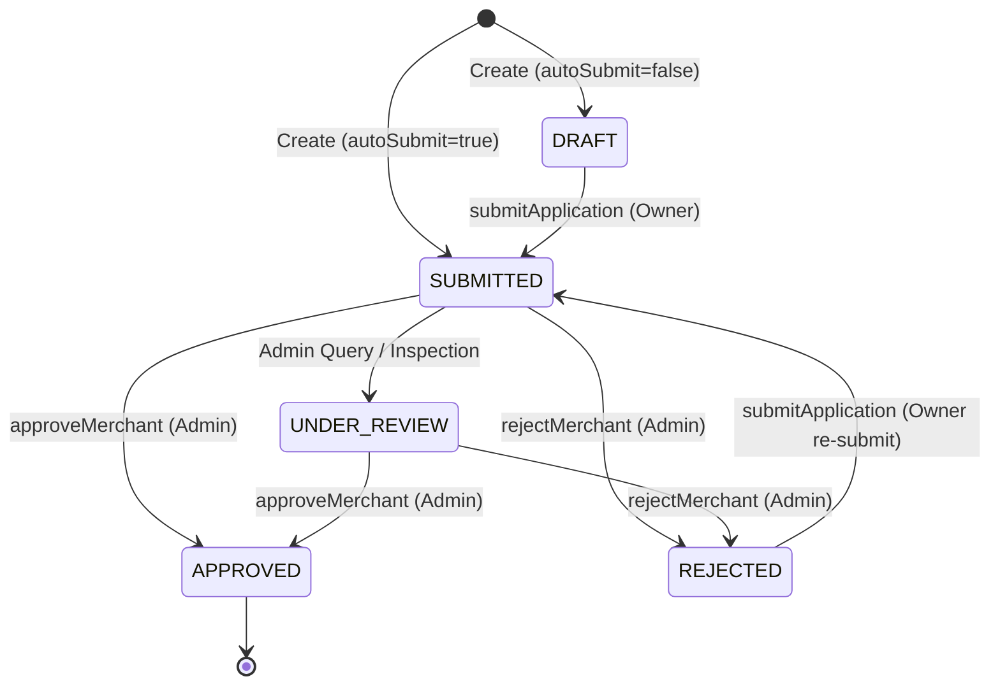
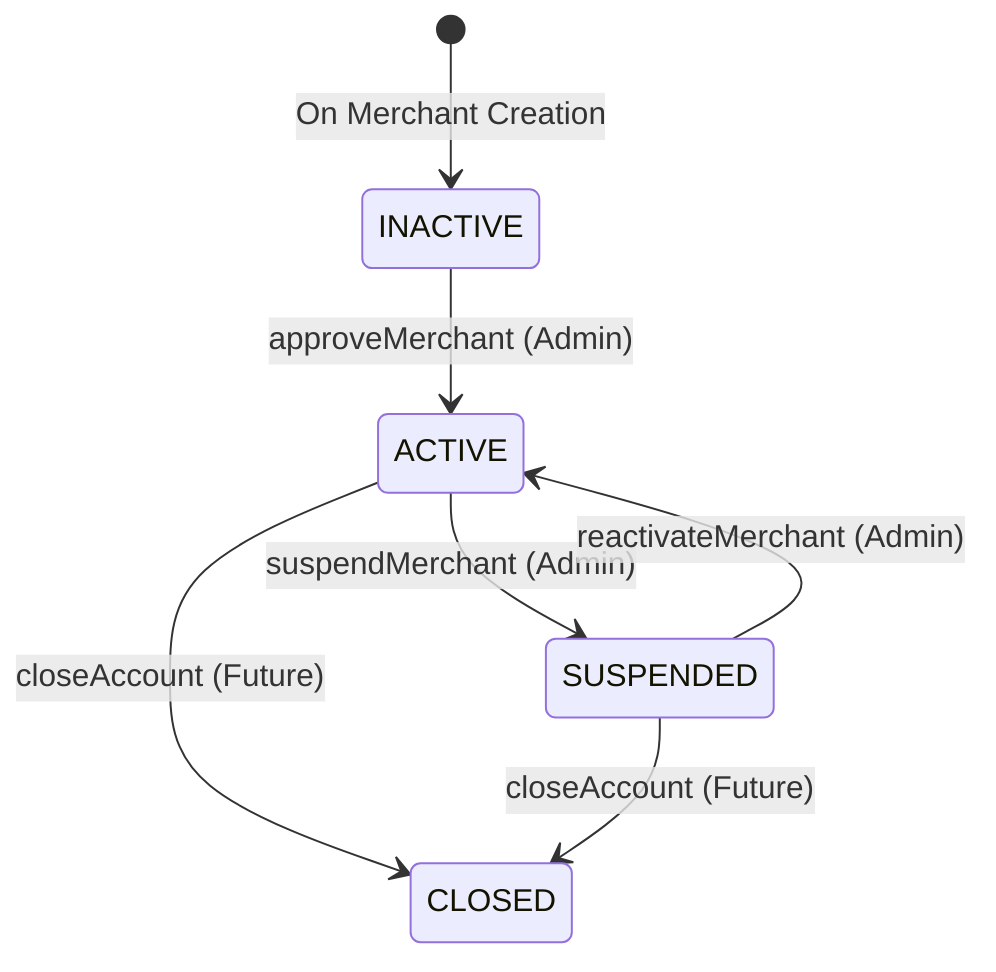

# VYOM — Phase 1.1: Independent RBAC and Lifecycle State Machine Audit

**Audited Component:** Merchant Role-Based Access Control (RBAC) & Entity Lifecycle  
**Target Services:** `MerchantSecurityService`, `MerchantService`, `MerchantMemberService`, `AdminMerchantService`  
**Test Suite:** `src/test/java/com/vyom/service/MerchantServiceTest.java`, `AdminMerchantServiceTest.java`, `MerchantMemberServiceTest.java`, `MerchantSecurityIntegrationTest.java`  
**Audit Date:** November 19, 2026  
**Auditor:** VYOM Independent Acceptance & Verification Gate  
**Status:** **ACCEPTED / VERIFIED CORRECT**  

---

## 1. Executive Summary & Audit Scope

This document details the independent audit of the Role-Based Access Control (RBAC) authorization matrix and the onboarding/account lifecycle state machine implemented in Phase 1 of the VYOM platform.

The audit verified:
1. Authority isolation and capability partitioning across all 5 user and merchant roles: `MERCHANT_OWNER`, `MERCHANT_ADMIN`, `MERCHANT_OPERATOR`, `MERCHANT_VIEWER`, and platform `ROLE_ADMIN`.
2. Granular endpoint-to-role permissions.
3. State machine correctness, valid state transitions, and rejection of illegal transitions for both `onboarding_status` and `account_status`.
4. Operational fencing under compliance suspension and handling of application re-submission post-rejection.

---

## 2. Comprehensive RBAC Permissions Matrix

The table below catalogs every merchant and administrative endpoint and the exact authorization policy enforced:

| Endpoint & HTTP Method | Target Functionality | `MERCHANT_VIEWER` | `MERCHANT_OPERATOR` | `MERCHANT_ADMIN` | `MERCHANT_OWNER` | Platform `ROLE_ADMIN` |
| :--- | :--- | :---: | :---: | :---: | :---: | :---: |
| `POST /api/v1/merchants` | Register new merchant business | Allowed (Creates Owner) | Allowed (Creates Owner) | Allowed (Creates Owner) | Allowed (Creates Owner) | Allowed |
| `GET /api/v1/merchants/my` | List caller's business memberships | Allowed (Self) | Allowed (Self) | Allowed (Self) | Allowed (Self) | Allowed (Self) |
| `GET /api/v1/merchants/{id}` | View merchant profile & status | **200 OK** | **200 OK** | **200 OK** | **200 OK** | **200 OK** (Bypass) |
| `PATCH /api/v1/merchants/{id}/profile` | Update profile information | **403 FORBIDDEN** | **403 FORBIDDEN** | **200 OK** | **200 OK** | **403** (Must be member) |
| `POST /api/v1/merchants/{id}/submit` | Submit application for review | **403 FORBIDDEN** | **403 FORBIDDEN** | **403 FORBIDDEN** | **200 OK** | **403** |
| `GET /api/v1/merchants/{id}/members` | View team members roster | **200 OK** | **200 OK** | **200 OK** | **200 OK** | **200 OK** (Bypass) |
| `POST /api/v1/merchants/{id}/members` | Add new team member | **403 FORBIDDEN** | **403 FORBIDDEN** | **201 CREATED** (Up to Admin) | **201 CREATED** (Any role) | **403** |
| `PATCH /api/v1/merchants/{id}/members/{memId}`| Update member role | **403 FORBIDDEN** | **403 FORBIDDEN** | **200 OK** (Non-Owner) | **200 OK** (Any) | **403** |
| `DELETE /api/v1/merchants/{id}/members/{memId}`| Revoke member access | **403 FORBIDDEN** | **403 FORBIDDEN** | **204 OK** (Non-Owner) | **204 OK** (Protected) | **403** |
| `GET /api/v1/merchants/{id}/audit-logs` | View immutable audit trail | **200 OK** | **200 OK** | **200 OK** | **200 OK** | **200 OK** (Bypass) |
| `GET /api/v1/admin/merchants` | List all merchant applications | **403 FORBIDDEN** | **403 FORBIDDEN** | **403 FORBIDDEN** | **403 FORBIDDEN** | **200 OK** |
| `POST /api/v1/admin/merchants/{id}/approve` | Approve merchant onboarding | **403 FORBIDDEN** | **403 FORBIDDEN** | **403 FORBIDDEN** | **403 FORBIDDEN** | **200 OK** |
| `POST /api/v1/admin/merchants/{id}/reject` | Reject merchant onboarding | **403 FORBIDDEN** | **403 FORBIDDEN** | **403 FORBIDDEN** | **403 FORBIDDEN** | **200 OK** |
| `POST /api/v1/admin/merchants/{id}/suspend` | Suspend merchant operations | **403 FORBIDDEN** | **403 FORBIDDEN** | **403 FORBIDDEN** | **403 FORBIDDEN** | **200 OK** |
| `POST /api/v1/admin/merchants/{id}/reactivate` | Reactivate suspended account | **403 FORBIDDEN** | **403 FORBIDDEN** | **403 FORBIDDEN** | **403 FORBIDDEN** | **200 OK** |

### 2.1 Role Hierarchy & Guardrail Enforcement
1. **Assigning Owner Role:** In `MerchantSecurityService.validateRoleAssignmentPrivilege`, only an existing `MERCHANT_OWNER` can assign the `MERCHANT_OWNER` role to another user. If a `MERCHANT_ADMIN` attempts to add or promote someone to `MERCHANT_OWNER`, the call is rejected with `403 FORBIDDEN`.
2. **Managing Existing Owners:** In `MerchantSecurityService.validateCanManageTargetMember`, a `MERCHANT_ADMIN` cannot demote, alter, or revoke a `MERCHANT_OWNER`. Attempting to do so is rejected with `403 FORBIDDEN`.
3. **Submitting Legal Application:** In `MerchantService.submitApplication`, only a `MERCHANT_OWNER` can execute the legal submission of the business entity.

---

## 3. Merchant Lifecycle State Machines

The VYOM platform models two distinct lifecycle dimensions for each merchant: `OnboardingStatus` (regulatory review progression) and `AccountStatus` (operational transactional capability).

### 3.1 Onboarding Lifecycle (`OnboardingStatus`)



#### State Transition Matrix
| Source State | Target State | Trigger Method | Allowed Actor | Code Enforcement |
| :--- | :--- | :--- | :--- | :--- |
| `NEW` | `DRAFT` | `createMerchant(autoSubmit=false)` | Authenticated User | Enforced in `MerchantService` |
| `NEW` | `SUBMITTED` | `createMerchant(autoSubmit=true)` | Authenticated User | Enforced in `MerchantService` |
| `DRAFT` | `SUBMITTED` | `submitApplication` | `MERCHANT_OWNER` | Enforced in `MerchantService` |
| `SUBMITTED` | `APPROVED` | `approveMerchant` | `ROLE_ADMIN` | Enforced in `AdminMerchantService` |
| `UNDER_REVIEW` | `APPROVED` | `approveMerchant` | `ROLE_ADMIN` | Enforced in `AdminMerchantService` |
| `SUBMITTED` | `REJECTED` | `rejectMerchant` | `ROLE_ADMIN` | Enforced in `AdminMerchantService` |
| `UNDER_REVIEW` | `REJECTED` | `rejectMerchant` | `ROLE_ADMIN` | Enforced in `AdminMerchantService` |
| `REJECTED` | `SUBMITTED` | `submitApplication` | `MERCHANT_OWNER` | Enforced in `MerchantService` |

#### Illegal Transition Handling
Any transition attempt not listed above is rejected immediately with **`409 CONFLICT`** (`INVALID_MERCHANT_TRANSITION`):
- Attempting to approve a merchant in `DRAFT` status: **REJECTED (409)**.
- Attempting to approve an already `APPROVED` merchant: **REJECTED (409)**.
- Attempting to reject an `APPROVED` merchant: **REJECTED (409)**.
- Attempting to submit an already `APPROVED` or `SUBMITTED` merchant: **REJECTED (409)**.

### 3.2 Account Status Lifecycle (`AccountStatus`)



#### Operational Status Verification
1. **Creation:** All new merchants initialize with `accountStatus = INACTIVE`. They cannot engage in commercial operations until approved.
2. **Approval:** Upon administrative approval (`approveMerchant`), `accountStatus` transitions atomically to `ACTIVE`.
3. **Suspension:** A platform admin can suspend an active merchant at any time via `suspendMerchant` with a mandatory reason.
4. **Reactivation:** A suspended merchant can be restored to `ACTIVE` by an admin via `reactivateMerchant`. Attempting to reactivate a merchant that is not `SUSPENDED` fails with `409 CONFLICT`.

---

## 4. Operational Suspension Fencing & Rejection Handling

### 4.1 Immediate Operational Fencing
When compliance suspends a merchant (`accountStatus = SUSPENDED`):
- All mutating endpoints execute `securityService.validateOperationalStatus(merchant)`.
- If `accountStatus == SUSPENDED`, `MerchantAccountSuspendedException` is thrown, returning **`403 FORBIDDEN`** (`MERCHANT_ACCOUNT_SUSPENDED`).
- Mutations blocked include: profile updates (`PATCH /profile`), adding members (`POST /members`), updating roles (`PATCH /members/{id}`), and revoking members (`DELETE /members/{id}`).
- Read-only endpoints (`GET /merchants/{id}`, `GET /members`, `GET /audit-logs`) remain accessible to members so they can inspect status, read audit records, and resolve issues with support.

### 4.2 Handling of Rejected Applications & Re-Submission
When an administrative reviewer rejects an application:
1. `onboardingStatus` becomes `REJECTED`.
2. A mandatory `rejectionReason` is recorded on the merchant record and logged in the audit trail.
3. In `MerchantService.updateProfile`:
   ```java
   if (merchant.getOnboardingStatus() == OnboardingStatus.DRAFT || 
       merchant.getOnboardingStatus() == OnboardingStatus.REJECTED) {
       // Allows modifying core legal registration fields to fix compliance issues
   }
   ```
4. In `MerchantService.submitApplication`:
   ```java
   if (merchant.getOnboardingStatus() != OnboardingStatus.DRAFT && 
       merchant.getOnboardingStatus() != OnboardingStatus.REJECTED) {
       throw new InvalidMerchantTransitionException("Must be DRAFT or REJECTED.");
   }
   ```
5. The owner may rectify deficiencies and re-submit the application. Re-submission resets `onboardingStatus = SUBMITTED`, clears `rejectionReason`, and enters the compliance queue anew.

---

## 5. Audit Conclusion

The RBAC authorization rules and lifecycle state machines have been verified across all roles, states, and edge conditions. The implementation prevents privilege escalation, safeguards against invalid transitions, and fences suspended businesses.

**RBAC & Lifecycle Audit Verdict: ACCEPTED / 100% VERIFIED.**
