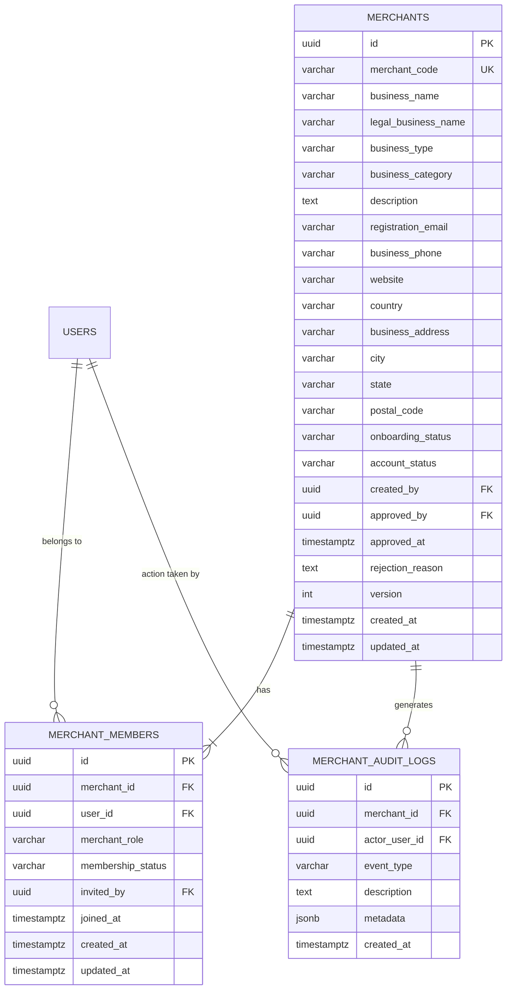
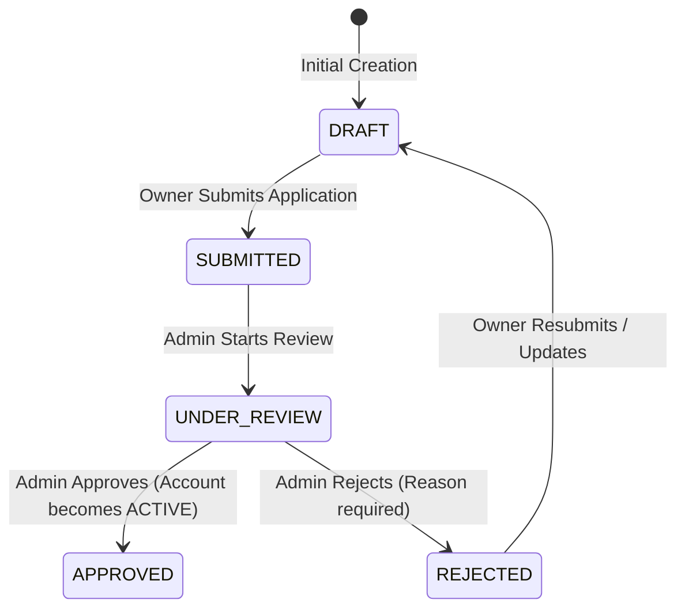
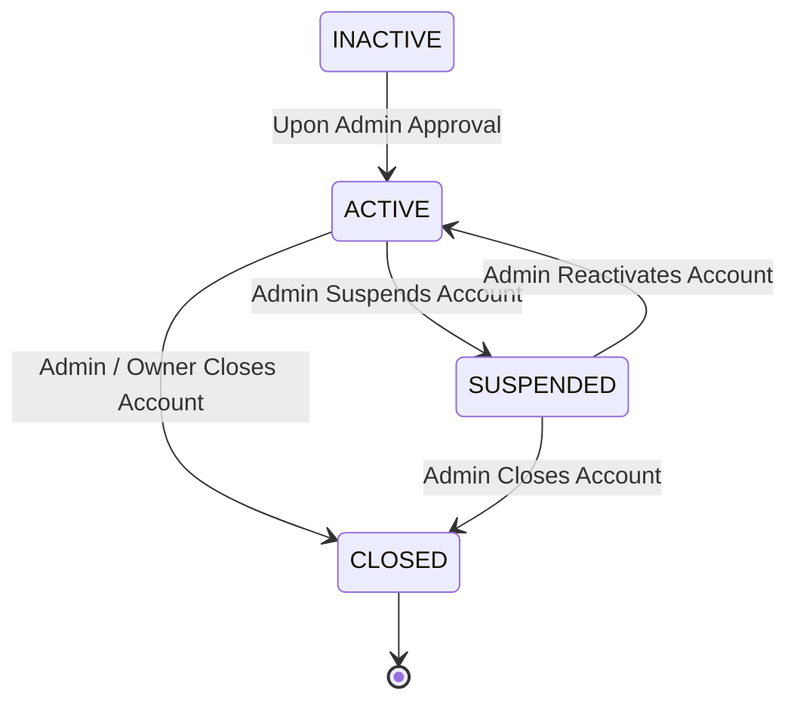

# VYOM — Phase 1: Baseline Architecture & Merchant Domain Design

**Phase:** Phase 1 (Merchant Ecosystem Foundation)  
**Date:** 2026-11-19  
**Status:** Architecture Baseline & Specification  
**Repository:** `D:\VYOM`  
**Target Runtimes:** Java 21 / Spring Boot 3.4.3, Node.js 22 (Express Gateway), PostgreSQL 18.4  

---

## 1. Executive Summary & Objective

The objective of **Phase 1** is to engineer the **Merchant Ecosystem Foundation** for VYOM (Virtual Yatra of Money), inspired by publicly observable merchant workflows (such as PhonePe Business and SnapScan Store Management), within an original, technically rigorous modular monolith architecture.

Phase 1 establishes:
1. **Merchant Identity & Business Profiles:** Business entity registration, verification lifecycle, address and category classification.
2. **Merchant Membership & Multi-User Support:** Associating existing authenticated users to merchants with granular roles.
3. **Merchant Role-Based Access Control (RBAC):** Defining hierarchical merchant permissions (`MERCHANT_OWNER`, `MERCHANT_ADMIN`, `MERCHANT_OPERATOR`, `MERCHANT_VIEWER`) strictly isolated from global administrative roles.
4. **Administrative Review & Lifecycle State Machine:** Strict transitions for onboarding (`DRAFT`, `SUBMITTED`, `UNDER_REVIEW`, `APPROVED`, `REJECTED`) and account operations (`ACTIVE`, `SUSPENDED`, `CLOSED`).
5. **Team Management & Audit Trail:** Secure user invitations by email, role assignments, last-owner protections, and tamper-resistant audit logs.
6. **Merchant Dashboard:** Front-facing UI for business profile management, team administration, and operational status visibility with honest empty states (zero fabricated metrics).
7. **Merchant Financial Architecture Assessment:** Detailed technical design for future merchant payable and settlement accounts (design-only; no financial ledger mutations in Phase 1).

---

## 2. Existing Relevant Architecture & Reusable Components

A thorough inspection of the existing codebase confirms the following foundational patterns and reusable components:

### 2.1 Identity & Authentication
- **User Entity (`com.vyom.entity.User`):** Represents authenticated users with UUID primary key, lowercase normalized email, BCrypt password hash (cost factor 12, max 72 bytes), full name, and global `Role` (`USER`, `ADMIN`).
- **Principal Representation (`com.vyom.security.UserPrincipal`):** Implements Spring Security's `UserDetails`, encapsulating `userId`, `email`, `fullName`, and authorities (`ROLE_USER`, `ROLE_ADMIN`).
- **Security Utilities (`com.vyom.security.SecurityUtils`):**
  - `getCurrentUser()`: Returns authoritative `UserPrincipal`.
  - `getCurrentUserId()`: Returns authenticated user's UUID.
  - `isCurrentUserAdmin()`: Checks if caller holds global `ROLE_ADMIN`.
- **JWT Subsystem (`com.vyom.security.JwtTokenService`):** Generates and validates HS256 tokens with configurable expiration, user ID subject claim, and fail-fast startup enforcement in production environments.
- **Authentication Filter (`com.vyom.security.JwtAuthenticationFilter`):** Intercepts requests, validates Bearer tokens, resolves identity from `UserRepository`, builds `UserPrincipal`, and populates `SecurityContext` and MDC logging context.

### 2.2 Financial Invariants & Wallet Ownership
- **Wallets (`com.vyom.entity.Wallet`):** Stores consumer balances (`CUSTOMER`) and platform settlement pools (`SYSTEM_SETTLEMENT`).
- **Ledger Invariant (`db/migration/V7`, `V8`):** Strict double-entry constraint trigger enforces exactly two entries per transaction ($\sum \text{DEBIT} = \sum \text{CREDIT} = \text{Amount}$) and immutable append-only ledger entries.
- **Architectural Boundary:** Merchant business entities in Phase 1 **do not create consumer wallets or alter ledger balances**. Merchant identity and team membership remain independent of financial accounting.

### 2.3 API Conventions & Error Handling
- **Global Exception Handling (`com.vyom.exception.GlobalExceptionHandler`):** Maps domain exceptions to structured `ErrorResponse` objects with standard HTTP status codes (`400`, `401`, `403`, `404`, `409`, `500`), error codes, messages, request URIs, and correlation IDs.
- **Pagination (`com.vyom.dto.response.PagedResponse<T>`):** Canonical record wrapping Spring Data `Page<T>` with `items`, `page`, `size`, `totalElements`, `totalPages`, and `hasNext`.
- **Gateway Forwarding (`gateway/src/services/backendClient.js`):** Express gateway validates request headers, enforces rate limits, sanitizes `X-Request-Id`, and forwards requests to Spring Boot via HTTP.

---

## 3. Proposed Merchant Domain Boundaries

The Merchant domain is organized into three cohesive core entities:

### 3.1 Merchant Entity
Represents the registered business identity.
- **Identity:** UUID `id`, human-readable `merchant_code` (e.g., `MCH-XXXXXXXXXXXX` generated via `ReferenceGenerator`).
- **Commercial Details:** `business_name` (store/display name), `legal_business_name`, `business_type` (e.g. `SOLE_PROPRIETORSHIP`, `PRIVATE_LIMITED`, `PARTNERSHIP`), `business_category` (e.g. `RETAIL`, `FOOD_BEVERAGE`, `HEALTHCARE`, `SERVICES`).
- **Contact & Location:** `registration_email`, `business_phone`, `website`, `country` (default `IND`), `business_address`, `city`, `state`, `postal_code`.
- **Lifecycle:** `onboarding_status` (`DRAFT`, `SUBMITTED`, `UNDER_REVIEW`, `APPROVED`, `REJECTED`), `account_status` (`INACTIVE`, `ACTIVE`, `SUSPENDED`, `CLOSED`).
- **Administrative Audit:** `created_by`, `approved_by`, `approved_at`, `rejection_reason`, and optimistic locking `version`.

### 3.2 Merchant Member Entity
Associates an existing `User` with a `Merchant`.
- **Relationship:** Many-to-Many join table between `merchants` and `users`.
- **Unique Constraint:** `UNIQUE (merchant_id, user_id)` — a user can only have one active or historic membership record per merchant.
- **Role:** `merchant_role` (`MERCHANT_OWNER`, `MERCHANT_ADMIN`, `MERCHANT_OPERATOR`, `MERCHANT_VIEWER`).
- **Membership Status:** `membership_status` (`ACTIVE`, `REVOKED`).
- **Audit:** `invited_by`, `joined_at`, `created_at`, `updated_at`.

### 3.3 Merchant Audit Log Entity
Tamper-resistant audit record capturing all critical domain events for compliance and dispute review.
- **Captured Events:** `MERCHANT_CREATED`, `MERCHANT_SUBMITTED`, `MERCHANT_APPROVED`, `MERCHANT_REJECTED`, `MERCHANT_SUSPENDED`, `MERCHANT_REACTIVATED`, `PROFILE_UPDATED`, `MEMBER_ADDED`, `MEMBER_ROLE_CHANGED`, `MEMBER_REVOKED`.
- **Immutability:** Application role has `INSERT` and `SELECT` only; records cannot be updated or deleted.

---

## 4. Merchant Lifecycle State Machine

The merchant lifecycle maintains strict separation between **Onboarding Status** (compliance/application lifecycle) and **Account Status** (operational ability to transact).

### 4.1 Onboarding Lifecycle State Transitions

- **Transitions:**
  1. `DRAFT` $\to$ `SUBMITTED`: Performed by `MERCHANT_OWNER` when all required fields are validated.
  2. `SUBMITTED` $\to$ `UNDER_REVIEW`: Performed by Platform Administrator (`ROLE_ADMIN`).
  3. `UNDER_REVIEW` $\to$ `APPROVED`: Performed by Platform Administrator. Automatically transitions `account_status` from `INACTIVE` to `ACTIVE`. Sets `approved_by` and `approved_at`.
  4. `UNDER_REVIEW` $\to$ `REJECTED`: Performed by Platform Administrator with mandatory `rejection_reason`.
  5. `REJECTED` $\to$ `DRAFT`: Performed by `MERCHANT_OWNER` to revise business information before resubmission.

### 4.2 Account Operational Status Transitions

- **Operational Rules:**
  - An account must be in `ACTIVE` state for any protected operational or team actions.
  - If `SUSPENDED`, all merchant team members immediately receive `403 ACCESS_DENIED` on mutating endpoints.
  - If `CLOSED`, the account is permanently deactivated.

---

## 5. Merchant Authorization & RBAC Architecture

Merchant permissions are strictly distinct from platform user roles:

| Dimension | Global Platform Role | Merchant Scoped Role |
| :--- | :--- | :--- |
| **Entities** | `User` | `MerchantMember` |
| **Values** | `ROLE_USER`, `ROLE_ADMIN` | `MERCHANT_OWNER`, `MERCHANT_ADMIN`, `MERCHANT_OPERATOR`, `MERCHANT_VIEWER` |
| **Scope** | Entire VYOM Application | Specific `merchant_id` relation |
| **Source of Truth** | `users.role` column | `merchant_members.merchant_role` + `merchant_members.membership_status` |

### 5.1 Merchant Permission Matrix

| Capability / Action | MERCHANT_OWNER | MERCHANT_ADMIN | MERCHANT_OPERATOR | MERCHANT_VIEWER | Platform ADMIN |
| :--- | :---: | :---: | :---: | :---: | :---: |
| **View Merchant Dashboard** | Yes | Yes | Yes | Yes | Yes |
| **View Business Profile** | Yes | Yes | Yes | Yes | Yes |
| **Edit Contact / Description / Website** | Yes | Yes | No | No | No |
| **Edit Legal Name / Business Type** | Only in DRAFT | Only in DRAFT | No | No | No |
| **Submit Application for Review** | Yes | No | No | No | No |
| **View Team Members** | Yes | Yes | Yes | Yes | Yes |
| **Add / Invite Team Member** | Yes | Yes (Non-Owner) | No | No | No |
| **Change Member Role** | Yes | Yes (Non-Owner) | No | No | No |
| **Revoke Member** | Yes | Yes (Non-Owner) | No | No | No |
| **Revoke Last Active Owner** | **FORBIDDEN** | **FORBIDDEN** | **FORBIDDEN** | **FORBIDDEN** | **FORBIDDEN** |
| **View Audit Trail** | Yes | Yes | No | No | Yes |
| **Administrative Review (Approve/Reject)** | No | No | No | No | **Yes** |
| **Administrative Suspend / Reactivate** | No | No | No | No | **Yes** |

### 5.2 Security Enforcements
1. **Never Trust Client-Supplied IDs:** `userId` and `merchantRole` in request bodies are ignored. The acting user identity is resolved solely from `SecurityUtils.getCurrentUserId()`.
2. **Immediate Revocation:** If a membership's `membership_status` is `REVOKED`, or if the parent merchant is `SUSPENDED`, authorization checks fail immediately at the database query level.
3. **Last Owner Invariant:** The system strictly rejects any operation that would revoke or demote the last remaining active `MERCHANT_OWNER`.
4. **No Privilege Escalation:** A `MERCHANT_ADMIN` cannot assign the `MERCHANT_OWNER` role, cannot demote an owner, and cannot revoke an owner's membership.

---

## 6. API Endpoint Design

All endpoints follow existing `/api/v1` conventions and return standard DTOs or `PagedResponse<T>`:

### 6.1 Merchant Business Endpoints
- `POST /api/v1/merchants`: Register a new business application (Creator becomes initial `MERCHANT_OWNER`).
- `GET /api/v1/merchants/me`: List all merchant businesses where the caller is an active member.
- `GET /api/v1/merchants/{merchantId}`: Get detailed merchant business profile and current user's membership role.
- `PATCH /api/v1/merchants/{merchantId}/profile`: Update editable business fields.
- `POST /api/v1/merchants/{merchantId}/submit`: Submit draft application for review.
- `GET /api/v1/merchants/{merchantId}/audit-logs`: View audit logs (Paged, Owner/Admin only).

### 6.2 Team Management Endpoints
- `GET /api/v1/merchants/{merchantId}/members`: List all team members.
- `POST /api/v1/merchants/{merchantId}/members`: Add team member by existing user email.
- `PATCH /api/v1/merchants/{merchantId}/members/{membershipId}`: Update member role.
- `DELETE /api/v1/merchants/{merchantId}/members/{membershipId}`: Revoke team membership.

### 6.3 Platform Administration Endpoints (`ROLE_ADMIN` Only)
- `GET /api/v1/admin/merchants`: List all merchant applications (Paged, filterable by onboarding/account status).
- `GET /api/v1/admin/merchants/{merchantId}`: Inspect full merchant application details.
- `POST /api/v1/admin/merchants/{merchantId}/approve`: Approve application (Activates merchant).
- `POST /api/v1/admin/merchants/{merchantId}/reject`: Reject application (Requires `rejectionReason`).
- `POST /api/v1/admin/merchants/{merchantId}/suspend`: Suspend merchant account.
- `POST /api/v1/admin/merchants/{merchantId}/reactivate`: Reactivate suspended account.

---

## 7. Architectural Risks & Mitigations

1. **Risk:** Conflating global user roles with merchant-specific permissions.  
   *Mitigation:* Global Spring Security `ROLE_ADMIN` is restricted to platform administration routes (`/api/v1/admin/**`). Merchant routes use a dedicated domain service `MerchantSecurityService` evaluating `(merchant_id, user_id, required_role)`.
2. **Risk:** Cross-merchant tenant leakage.  
   *Mitigation:* All member and profile queries enforce strict foreign key filtering on `merchant_id`. Attempting to access an unassigned merchant returns `403 ACCESS_DENIED` or `404 NOT_FOUND`.
3. **Risk:** Concurrent approval or state transition race conditions.  
   *Mitigation:* JPA `@Version` column on `Merchant` entity enables optimistic locking on all administrative and lifecycle updates.
4. **Risk:** Stale membership permissions if relying on JWT claims.  
   *Mitigation:* Merchant permissions are resolved authoritatively from the database on each merchant operation, ensuring immediate revocation semantics.

---

## 8. Explicit Scope Exclusions for Phase 1

The following capabilities are **strictly deferred to subsequent phases**:
- No payment processing, QR codes, or payment checkout sessions.
- No payment links or virtual POS terminals.
- No merchant fee calculations, settlement batches, or payout transfers.
- No merchant financial ledger mutations or wallet balance modifications.
- No external bank account verification or simulated banking integrations.

---

## 9. Conclusion

The Phase 1 domain design provides a clean, secure, and extensible foundation for VYOM's merchant platform. It preserves all Phase 0 accounting and security invariants while establishing a multi-tenant business identity and authorization layer ready for future payment processing.
