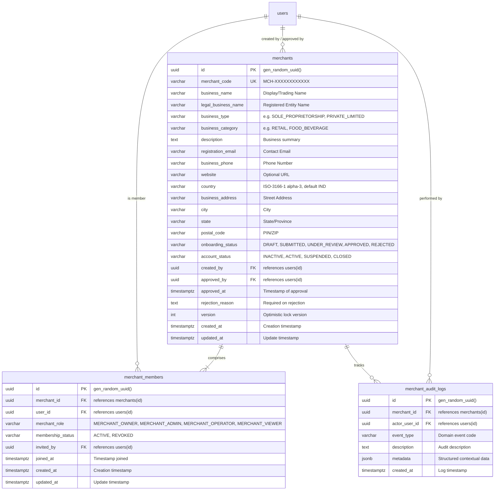

# VYOM — Phase 1: Database Design Specification

**Phase:** Phase 1 (Merchant Ecosystem Foundation)  
**Date:** 2026-11-19  
**Status:** Database Specification & Schema Architecture  
**Flyway Migration Target:** `src/main/resources/db/migration/V9__merchant_ecosystem_foundation.sql`  
**Database Engine:** PostgreSQL 18.4  

---

## 1. Executive Summary

This specification documents the physical and relational database design for the Merchant Ecosystem in VYOM.
The schema adheres to the following principles:
1. **Zero Financial Mutation:** Introduces merchant identity, team memberships, and audit trails without modifying existing consumer wallets, transactions, transfers, or double-entry ledger invariants.
2. **Relational Integrity:** Foreign keys link to `users(id)` with `ON DELETE RESTRICT` to prevent orphan records.
3. **Optimistic Locking:** Adds a `version` column to `merchants` for atomic, race-free state transitions during administrative reviews.
4. **Least-Privilege Role Grants:** Fully integrated with `vyom_flyway` and `vyom_app` roles established in Phase 0.1.

---

## 2. Entity-Relationship Model



---

## 3. Data Dictionary

### 3.1 Table: `merchants`
Stores business entity registration, contact data, location, and approval lifecycle.

| Column Name | Data Type | Nullable | Constraints & Defaults | Description |
| :--- | :--- | :---: | :--- | :--- |
| `id` | `UUID` | No | `PRIMARY KEY DEFAULT gen_random_uuid()` | Internal unique identifier |
| `merchant_code` | `VARCHAR(32)` | No | `UNIQUE` | External human-readable code (e.g. `MCH-20261119-ABCD1234`) |
| `business_name` | `VARCHAR(150)` | No | `CHECK (length(trim(business_name)) >= 2)` | Trade/store display name |
| `legal_business_name` | `VARCHAR(200)` | No | `CHECK (length(trim(legal_business_name)) >= 2)` | Official registered business name |
| `business_type` | `VARCHAR(50)` | No | Enum check | `SOLE_PROPRIETORSHIP`, `PARTNERSHIP`, `PRIVATE_LIMITED`, `PUBLIC_LIMITED`, `LLP`, `INDIVIDUAL` |
| `business_category` | `VARCHAR(50)` | No | Enum check | `RETAIL`, `FOOD_BEVERAGE`, `HEALTHCARE`, `SERVICES`, `EDUCATION`, `TECHNOLOGY`, `OTHER` |
| `description` | `TEXT` | Yes | Max 1000 chars | Public business summary |
| `registration_email` | `VARCHAR(255)` | No | Email format | Official business correspondence email |
| `business_phone` | `VARCHAR(20)` | No | `CHECK (business_phone ~ '^[0-9+\\-\\s()]{7,20}$')` | Contact telephone number |
| `website` | `VARCHAR(255)` | Yes | URL format | Optional business website |
| `country` | `VARCHAR(3)` | No | `DEFAULT 'IND'` | ISO-3166-1 alpha-3 country code |
| `business_address` | `VARCHAR(255)` | No | `CHECK (length(trim(business_address)) >= 5)` | Street address |
| `city` | `VARCHAR(100)` | No | `CHECK (length(trim(city)) >= 2)` | City |
| `state` | `VARCHAR(100)` | No | `CHECK (length(trim(state)) >= 2)` | State or province |
| `postal_code` | `VARCHAR(20)` | No | `CHECK (length(trim(postal_code)) >= 3)` | Postal code |
| `onboarding_status` | `VARCHAR(30)` | No | `DEFAULT 'SUBMITTED'`, Enum check | `DRAFT`, `SUBMITTED`, `UNDER_REVIEW`, `APPROVED`, `REJECTED` |
| `account_status` | `VARCHAR(30)` | No | `DEFAULT 'INACTIVE'`, Enum check | `INACTIVE`, `ACTIVE`, `SUSPENDED`, `CLOSED` |
| `created_by` | `UUID` | No | `REFERENCES users(id) ON DELETE RESTRICT` | User who created the application |
| `approved_by` | `UUID` | Yes | `REFERENCES users(id) ON DELETE RESTRICT` | Administrator who reviewed application |
| `approved_at` | `TIMESTAMPTZ` | Yes | — | Approval/Rejection timestamp |
| `rejection_reason` | `TEXT` | Yes | — | Required if status is `REJECTED` |
| `version` | `INT` | No | `DEFAULT 0` | Optimistic locking version |
| `created_at` | `TIMESTAMPTZ` | No | `DEFAULT clock_timestamp()` | Row creation timestamp |
| `updated_at` | `TIMESTAMPTZ` | No | `DEFAULT clock_timestamp()` | Row last update timestamp |

---

### 3.2 Table: `merchant_members`
Maintains user memberships, assigned roles, and access state per merchant.

| Column Name | Data Type | Nullable | Constraints & Defaults | Description |
| :--- | :--- | :---: | :--- | :--- |
| `id` | `UUID` | No | `PRIMARY KEY DEFAULT gen_random_uuid()` | Internal unique identifier |
| `merchant_id` | `UUID` | No | `REFERENCES merchants(id) ON DELETE RESTRICT` | Associated merchant |
| `user_id` | `UUID` | No | `REFERENCES users(id) ON DELETE RESTRICT` | Associated user identity |
| `merchant_role` | `VARCHAR(30)` | No | Enum check | `MERCHANT_OWNER`, `MERCHANT_ADMIN`, `MERCHANT_OPERATOR`, `MERCHANT_VIEWER` |
| `membership_status` | `VARCHAR(30)` | No | `DEFAULT 'ACTIVE'`, Enum check | `ACTIVE`, `REVOKED` |
| `invited_by` | `UUID` | Yes | `REFERENCES users(id) ON DELETE RESTRICT` | Member who extended the invitation |
| `joined_at` | `TIMESTAMPTZ` | No | `DEFAULT clock_timestamp()` | Timestamp user joined the team |
| `created_at` | `TIMESTAMPTZ` | No | `DEFAULT clock_timestamp()` | Row creation timestamp |
| `updated_at` | `TIMESTAMPTZ` | No | `DEFAULT clock_timestamp()` | Row last update timestamp |

**Indexes & Constraints:**
- `CONSTRAINT uq_merchant_member_user UNIQUE (merchant_id, user_id)`: Enforces one membership record per user per merchant.
- `CREATE INDEX idx_merchant_members_user ON merchant_members(user_id)`: Accelerates `GET /api/v1/merchants/me`.
- `CREATE INDEX idx_merchant_members_merchant ON merchant_members(merchant_id)`: Accelerates team listing and authorization checks.
- `CREATE INDEX idx_merchant_members_status ON merchant_members(merchant_id, membership_status)`: Filters active memberships.

---

### 3.3 Table: `merchant_audit_logs`
Immutable audit log tracking domain actions and state changes.

| Column Name | Data Type | Nullable | Constraints & Defaults | Description |
| :--- | :--- | :---: | :--- | :--- |
| `id` | `UUID` | No | `PRIMARY KEY DEFAULT gen_random_uuid()` | Internal unique identifier |
| `merchant_id` | `UUID` | No | `REFERENCES merchants(id) ON DELETE RESTRICT` | Associated merchant |
| `actor_user_id` | `UUID` | No | `REFERENCES users(id) ON DELETE RESTRICT` | User who performed the action |
| `event_type` | `VARCHAR(50)` | No | Alphanumeric string | e.g. `MERCHANT_SUBMITTED`, `MERCHANT_APPROVED`, `MEMBER_ADDED` |
| `description` | `TEXT` | No | — | Human-readable explanation of event |
| `metadata` | `JSONB` | Yes | `DEFAULT '{}'::jsonb` | Contextual key-value pairs (e.g. role changed from/to) |
| `created_at` | `TIMESTAMPTZ` | No | `DEFAULT clock_timestamp()` | Timestamp of event |

**Indexes:**
- `CREATE INDEX idx_merchant_audit_merchant_created ON merchant_audit_logs(merchant_id, created_at DESC)`: Rapid audit trail retrieval.

---

## 4. Role-Based Least-Privilege Grants (`vyom_app`)

In accordance with Phase 0.1 database role segregation:
```sql
DO $$
BEGIN
  IF EXISTS (SELECT FROM pg_catalog.pg_roles WHERE rolname = 'vyom_app') THEN
    GRANT SELECT, INSERT, UPDATE ON TABLE merchants TO vyom_app;
    GRANT SELECT, INSERT, UPDATE, DELETE ON TABLE merchant_members TO vyom_app;
    GRANT SELECT, INSERT ON TABLE merchant_audit_logs TO vyom_app;
  END IF;
END
$$;
```
- `merchants`: `SELECT, INSERT, UPDATE` (No DELETE/TRUNCATE).
- `merchant_members`: `SELECT, INSERT, UPDATE, DELETE`.
- `merchant_audit_logs`: `SELECT, INSERT` ONLY (Immutable audit trail; no UPDATE or DELETE).

---

## 5. Migration Strategy

Migration script `V9__merchant_ecosystem_foundation.sql` will be applied via Flyway.
It creates all tables, check constraints, indexes, and least-privilege role grants in a single transactional migration, ensuring backward compatibility with V1–V8.
