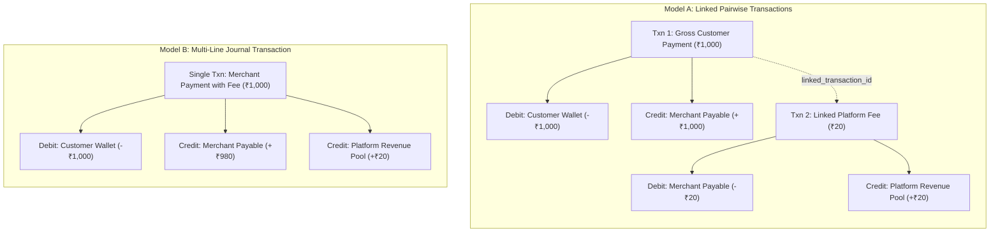
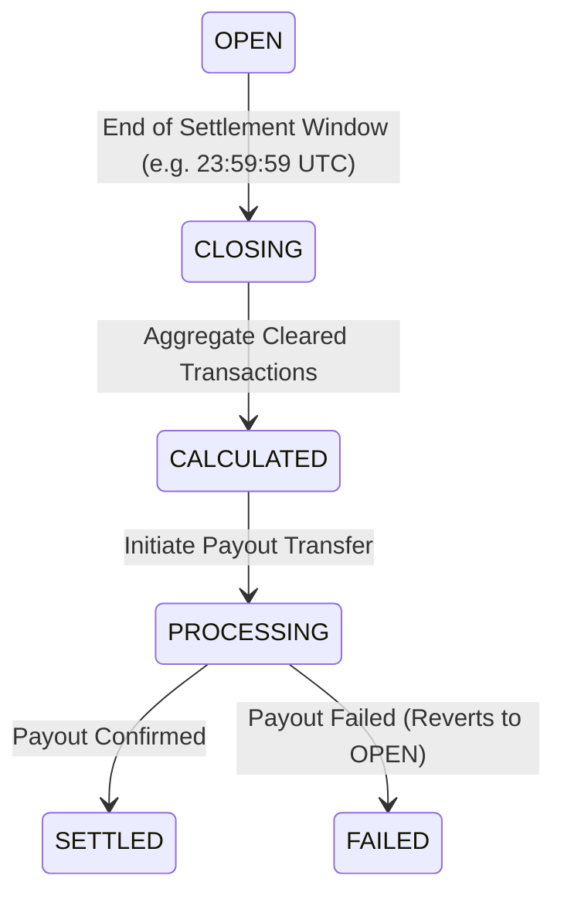

# VYOM — Phase 1: Merchant Financial Architecture Assessment (Design Only)

**Phase:** Phase 1 (Merchant Ecosystem Foundation)  
**Date:** 2026-11-19  
**Status:** Architectural Assessment & Tradeoff Analysis (Design Only — Zero Implementation in Phase 1)  
**Target Subsystems:** PostgreSQL Double-Entry Ledger, Financial Accounting Engine  

---

## 1. Executive Summary & Design Mandate

In Phase 1, VYOM establishes merchant identity, onboarding, memberships, and role-based access control. In accordance with the Phase 1 engineering boundaries, **no merchant payment processing, wallet balances, or financial ledger mutations are implemented in this phase**.

This assessment prepares the architectural foundation for subsequent phases (Phase 2+), analyzing how merchant payable balances, payment collections, fee deductions, refunds, and batch settlements will be integrated into VYOM's PostgreSQL double-entry financial ledger without compromising existing financial invariants.

---

## 2. Representation of Merchant Financial Accounts

### 2.1 The Consumer vs. Merchant Account Dichotomy
In Phase 0, wallets represent personal consumer balances (`account_type = 'CUSTOMER'`) and platform settlement pools (`account_type = 'SYSTEM_SETTLEMENT'`). Wallets are strictly associated with a `user_id` (`wallets.user_id REFERENCES users(id)`).

For merchant accounts, three architectural models were evaluated:

| Representation Model | Schema Structure | Pros | Cons / Risks | Architectural Decision |
| :--- | :--- | :--- | :--- | :---: |
| **Model 1: Direct User Wallet Reuse** | Associate merchant payments to the `MERCHANT_OWNER`'s personal wallet. | Zero schema changes. | **Severe Flaw:** Co-mingles personal and business funds. Fails when ownership changes or if multiple owners exist. Tax and audit nightmare. | **REJECTED** |
| **Model 2: Merchant-Dedicated Wallet Entity** | Alter `wallets` table to allow `merchant_id UUID REFERENCES merchants(id)` (mutually exclusive with `user_id`). | Reuses existing balance locking, transfers, and ledger triggers. | Requires nullable `user_id` on `wallets` or conditional foreign keys, requiring delicate migration of existing table constraints. | Viable Alternative |
| **Model 3: First-Class Merchant Financial Account (`merchant_accounts`)** | Create dedicated `merchant_accounts` table linked to `merchants(id)`, with specialized sub-accounts (`PAYABLE`, `SETTLEMENT`, `HOLD`, `FEE_RESERVE`). | Clean domain separation; allows multiple currencies, holding accounts for rolling reserves, and fee escrow. | Requires integrating a new balance entity into the double-entry ledger. | **RECOMMENDED** |

### 2.2 Recommended Account Structure
In Phase 2, each approved merchant will have a dedicated `merchant_accounts` entity:
- `id UUID PRIMARY KEY`
- `merchant_id UUID NOT NULL REFERENCES merchants(id)`
- `account_type VARCHAR(30)`: `MERCHANT_PAYABLE` (unsettled gross sales), `MERCHANT_SETTLEMENT` (cleared funds ready for payout), `MERCHANT_ROLLING_RESERVE` (dispute collateral).
- `currency VARCHAR(3)` (e.g. `INR`)
- `balance NUMERIC(19,4) NOT NULL DEFAULT 0.0000`
- `status VARCHAR(20) NOT NULL DEFAULT 'ACTIVE'`

---

## 3. Fee Accounting Architectural Tradeoff: Linked Pairwise vs. Multi-Line Journal

The existing VYOM financial engine (enforced by trigger `trg_defer_verify_transaction_ledger` in V7/V8) strictly mandates:
$$\text{For every financial transaction: } \text{DEBIT Count} = 1, \text{CREDIT Count} = 1, \text{and } \sum \text{DEBIT} = \sum \text{CREDIT} = \text{Amount}$$

When a merchant accepts a payment with an intermediary platform fee (e.g., customer pays ₹1,000; platform fee ₹20; net payable to merchant ₹980), accounting for this fee requires an architectural choice between two core models:

---

### 3.1 Model A: Linked Pairwise Transactions
In this model, the existing "exactly two entries per transaction" invariant is 100% preserved:
1. **Transaction 1 (GROSS_PAYMENT):**
   - Amount: ₹1,000.00
   - DEBIT: Customer Wallet (₹1,000.00)
   - CREDIT: Merchant Payable Account (₹1,000.00)
2. **Transaction 2 (MERCHANT_FEE):**
   - Amount: ₹20.00
   - DEBIT: Merchant Payable Account (₹20.00)
   - CREDIT: Platform Revenue Settlement Account (₹20.00)
   - Foreign Key: `parent_transaction_id` points to Transaction 1.

#### Tradeoff Analysis:
- **Schema & Migration Impact:** Zero changes to existing triggers or constraints. Existing V7/V8 constraint trigger `trg_defer_verify_transaction_ledger` remains untouched.
- **Reconciliation Impact:** Perfectly backward-compatible. Existing `benchmark/reconcile.js` checks continue to pass without modification.
- **Atomicity:** Both transactions execute within a single Spring `@Transactional` block. If fee debit fails, the gross payment rolls back automatically.
- **Refunds & Reversals:** Partial or full refunds can reverse gross payment and pro-rata fee transactions cleanly as independent pairwise records.

---

### 3.2 Model B: Generalized Multi-Line Journal
In this model, the database trigger is modified to allow $N$ debits and $M$ credits, asserting only that:
$$\sum_{i=1}^N \text{DEBIT}_i = \sum_{j=1}^M \text{CREDIT}_j$$
- Amount: ₹1,000.00
- DEBIT: Customer Wallet (₹1,000.00)
- CREDIT: Merchant Payable (₹980.00)
- CREDIT: Platform Revenue (₹20.00)

#### Tradeoff Analysis:
- **Schema & Migration Impact:** Requires modifying or replacing V7/V8 constraint triggers across all environments.
- **Reconciliation Impact:** Breaks existing reconciliation queries in `benchmark/reconcile.js` (specifically Check 8, which asserts exactly 2 entries per transaction).
- **Concurrency & Lock Contention:** Single transaction holds row locks across customer wallet, merchant account, and platform revenue pool simultaneously.
- **Complexity:** Higher mathematical flexibility, but significantly higher risk of migration breakage.

---

### 3.3 Architectural Verdict & Recommendation
**Model A (Linked Pairwise Transactions) is RECOMMENDED for Phase 2.**
- It preserves 100% of the battle-tested Phase 0/0.1 financial triggers and invariants.
- It guarantees zero breaking changes to existing reconciliation algorithms.
- It provides a clear, immutable audit trail where merchant fees are explicitly itemized rather than obfuscated in compound multi-line journals.

---

## 4. Refund, Reversal & Dispute Interaction with Merchant Balances

When a customer initiates a refund or dispute on a merchant transaction:
1. **Full Refund:**
   - Transaction 1: Customer Credited (₹1,000), Merchant Payable Debited (₹1,000).
   - Transaction 2 (Fee Reversal, policy-dependent): Platform Revenue Debited (₹20), Merchant Payable Credited (₹20).
2. **Partial Refund (e.g. ₹400 of ₹1,000):**
   - Customer Credited ₹400; Merchant Payable Debited ₹400.
   - Enforced by existing parent-child refund constraint: $\sum \text{Refunds} \le \text{Original Amount}$.
3. **Insufficient Merchant Balance Protection:**
   - If a merchant's payable balance is insufficient to cover a refund or dispute chargeback, the operation must either:
     - Hold the refund in `PENDING_FUNDS` state until subsequent sales replenish the payable account, or
     - Draw from the merchant's `ROLLING_RESERVE` account.

---

## 5. Settlement Batch Processing Architecture

Merchant payouts are typically not dispatched to external banks instantaneously per transaction. Instead, payouts occur in scheduled settlement batches (e.g. T+1 or T+2 cycles).

### 5.1 Proposed Batch Settlement Lifecycle

1. **Aggregation:** System queries all settled payments for Merchant $M$ within window $[T_{\text{start}}, T_{\text{end}}]$.
2. **Batch Totaling:** $\text{Net Payout} = \sum \text{Gross Payments} - \sum \text{Fees} - \sum \text{Refunds} - \text{Reserve Hold}$.
3. **Ledger Execution:**
   - DEBIT: Merchant Payable Account (Net Amount)
   - CREDIT: Merchant Settlement Disbursement Account (Net Amount)
4. **Disbursement Simulation:** Payout reference generated (e.g. simulated NEFT/IMPS/ACH transfer reference) without altering ledger balance.

---

## 6. Conclusion & Roadmap

The recommended **Linked Pairwise Financial Model (Model A)** provides an elegant, zero-regression path for future merchant payment processing.
By deferring all financial ledger modifications to subsequent phases, Phase 1 establishes a pristine identity, authorization, and governance boundary for VYOM's merchant ecosystem.
