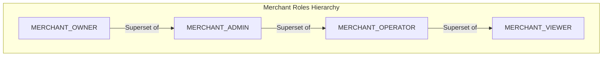

# VYOM — Phase 1: Merchant RBAC & Authorization Matrix

**Phase:** Phase 1 (Merchant Ecosystem Foundation)  
**Date:** 2026-11-19  
**Status:** Authorization Architecture & Security Specification  
**Repository:** `D:\VYOM`  

---

## 1. Executive Summary

This document defines the Role-Based Access Control (RBAC) architecture for VYOM's Merchant Ecosystem.
The authorization model is built on three core security pillars:
1. **Dual-Tier Role Separation:** Global platform roles (`USER`, `ADMIN`) are strictly decoupled from merchant-scoped roles (`MERCHANT_OWNER`, `MERCHANT_ADMIN`, `MERCHANT_OPERATOR`, `MERCHANT_VIEWER`).
2. **Authoritative Membership Resolution:** Merchant permissions are resolved dynamically on each request from `merchant_members` and `merchants`. Client-supplied roles and IDs in request bodies or query parameters are never trusted.
3. **Defense-in-Depth & Invariant Protection:** Critical invariants, such as the **Last Active Owner Protection Rule**, are enforced at the service and transaction boundary.

---

## 2. Role Definitions

### 2.1 Merchant-Scoped Roles



1. **`MERCHANT_OWNER`:**
   - The primary executive authority for the merchant account.
   - Initial creator of the merchant application automatically receives this role upon registration.
   - Possesses full administrative rights over business profiles, team memberships, and future financial settlement configurations.
   - The only role permitted to submit applications for review and transfer or designate other owners.
   - Cannot be removed or demoted by `MERCHANT_ADMIN`.
2. **`MERCHANT_ADMIN`:**
   - Operational manager of business settings and ordinary team members.
   - Permitted to update business contact information, invite new members (`OPERATOR`, `VIEWER`), update their roles, and revoke their access.
   - **Explicit Restrictions:** Cannot invite or assign `MERCHANT_OWNER`, cannot demote an owner, cannot revoke an owner's membership, and cannot submit or withdraw official business applications.
3. **`MERCHANT_OPERATOR`:**
   - Day-to-day operational role.
   - Permitted to view dashboard metrics, business profiles, and operational logs.
   - **Explicit Restrictions:** Read-only access to team members; cannot invite, edit, or revoke any team members; cannot edit business profile information.
4. **`MERCHANT_VIEWER`:**
   - Strict read-only role for auditors, accountants, or external advisors.
   - Permitted to view the merchant dashboard, business profile, and public team list.
   - Zero mutating permissions across all merchant endpoints.

### 2.2 Global Platform Roles
1. **`ROLE_ADMIN` (Platform Administrator):**
   - Platform-wide administrative authority.
   - Reviews, approves, rejects, suspends, and reactivates merchant applications.
   - Accesses `/api/v1/admin/**` endpoints.
   - **Boundary Enforcement:** Platform administrators do not automatically become merchant members or owners. Their review actions are audited separately in `merchant_audit_logs`.
2. **`ROLE_USER` (Platform Consumer):**
   - Standard registered customer.
   - Eligible to register personal wallets and initiate new merchant onboarding applications.

---

## 3. Comprehensive Permission Matrix

| Operation / Endpoint | Scope | Required Role | Owner | Admin | Operator | Viewer | Platform Admin | Unauth |
| :--- | :--- | :--- | :---: | :---: | :---: | :---: | :---: | :---: |
| **Register Merchant** (`POST /api/v1/merchants`) | Global | `ROLE_USER` | — | — | — | — | Yes | **Deny (401)** |
| **List My Merchants** (`GET /api/v1/merchants/me`) | User | Authenticated | Yes | Yes | Yes | Yes | Yes | **Deny (401)** |
| **View Merchant Profile** (`GET /api/v1/merchants/{id}`) | Merchant | Active Member or Platform Admin | **Allow** | **Allow** | **Allow** | **Allow** | **Allow** | **Deny (401)** |
| **Update Business Profile** (`PATCH /api/v1/merchants/{id}/profile`) | Merchant | `OWNER` or `ADMIN` | **Allow** | **Allow** | Deny (403) | Deny (403) | Deny (403) | **Deny (401)** |
| **Submit Application** (`POST /api/v1/merchants/{id}/submit`) | Merchant | `OWNER` only | **Allow** | Deny (403) | Deny (403) | Deny (403) | Deny (403) | **Deny (401)** |
| **List Team Members** (`GET /api/v1/merchants/{id}/members`) | Merchant | Active Member or Platform Admin | **Allow** | **Allow** | **Allow** | **Allow** | **Allow** | **Deny (401)** |
| **Add Team Member** (`POST /api/v1/merchants/{id}/members`) | Merchant | `OWNER` or `ADMIN` | **Allow** | **Allow\*** | Deny (403) | Deny (403) | Deny (403) | **Deny (401)** |
| **Update Member Role** (`PATCH /api/v1/merchants/{id}/members/{mId}`) | Merchant | `OWNER` or `ADMIN` | **Allow** | **Allow\*** | Deny (403) | Deny (403) | Deny (403) | **Deny (401)** |
| **Revoke Member** (`DELETE /api/v1/merchants/{id}/members/{mId}`) | Merchant | `OWNER` or `ADMIN` | **Allow** | **Allow\*** | Deny (403) | Deny (403) | Deny (403) | **Deny (401)** |
| **View Audit Logs** (`GET /api/v1/merchants/{id}/audit-logs`) | Merchant | `OWNER`, `ADMIN`, or Platform Admin | **Allow** | **Allow** | Deny (403) | Deny (403) | **Allow** | **Deny (401)** |
| **Admin List Applications** (`GET /api/v1/admin/merchants`) | Global | `ROLE_ADMIN` | Deny (403) | Deny (403) | Deny (403) | Deny (403) | **Allow** | **Deny (401)** |
| **Admin Approve** (`POST /api/v1/admin/merchants/{id}/approve`) | Global | `ROLE_ADMIN` | Deny (403) | Deny (403) | Deny (403) | Deny (403) | **Allow** | **Deny (401)** |
| **Admin Reject** (`POST /api/v1/admin/merchants/{id}/reject`) | Global | `ROLE_ADMIN` | Deny (403) | Deny (403) | Deny (403) | Deny (403) | **Allow** | **Deny (401)** |
| **Admin Suspend** (`POST /api/v1/admin/merchants/{id}/suspend`) | Global | `ROLE_ADMIN` | Deny (403) | Deny (403) | Deny (403) | Deny (403) | **Allow** | **Deny (401)** |
| **Admin Reactivate** (`POST /api/v1/admin/merchants/{id}/reactivate`) | Global | `ROLE_ADMIN` | Deny (403) | Deny (403) | Deny (403) | Deny (403) | **Allow** | **Deny (401)** |

*\*Note: `MERCHANT_ADMIN` can only manage members with roles `OPERATOR` or `VIEWER`. They cannot add, modify, or revoke a `MERCHANT_OWNER`.*

---

## 4. Key Security Invariants & Guardrails

### 4.1 Last Active Owner Protection Rule
- **The Rule:** A merchant MUST always have at least one active `MERCHANT_OWNER`.
- **Enforcement:**
  - An owner cannot revoke their own membership if they are the sole active owner.
  - An owner cannot demote their own role to `ADMIN`, `OPERATOR`, or `VIEWER` if no other active owner exists.
  - Violation results in `409 CONFLICT` with error code `LAST_OWNER_PROTECTION_VIOLATION`.

### 4.2 Privilege Escalation Prevention
- A `MERCHANT_ADMIN` cannot invite or assign a user to the `MERCHANT_OWNER` role.
- A `MERCHANT_ADMIN` cannot modify or revoke any user holding the `MERCHANT_OWNER` role.
- Violation results in `403 ACCESS_DENIED` with error code `INSUFFICIENT_MERCHANT_PRIVILEGE`.

### 4.3 Account Status Gating
- When a merchant's `account_status` is `SUSPENDED` or `CLOSED`, all non-administrative mutating endpoints reject requests with `403 ACCESS_DENIED` (`MERCHANT_ACCOUNT_SUSPENDED`).
- Ordinary members can view their status but cannot update profiles or invite team members until reactivated by a platform administrator.

### 4.4 Immediate Revocation Semantics
- When a membership's `membership_status` is set to `REVOKED`, subsequent requests from that user for that merchant are denied immediately.
- Authorization relies on real-time database queries against `merchant_members WHERE merchant_id = ? AND user_id = ? AND membership_status = 'ACTIVE'`, preventing token replay or stale claim attacks.

---

## 5. Implementation Architecture (`MerchantSecurityService`)

To prevent fragmented authorization checks in controllers, all merchant permission checks are centralized in `MerchantSecurityService`:

```java
@Service
public class MerchantSecurityService {
    public MerchantMember requireMembership(UUID merchantId, UUID userId);
    public MerchantMember requireRole(UUID merchantId, UUID userId, Set<MerchantRole> allowedRoles);
    public boolean hasRole(UUID merchantId, UUID userId, Set<MerchantRole> allowedRoles);
    public void validateNotLastOwner(UUID merchantId, UUID targetUserId);
    public void validateRoleAssignmentPrivilege(MerchantRole callerRole, MerchantRole targetRole);
}
```

This ensures consistent, testable, and maintainable security boundaries across all merchant endpoints.
