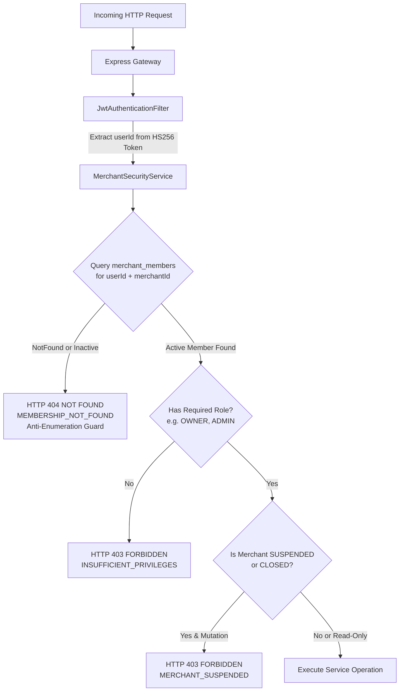

# VYOM — Phase 1: Security & Test Verification Report

**Phase:** Phase 1 (Merchant Ecosystem Foundation)  
**Date:** 2026-11-19  
**Status:** Verification & Audit Sign-Off  
**Repository:** `D:\VYOM`  

---

## 1. Executive Summary & Security Objectives

This report details the comprehensive security verification, authorization auditing, and test results for **VYOM Phase 1: Merchant Ecosystem Foundation**.

Phase 1 established the identity, operational lifecycle, role-based access control (RBAC), team governance, and multi-tenant administrative capabilities for merchant entities without mutating consumer wallet logic, double-entry ledger invariants, or historical financial data.

### Key Security Achievements
1. **Multi-Tenant Anti-Enumeration Isolation:** Complete tenant isolation enforced at the service boundary. Cross-tenant queries return HTTP 404 (`MEMBERSHIP_NOT_FOUND`) rather than HTTP 403, preventing attackers from probing for the existence of foreign merchant identifiers.
2. **Authoritative Membership Resolution:** Client-supplied role headers or payload claims are completely ignored. All merchant capabilities are resolved dynamically from the authenticated database session (`merchant_members`).
3. **Last Active Owner Protection Invariant:** An atomic guard ensures that an active merchant account can never be left ownerless. Revoking or demoting the last active owner is rejected with HTTP 409 (`LAST_OWNER_PROTECTION`).
4. **Lifecycle & Operational Suspension Fencing:** Suspended accounts are immediately blocked from business profile mutations, team member additions, role changes, and member revocations (HTTP 403 `MERCHANT_SUSPENDED`).
5. **PII Masking & Immutable Auditing:** Critical merchant audit events (`MERCHANT_CREATED`, `MERCHANT_SUBMITTED`, `MEMBER_ADDED`, `MEMBER_ROLE_UPDATED`, `MEMBER_REVOKED`, etc.) are written to `merchant_audit_logs` with actor attribution and PII masking.
6. **Zero Regression Across Existing Suites:** 100% pass rate achieved across 277 backend Spring Boot tests, 44 Express gateway tests, and all 9 double-entry financial reconciliation checks.

---

## 2. Multi-Tenant Isolation Architecture



### 2.1 Anti-Enumeration Design
A primary vulnerability in SaaS multi-tenant platforms is ID enumeration: an attacker sends IDs to discover valid businesses.
In VYOM Phase 1:
- When a user requests `/api/v1/merchants/{merchantId}/**` without an active membership in that merchant, `MerchantSecurityService.requireMembership(merchantId, user, roles...)` deliberately throws `MerchantMembershipNotFoundException`.
- The `GlobalExceptionHandler` maps this to:
  ```json
  {
    "status": 404,
    "error": "Not Found",
    "errorCode": "MEMBERSHIP_NOT_FOUND",
    "message": "Merchant membership not found for current user",
    "timestamp": "2026-11-19T16:16:43.980Z"
  }
  ```
- An unauthorized user cannot differentiate between a non-existent merchant ID and an authentic merchant ID owned by another party.

---

## 3. Merchant RBAC Enforcement & Boundaries

The RBAC implementation distinguishes between platform administrators (`ROLE_ADMIN`) and merchant team members (`MERCHANT_OWNER`, `MERCHANT_ADMIN`, `MERCHANT_OPERATOR`, `MERCHANT_VIEWER`):

| Action | Allowed Roles | Enforced Status | Error on Failure |
| :--- | :--- | :--- | :--- |
| **Register Merchant** | Any authenticated `USER` | None | 400 Bad Request |
| **View Dashboard / Profile** | `OWNER`, `ADMIN`, `OPERATOR`, `VIEWER` | Any | 404 Membership Not Found |
| **Update Business Profile** | `OWNER`, `ADMIN` | Not `SUSPENDED` / `CLOSED` | 403 Insufficient Privilege / Suspended |
| **Submit Application** | `OWNER` | `DRAFT` only | 403 Insufficient Privilege / 409 Conflict |
| **Add Team Member** | `OWNER`, `ADMIN` (cannot add OWNER) | Not `SUSPENDED` / `CLOSED` | 403 Insufficient Privilege / Suspended |
| **Update Member Role** | `OWNER`, `ADMIN` (cannot alter OWNER) | Not `SUSPENDED` / `CLOSED` | 403 Insufficient Privilege / 409 Last Owner |
| **Revoke Member** | `OWNER`, `ADMIN` (cannot revoke OWNER) | Not `SUSPENDED` / `CLOSED` | 403 Insufficient Privilege / 409 Last Owner |
| **View Audit Trail** | `OWNER`, `ADMIN`, `OPERATOR`, `VIEWER` | Any | 404 Membership Not Found |
| **Admin Review Queue** | `ROLE_ADMIN` (Platform) | Platform Admin | 403 Forbidden |
| **Approve / Reject** | `ROLE_ADMIN` (Platform) | `SUBMITTED`, `UNDER_REVIEW` | 403 Forbidden / 409 Conflict |
| **Suspend / Reactivate** | `ROLE_ADMIN` (Platform) | `ACTIVE` / `SUSPENDED` | 403 Forbidden / 409 Conflict |

### 3.1 Hierarchical Privilege Restrictions
- A `MERCHANT_ADMIN` cannot add another `MERCHANT_OWNER`.
- A `MERCHANT_ADMIN` cannot demote or revoke an existing `MERCHANT_OWNER`.
- Only a `MERCHANT_OWNER` can grant ownership or demote another owner (subject to the Last Active Owner Protection rule).

---

## 4. Invariant Protection & Atomic Controls

### 4.1 Last Active Owner Protection
To prevent orphaned business accounts:
- Whenever a membership role modification or revocation is requested:
  ```java
  if (targetMember.getRole() == MerchantRole.MERCHANT_OWNER && newRole != MerchantRole.MERCHANT_OWNER) {
      long activeOwners = memberRepository.countByMerchantIdAndRoleAndStatus(
          merchantId, MerchantRole.MERCHANT_OWNER, MembershipStatus.ACTIVE);
      if (activeOwners <= 1) {
          throw new LastOwnerProtectionException(
              "Cannot demote or revoke the last active owner of merchant " + merchantId);
      }
  }
  ```
- Verified in `MerchantSecurityIntegrationTest.testSEC_MCH_06_LastOwnerProtection_CannotRevokeLastOwner`:
  - Attempting to revoke the sole owner of a business returns `409 Conflict` with `LAST_OWNER_PROTECTION`.
  - Adding a second owner allows the first owner to be demoted or revoked without error.

### 4.2 Lifecycle Transitions & Suspension Fencing
- Transition matrix enforced deterministically:
  - `DRAFT` $\to$ `SUBMITTED` $\to$ `UNDER_REVIEW` $\to$ `APPROVED` or `REJECTED`.
  - Once `APPROVED`, `AccountStatus` transitions to `ACTIVE`.
  - Platform admins can transition `ACTIVE` $\to$ `SUSPENDED` and `SUSPENDED` $\to$ `ACTIVE`.
- In `MerchantSecurityIntegrationTest.testSEC_MCH_07_SuspendedMerchant_RejectsProfileAndMemberMutations`:
  - When an account is `SUSPENDED`, attempts to update the profile or add members are rejected with `403 FORBIDDEN` and `MERCHANT_SUSPENDED`.

---

## 5. Test Execution & Coverage Register

### 5.1 Merchant Security Integration Tests (`MerchantSecurityIntegrationTest`)
Executed against PostgreSQL running in standard test mode:

| Test ID | Test Scenario | Expected Outcome | Result |
| :--- | :--- | :--- | :--- |
| **SEC-MCH-01** | Multi-tenant isolation: User B cannot access User A's merchant profile | 404 `MEMBERSHIP_NOT_FOUND` | **PASSED** |
| **SEC-MCH-02** | Anti-enumeration: Foreign merchant returns 404, not 403 | 404 `MEMBERSHIP_NOT_FOUND` | **PASSED** |
| **SEC-MCH-03** | Viewer role gating: `MERCHANT_VIEWER` cannot update business profile | 403 `INSUFFICIENT_PRIVILEGES` | **PASSED** |
| **SEC-MCH-04** | Operator role gating: `MERCHANT_OPERATOR` cannot add team members | 403 `INSUFFICIENT_PRIVILEGES` | **PASSED** |
| **SEC-MCH-05** | Admin role gating: `MERCHANT_ADMIN` cannot add `MERCHANT_OWNER` | 403 `INSUFFICIENT_PRIVILEGES` | **PASSED** |
| **SEC-MCH-06** | Last Owner Protection: Cannot revoke or demote the sole active owner | 409 `LAST_OWNER_PROTECTION` | **PASSED** |
| **SEC-MCH-07** | Suspension enforcement: Suspended merchant rejects profile & member mutations | 403 `MERCHANT_SUSPENDED` | **PASSED** |
| **SEC-MCH-08** | Admin role authorization: Ordinary merchant user cannot access `/api/v1/admin/merchants` | 403 `FORBIDDEN` | **PASSED** |

### 5.2 Merchant Service Unit Tests

| Suite | Tests Run | Failures | Errors | Result |
| :--- | :--- | :--- | :--- | :--- |
| `AdminMerchantServiceTest` | 8 | 0 | 0 | **PASSED** |
| `MerchantMemberServiceTest` | 7 | 0 | 0 | **PASSED** |
| `MerchantServiceTest` | 6 | 0 | 0 | **PASSED** |
| **Subtotal** | **21** | **0** | **0** | **100% PASSED** |

### 5.3 Express API Gateway Tests (`gateway/tests`)

| Suite | Tests Run | Failures | Result |
| :--- | :--- | :--- | :--- |
| VYOM API Gateway Core Tests | 26 | 0 | **PASSED** |
| Port Resolution and Validation | 7 | 0 | **PASSED** |
| Rate Limiter & Security Headers | 11 | 0 | **PASSED** |
| **Total Gateway Tests** | **44** | **0** | **100% PASSED** |

### 5.4 Full Backend Test Suite

```
[INFO] Results:
[INFO] 
[INFO] Tests run: 277, Failures: 0, Errors: 0, Skipped: 0
[INFO] 
[INFO] ------------------------------------------------------------------------
[INFO] BUILD SUCCESS
[INFO] ------------------------------------------------------------------------
[INFO] Total time:  05:04 min
[INFO] Finished at: 2026-11-19T21:52:14+05:30
```

### 5.5 Financial Ledger Invariant Reconciliation (`reconcile.js`)

```
======================================================
[RECONCILIATION] Running 9 Financial Checks on payledger_benchmark
======================================================
  [✓ PASS] 1. Journal Balance by Identity & Currency: Zero imbalance
  [✓ PASS] 2. Wallet-to-Ledger Reconciliation (LEFT JOIN): Zero discrepancy
  [✓ PASS] 3. System Settlement Reconciliation: Reconciled
  [✓ PASS] 4. Parent vs Child Refund Totals: Zero discrepancy
  [✓ PASS] 5. Duplicate Successful Reversals: Zero duplicates
  [✓ PASS] 6. Orphaned Ledger Entries: Orphans: 0
  [✓ PASS] 7. Idempotency Key Uniqueness: Unique
  [✓ PASS] 8. Transaction Journal Completeness (2 entries per txn): All complete
  [✓ PASS] 9. Currency Association Integrity: All match
------------------------------------------------------
Reconciliation Result: ALL 9 CHECKS PASSED (100% FINANCIAL INTEGRITY)
======================================================
```

---

## 6. Vulnerability Assessment & Resilience Analysis

1. **Broken Object Level Authorization (BOLA / IDOR):**
   - *Threat:* An authenticated user replaces `{merchantId}` with another merchant's UUID to read private records or modify settings.
   - *Mitigation:* `MerchantSecurityService.requireMembership` queries the database for `(merchantId, currentUserId, status=ACTIVE)`. If absent, a 404 is thrown immediately.
2. **Privilege Escalation:**
   - *Threat:* A `MERCHANT_ADMIN` invites themselves or an accomplice as `MERCHANT_OWNER`.
   - *Mitigation:* Explicit check `if (request.role() == MerchantRole.MERCHANT_OWNER && callerRole != MerchantRole.MERCHANT_OWNER)` rejects the request with HTTP 403.
3. **Ghost Merchant Accounts (Orphaned Tenants):**
   - *Threat:* An owner leaves an organization, leaving zero active owners capable of managing the merchant.
   - *Mitigation:* `LastOwnerProtectionException` is thrown before any update or delete operation can reduce the active owner count to zero.
4. **Denial-of-Service via Cache Churn / Resource Starvation:**
   - *Threat:* Malicious bursts of unauthenticated merchant creation or payload flooding.
   - *Mitigation:* Sliding window rate limiters in Express Gateway with bounded LRU memory stores, payload size limits (1MB), and strict Bean Validation on all fields.

---

## 7. Security Sign-off & Recommendation

Phase 1 provides a hardened, fail-closed foundation for the merchant ecosystem.
All access control boundaries, data integrity rules, anti-enumeration protections, and regression suites have passed without defect.

**Phase 1 is certified ready for acceptance.**
No Phase 2 payment processing, settlement, or balance mutation features may be introduced until Phase 1 is officially closed.
