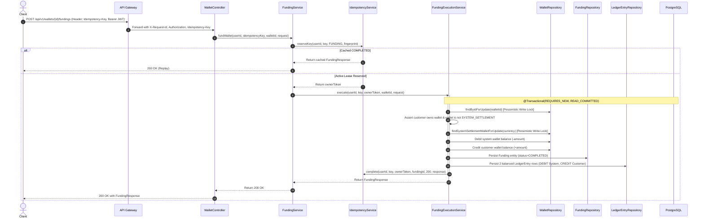
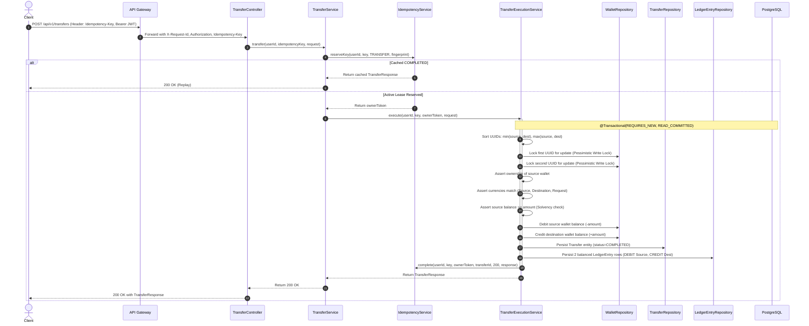
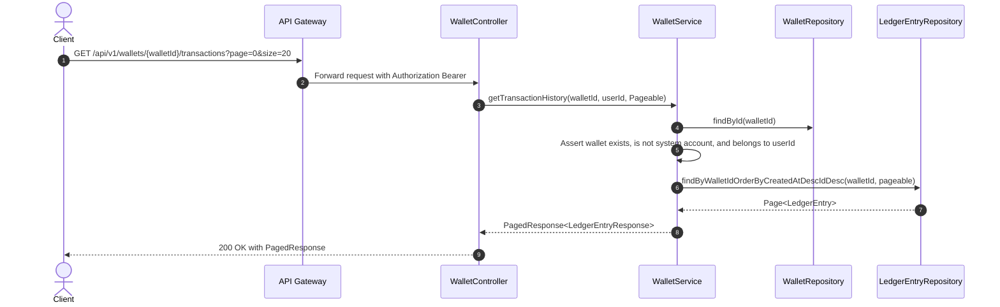
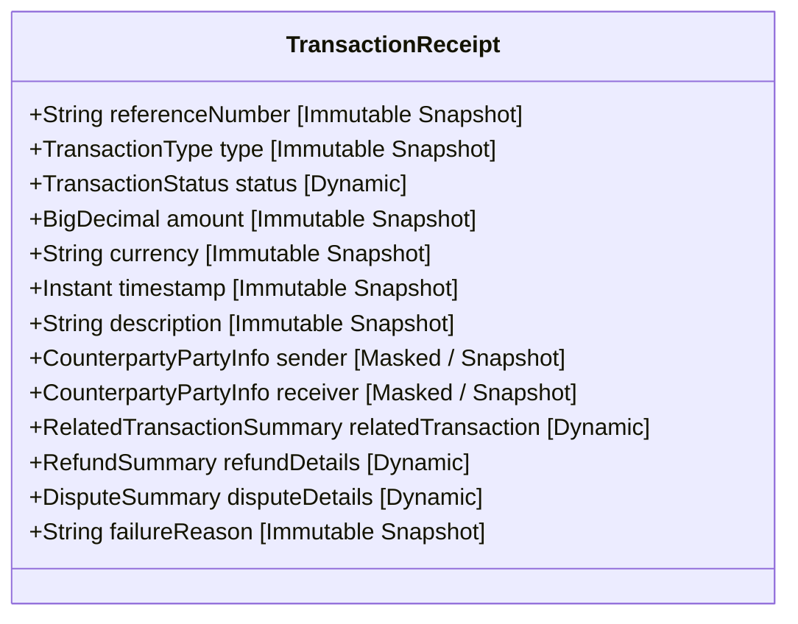
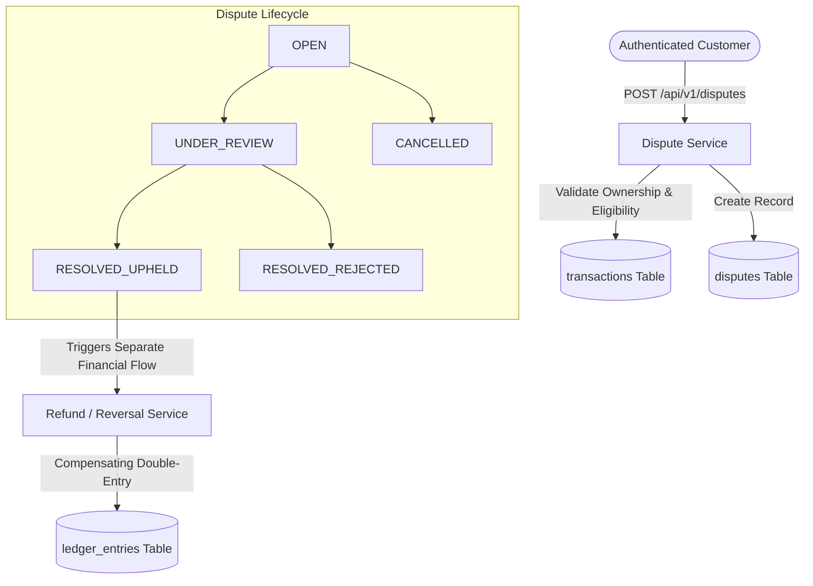

# VYOM — Phase 2.0: Transaction Lifecycle Architecture & System Design

**Document Version:** 1.0.0  
**Status:** DRAFT / PENDING APPROVAL  
**Target Baseline:** Post-Phase 1.2 Security & Financial Integrity Hardening  
**Scope:** Architectural blueprint for transaction lifecycle, unified transaction abstraction, refunds, reversals, receipts, history, disputes, and concurrency control.

---

## 1. System Overview & Forensic Architecture Baseline

### 1.1 Current Architecture Review
VYOM (Virtual Yatra of Money) is structured as a layered digital payment processing engine:
1. **Frontend:** Native vanilla HTML5, CSS3, and ES6 JavaScript (`gateway/public/`) with zero floating-point math, exact string formatting (`padEnd(4, '0')`), and client-side UUID generation.
2. **API Gateway:** Node.js/Express (`gateway/src/`) acting as a secure reverse proxy, handling client request ID tracking (`X-Request-Id`), JSON payload parsing, and upstream reverse proxy routing to the Spring Boot backend.
3. **Backend Service:** Java 21, Spring Boot 3.3.5, Spring Data JPA, and Spring Security with stateless JWT bearer authentication (HMAC-SHA256 with 256-bit key enforcement and UUID subject validation).
4. **Persistence & Accounting:** PostgreSQL 18 with Flyway schema versioning (V1–V4). All balances are represented as `NUMERIC(19, 4)` (fixed 4 decimal places, micro-unit 0.01 paise precision for INR).
5. **Double-Entry Ledger:** Append-only, trigger-protected (`trg_protect_ledger_entries`) ledger where every balance mutation is backed by atomic, balanced debits and credits.
6. **Idempotency Engine:** Scoped per user identity (`(user_id, idempotency_key)`), guarded by cryptographic SHA-256 payload fingerprints, exclusive lease ownership tokens (`owner_token`), monotonic versions, and atomic stale lease reclamation.

### 1.2 Execution Traces in the Existing Codebase

#### 1. Wallet Funding Execution Trace


#### 2. Wallet-to-Wallet Transfer Execution Trace


#### 3. Transaction History Retrieval Trace


### 1.3 Forensic Baseline Findings
1. **Source of Truth for Balances:** The immutable `ledger_entries` table is the definitive financial authority. `wallets.balance` is a high-performance materialized view updated within the exact same database transaction under row-level pessimistic locks.
2. **Missing Transaction Abstraction:** The system treats transfers and fundings as completely disconnected entity hierarchies (`transfers` vs `fundings`). There is no overarching `transactions` entity or unified reference (`txn_...`).
3. **Absence of Business Lifecycles:** Currently, operations transition immediately from invocation to `COMPLETED` inside a single synchronous transaction. Failures roll back entirely, resulting in no persistent transaction audit record for failed business operations.
4. **Lack of Compensation Infrastructure:** There is no schema or service support for refunds, reversals, or dispute tracking.
5. **Transaction History Limitations:** History is currently exposed only as raw ledger entries per wallet (`LedgerEntryResponse`), missing counterparty details, transaction types, receipts, or user-level cross-wallet filtering.

---

## 2. Core Architectural Decision: The Unified Transaction Anchor

### 2.1 Architectural Trade-Off Analysis

| Evaluation Dimension | Option A: Table Inheritance / Polymorphic `transactions` | Option B: Disconnected Domain Tables with `UNION ALL` Views | Option C: Unified Transaction Anchor (Recommended) |
| :--- | :--- | :--- | :--- |
| **Data Integrity** | High: Single table guarantees global uniqueness of transaction references and single foreign key from ledger entries. | Low: Foreign keys from ledger entries must be nullable or split across tables. Uniqueness requires cross-table triggers. | **Highest:** Central `transactions` table owns transaction identity, status, reference, and lifecycle. Specialized domain tables (`transfers`, `fundings`, `refunds`) link to it. |
| **Query Performance & Indexing** | Moderate: Large sparse table with nullable counterparty fields; large index footprint. | Very Low: User history requires scanning multiple tables via `UNION ALL`. Compound B-Tree indexes cannot order across unions without costly memory sorts. | **Optimal:** Composite indexes on `transactions (user_id, created_at DESC)` provide index-only scans for user history, filtering, and pagination. |
| **Schema Evolution & Maintainability** | Poor: Adding fields for one type (e.g. dispute notes or refund reason) pollutes the shared table. | Poor: Every new transaction type requires creating a new table, updating all SQL union views, and updating gateway adapters. | **Superior:** Clean separation of concerns. Core metadata lives in `transactions`; operation-specific data lives in dedicated satellites. |
| **Migration Risk (V1–V4)** | Extreme: Destructive modification of `transfers` and `fundings` would invalidate historical data and existing tests. | Moderate: No changes to tables, but high application query complexity. | **Zero / Minimal:** Non-destructive. Existing `transfers` and `fundings` tables are retained and linked via foreign keys; backfilled cleanly via V5 migration. |

### 2.2 Recommendation: The Unified Transaction Anchor Model
We establish a canonical `transactions` table that acts as the single source of truth for:
1. Stable, human-readable, and machine-searchable transaction references (`reference_number`, e.g. `TXN-20261118-A1B2C3D4`).
2. Unified transaction status and lifecycle (`INITIATED`, `PROCESSING`, `SUCCESS`, `FAILED`, `REVERSED`, `PARTIALLY_REFUNDED`, `REFUNDED`).
3. Transaction categorization (`TRANSFER`, `FUNDING`, `REFUND`, `REVERSAL`).
4. Financial metadata (amount, currency, initiating user, source/destination wallets).
5. Audit timestamps (`initiated_at`, `completed_at`) and error diagnostics (`failure_code`, `failure_reason`).
6. Lineage and parent-child hierarchy (`related_transaction_id` linking refunds and reversals directly to the original transfer).

Existing tables (`transfers`, `fundings`) and new capability tables (`refunds`, `disputes`) become specialized domain records that hold operation-specific attributes and reference `transactions(id)`.

---

## 3. Transaction Receipts Architecture

### 3.1 Immutable Snapshots vs Dynamic Fields
A financial transaction receipt must guarantee that historical facts never change, even if a user subsequently alters their profile name or closes a wallet. Conversely, current status (such as refund status or ongoing dispute) must reflect the live truth.



#### Snapshot Fields (Immutable):
- `reference_number`: The permanent reference issued at creation.
- `amount` & `currency`: Fixed monetary value.
- `initiated_at` & `completed_at`: Definitive wall-clock timestamps.
- `sender_snapshot`: Owner name and masked email at the moment the transaction occurred.
- `receiver_snapshot`: Recipient name and masked email at the moment the transaction occurred.
- `description`: Client-provided narrative.

#### Dynamic Fields (Live Lookup):
- `status`: Current operational state (e.g. changed from `SUCCESS` to `PARTIALLY_REFUNDED` or `REFUNDED`).
- `refund_details`: List of completed refund references, total refunded amount, and remaining refundable amount.
- `dispute_status`: Whether an active dispute exists, its status (`OPEN`, `RESOLVED`), and dispute reference.

### 3.2 Privacy & Information Masking Standard
Receipts must strictly prevent cross-user data leakage and PII exposure:
1. **Email Masking:** `user@example.com` $\to$ `u***r@example.com`.
2. **Name Masking:** For counterparties, display First Name and initial of Last Name (e.g., `Alice S.`), or `SYSTEM` for system settlement.
3. **Wallet Identifiers:** Display only the last 4 characters of the UUID (e.g. `****-****-****-7c5b`).
4. **Perspective-Aware Rendering:**
   - When the authenticated user is the **Sender**, they see their own full wallet and details, but the counterparty is masked.
   - When the authenticated user is the **Receiver**, they see their own details fully, and the sender is masked.
   - Unauthorized third parties requesting a receipt receive HTTP 403 `ACCESS_DENIED`.

---

## 4. User-Scoped Transaction History & Search Engine

### 4.1 Architecture & Query Strategy
To avoid loading entire histories into application memory, transaction history is queried directly via PostgreSQL using strict user scoping and composite B-Tree indexes:

```sql
SELECT t.*
FROM transactions t
WHERE (t.initiator_user_id = :userId OR t.recipient_user_id = :userId)
  AND (:type IS NULL OR t.transaction_type = :type)
  AND (:status IS NULL OR t.status = :status)
  AND (:startDate IS NULL OR t.created_at >= :startDate)
  AND (:endDate IS NULL OR t.created_at <= :endDate)
  AND (:minAmount IS NULL OR t.amount >= :minAmount)
  AND (:maxAmount IS NULL OR t.amount <= :maxAmount)
  AND (:reference IS NULL OR t.reference_number ILIKE :reference || '%')
ORDER BY t.created_at DESC, t.id DESC
LIMIT :limit OFFSET :offset;
```

### 4.2 Pagination Strategy
1. **Offset-Based Pagination:** Standard `page` and `size` parameters with a hard upper bound of `size <= 100`. Fast for standard UI navigation.
2. **Cursor/Keyset Pagination:** Supported via `(created_at, id)` composite ordering for infinite scroll and high-volume retrieval, preventing duplicate or skipped records during live concurrent transaction insertion.

---

## 5. Dispute & Support Subsystem Architecture

### 5.1 Dispute Separation Invariant
**Fundamental Financial Invariant:**  
*A dispute record is purely an administrative/operational tracking entity. It has ZERO direct effect on the double-entry general ledger and NEVER modifies wallet balances.*



### 5.2 Dispute Constraints & Rules
1. **Eligibility:** Disputes can only be created against completed `SUCCESS` transactions where the authenticated user is the sender or receiver.
2. **Duplicate Prevention:** Exactly one active dispute (`OPEN` or `UNDER_REVIEW`) is permitted per transaction.
3. **Auditability:** Every status change requires operator notes, recorded in `dispute_audit_log`.
4. **Resolution:** If a dispute is resolved in customer's favor (`RESOLVED_UPHELD`), a separate, explicit compensating transaction (`REFUND` or `REVERSAL`) is generated through the normal financial transaction pipeline with its own idempotency key.

---

## 6. End-to-End Concurrency & Failure Recovery Architecture

### 6.1 Transaction Boundaries & Locking Matrix

| Operation | Locks Acquired (Order & Type) | Isolation Level | Transaction Scope | Rollback Invariant |
| :--- | :--- | :--- | :--- | :--- |
| **Transfer** | 1. Min UUID (`PESSIMISTIC_WRITE`)<br>2. Max UUID (`PESSIMISTIC_WRITE`) | `READ_COMMITTED` | `REQUIRES_NEW` | If balance insufficient or DB error, all wallet and ledger mutations roll back. |
| **Funding** | 1. Customer Wallet (`PESSIMISTIC_WRITE`)<br>2. System Wallet (`PESSIMISTIC_WRITE`) | `READ_COMMITTED` | `REQUIRES_NEW` | If any constraint fails, system liquidity debit and customer credit roll back atomically. |
| **Refund** | 1. Original `transactions` row (`FOR UPDATE`)<br>2. Min UUID of recipient/sender<br>3. Max UUID of recipient/sender | `READ_COMMITTED` | `REQUIRES_NEW` | Serializes concurrent refunds on the original transaction. Prevents over-refunding. |
| **Reversal** | 1. Original `transactions` row (`FOR UPDATE`)<br>2. Min UUID<br>3. Max UUID | `READ_COMMITTED` | `REQUIRES_NEW` | Prevents double-reversal. Only un-reversed transactions can be reversed. |

### 6.2 Idempotency Lease Fencing Integration
The existing ownership token and fencing versioning mechanism (`owner_token`, `version`) in `idempotency_records` is seamlessly preserved across all new transaction types (`REFUND`, `REVERSAL`, `DISPUTE`). Stale workers whose processing lease times out (>120s) are fenced out atomically; any attempt by a superseded worker to commit a transaction or idempotency record will fail and roll back.
