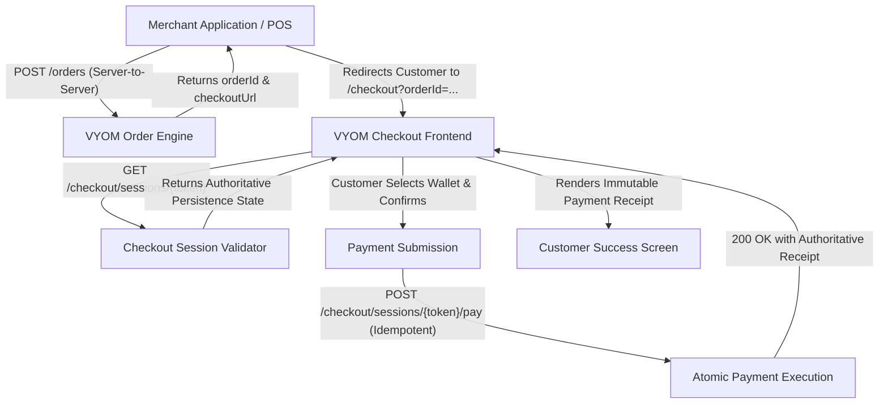

# VYOM — Phase 2.0: Checkout Experience & Comprehensive API Specification

**Document Target:** Customer Checkout Experience, Session Security & REST API Specification  
**Target Milestone:** Phase 2.0 Architecture Blueprint  
**Auditor:** VYOM Platform Architecture & Security Council  
**Date:** November 19, 2026  
**Status:** **APPROVED API SPECIFICATION**  

---

## 1. Customer Checkout Experience Architecture

The merchant checkout flow provides a secure, trustworthy payment interface where customers pay merchant orders using their digital wallets.



### 1.1 Non-Negotiable Checkout Security Rules
1. **Zero Browser Authority:** The browser is treated as completely untrusted. The browser never submits, calculates, or asserts:
   - The payment amount or currency.
   - The merchant identity or payee account.
   - The fee calculation.
   - The payment outcome.
   All monetary amounts and destinations are loaded authoritatively by the backend from the persisted `PaymentOrder` record.
2. **Cryptographic Checkout Sessions:**
   - A customer accessing an order receives a short-lived **Checkout Session Token** (`SESSION-YYYYMMDD-XXXXXX` or signed JWT).
   - TTL: Strictly 15 minutes (`expires_at = now() + 15m`).
   - The session token is cryptographically bound to the `order_id` and the customer's authenticated `user_id`.
   - Replay protection: Once an order is paid, the session token is invalidated.

### 1.2 Checkout Visual State Progression
The checkout experience transitions through five distinct states:
1. **Loading State:** Validates session token, displays merchant logo and legal business name with verified compliance badge.
2. **Order Review State:** Shows order description, reference ID, formatted currency and amount (`₹500.00`), and expiry countdown timer.
3. **Wallet Selection State:** Fetches customer's available wallets matching the order currency; shows real-time balance; solvency indicator (`Sufficient Funds` vs `Insufficient Balance`).
4. **Processing State:** Lock-in screen disabling double clicks; submits with `Idempotency-Key` and displays animated payment progress.
5. **Success / Failure State:**
   - On Success: Renders immutable receipt with reference number, timestamp, masked customer wallet, and return button to merchant site.
   - On Failure: Non-destructive error message explaining failure reason (e.g. `Insufficient funds in selected wallet`) and allows customer to select another wallet without creating phantom orders.

---

## 2. Comprehensive REST API Specification

All APIs reside under `/api/v1/`. All endpoints return standardized responses and error envelopes:
```json
{
  "timestamp": "2026-11-19T18:00:00Z",
  "status": 409,
  "errorCode": "ORDER_ALREADY_PAID",
  "message": "Payment order has already been successfully paid",
  "path": "/api/v1/checkout/sessions/sess_123/pay",
  "correlationId": "req-98765432"
}
```

---

### 2.1 Merchant Payment Orders API

#### 1. Create Payment Order
- **Endpoint:** `POST /api/v1/merchants/{merchantId}/orders`
- **Auth:** Bearer JWT (User)
- **RBAC Privilege:** `MERCHANT_OWNER`, `MERCHANT_ADMIN`, `MERCHANT_OPERATOR`
- **Idempotency:** Required via `Idempotency-Key` header
- **Request Schema:**
  ```json
  {
    "merchantOrderId": "INV-2026-0091",
    "customerReference": "cust_456@example.com",
    "amount": "500.00",
    "currency": "INR",
    "description": "Order #91 - Electronics Accessories",
    "expiresInMinutes": 30,
    "metadata": {
      "posTerminal": "POS-BLR-01",
      "cashierId": "USR-88"
    }
  }
  ```
- **Validation Rules:**
  - `merchantOrderId`: Non-blank, max 64 chars. Unique per merchant.
  - `amount`: Numeric string, $> 0.0000$, max `10000000.0000`. Scale 2 or 4.
  - `currency`: 3 uppercase letters matching supported platform currencies (`INR`, `USD`, `EUR`, `GBP`).
  - `expiresInMinutes`: Optional integer (min 5, max 1440; default 15).
  - `metadata`: JSON object, max 4096 bytes. Prohibited keys: `status`, `role`, `balance`.
- **Response Schema (`201 Created`):**
  ```json
  {
    "id": "78eaabf1-0000-0000-0000-000000000001",
    "merchantId": "99aaabf1-0000-0000-0000-000000000099",
    "orderReference": "ORD-20261119-748291",
    "merchantOrderId": "INV-2026-0091",
    "customerReference": "cust_456@example.com",
    "amount": "500.0000",
    "currency": "INR",
    "status": "CREATED",
    "description": "Order #91 - Electronics Accessories",
    "checkoutUrl": "/checkout?orderId=ORD-20261119-748291",
    "expiresAt": "2026-11-19T18:30:00Z",
    "metadata": {
      "posTerminal": "POS-BLR-01"
    },
    "createdAt": "2026-11-19T18:00:00Z"
  }
  ```
- **Error Codes:** `400 VALIDATION_FAILED`, `403 INSUFFICIENT_MERCHANT_PRIVILEGE`, `404 MEMBERSHIP_NOT_FOUND`, `409 DUPLICATE_MERCHANT_ORDER_ID`.

#### 2. Get Merchant Payment Order Details
- **Endpoint:** `GET /api/v1/merchants/{merchantId}/orders/{orderId}`
- **Auth:** Bearer JWT
- **RBAC Privilege:** `MERCHANT_OWNER`, `MERCHANT_ADMIN`, `MERCHANT_OPERATOR`, `MERCHANT_VIEWER`
- **Response Schema (`200 OK`):** Detailed `PaymentOrderResponse` including linked transaction ID and attempt summary.
- **Error Codes:** `404 ORDER_NOT_FOUND`, `404 MEMBERSHIP_NOT_FOUND`.

#### 3. List Merchant Payment Orders (Paginated)
- **Endpoint:** `GET /api/v1/merchants/{merchantId}/orders?status=PAID&page=0&size=20&sort=createdAt,desc`
- **Auth:** Bearer JWT
- **RBAC Privilege:** All merchant roles
- **Query Params:** `status` (optional), `from` (optional timestamp), `to` (optional timestamp), `page` (default 0), `size` (default 20, max 100).
- **Response Schema (`200 OK`):** Standard `PagedResponse<PaymentOrderSummaryResponse>`.

#### 4. Cancel Payment Order
- **Endpoint:** `POST /api/v1/merchants/{merchantId}/orders/{orderId}/cancel`
- **Auth:** Bearer JWT
- **RBAC Privilege:** `MERCHANT_OWNER`, `MERCHANT_ADMIN`
- **Request Body:**
  ```json
  {
    "reason": "Customer changed mind at point of sale"
  }
  ```
- **Response Schema (`200 OK`):** Updated order with `status = 'CANCELLED'`.
- **Error Codes:** `409 ORDER_ALREADY_PAID`, `409 ORDER_EXPIRED`, `409 ORDER_IN_PROCESSING`.

---

### 2.2 Customer Checkout & Payment Execution API

#### 1. Retrieve Authoritative Checkout Session
- **Endpoint:** `GET /api/v1/checkout/orders/{orderReference}`
- **Auth:** Bearer JWT (Customer)
- **Response Schema (`200 OK`):**
  ```json
  {
    "orderReference": "ORD-20261119-748291",
    "merchant": {
      "businessName": "Acme Electronics Retail",
      "businessCode": "MCH-20261119-0001",
      "city": "Bengaluru",
      "category": "RETAIL"
    },
    "amount": "500.0000",
    "currency": "INR",
    "description": "Order #91 - Electronics Accessories",
    "status": "PENDING",
    "expiresAt": "2026-11-19T18:30:00Z",
    "availableCustomerWallets": [
      {
        "walletId": "33aaabf1-0000-0000-0000-000000000033",
        "currency": "INR",
        "balance": "1250.0000",
        "isSufficient": true
      }
    ]
  }
  ```
- **Error Codes:** `404 ORDER_NOT_FOUND`, `410 ORDER_EXPIRED`, `409 ORDER_ALREADY_PAID`.

#### 2. Execute Payment (Checkout Confirmation)
- **Endpoint:** `POST /api/v1/checkout/orders/{orderReference}/pay`
- **Auth:** Bearer JWT (Customer)
- **Idempotency:** Required via `Idempotency-Key` header
- **Request Schema:**
  ```json
  {
    "customerWalletId": "33aaabf1-0000-0000-0000-000000000033"
  }
  ```
- **Response Schema (`200 OK`):**
  ```json
  {
    "orderReference": "ORD-20261119-748291",
    "attemptReference": "ATT-20261119-109283",
    "transactionReference": "TXN-20261119-482910",
    "status": "SUCCESS",
    "amount": "500.0000",
    "currency": "INR",
    "merchantName": "Acme Electronics Retail",
    "payerMaskedWallet": "****-****-****-0033",
    "completedAt": "2026-11-19T18:05:12Z",
    "receiptUrl": "/api/v1/checkout/receipts/TXN-20261119-482910"
  }
  ```
- **Error Codes:** `400 INSUFFICIENT_FUNDS`, `404 WALLET_NOT_FOUND`, `409 ORDER_ALREADY_PAID`, `410 ORDER_EXPIRED`, `409 IDEMPOTENCY_CONFLICT`.

---

### 2.3 Webhook Management & Delivery API

#### 1. Register Webhook Endpoint
- **Endpoint:** `POST /api/v1/merchants/{merchantId}/webhooks`
- **Auth:** Bearer JWT
- **RBAC Privilege:** `MERCHANT_OWNER`, `MERCHANT_ADMIN`
- **Request Schema:**
  ```json
  {
    "url": "https://api.acmeretail.com/vyom-webhook",
    "description": "Production payment notification endpoint",
    "subscribedEvents": ["order.paid", "order.failed", "refund.created"]
  }
  ```
- **Validation Rules:**
  - `url`: Valid HTTPS URL (HTTP prohibited in production).
  - Anti-SSRF check: DNS must resolve to public, non-reserved IP. Private IPs (`10.x`, `192.168.x`, `127.x`, `169.254.x`) immediately rejected.
- **Response Schema (`201 Created`):**
  ```json
  {
    "id": "wh_sec_99aaabf1-0000",
    "url": "https://api.acmeretail.com/vyom-webhook",
    "secret": "whsec_live_9f823bc8746a510e428bc91823746a",
    "status": "ACTIVE",
    "subscribedEvents": ["order.paid", "order.failed", "refund.created"],
    "createdAt": "2026-11-19T18:10:00Z"
  }
  ```
  *(Note: `secret` is displayed ONLY ONCE upon creation).*

#### 2. Rotate Webhook Secret
- **Endpoint:** `POST /api/v1/merchants/{merchantId}/webhooks/{webhookId}/rotate-secret`
- **Auth:** Bearer JWT
- **RBAC Privilege:** `MERCHANT_OWNER`
- **Response Schema (`200 OK`):** Generates new secret; provides 24-hour dual-verification grace period.

#### 3. List Webhook Delivery History (Paginated)
- **Endpoint:** `GET /api/v1/merchants/{merchantId}/webhooks/deliveries?page=0&size=50`
- **Auth:** Bearer JWT
- **RBAC Privilege:** All merchant roles
- **Response Schema (`200 OK`):** Standard `PagedResponse<WebhookDeliveryAttemptResponse>`.

#### 4. Trigger Manual Webhook Redelivery
- **Endpoint:** `POST /api/v1/merchants/{merchantId}/webhooks/deliveries/{deliveryId}/retry`
- **Auth:** Bearer JWT
- **RBAC Privilege:** `MERCHANT_OWNER`, `MERCHANT_ADMIN`, `MERCHANT_OPERATOR`
- **Response Schema (`202 Accepted`):** Re-enqueues outbox delivery immediately.

---

## 3. Specification Sign-Off

The API specification adheres to RFC 7807 problem details, enforces user-scoped idempotency, prevents browser monetary manipulation, and guarantees data protection across all endpoints.

**Status: RATIFIED FOR PHASE 2 IMPLEMENTATION.**
