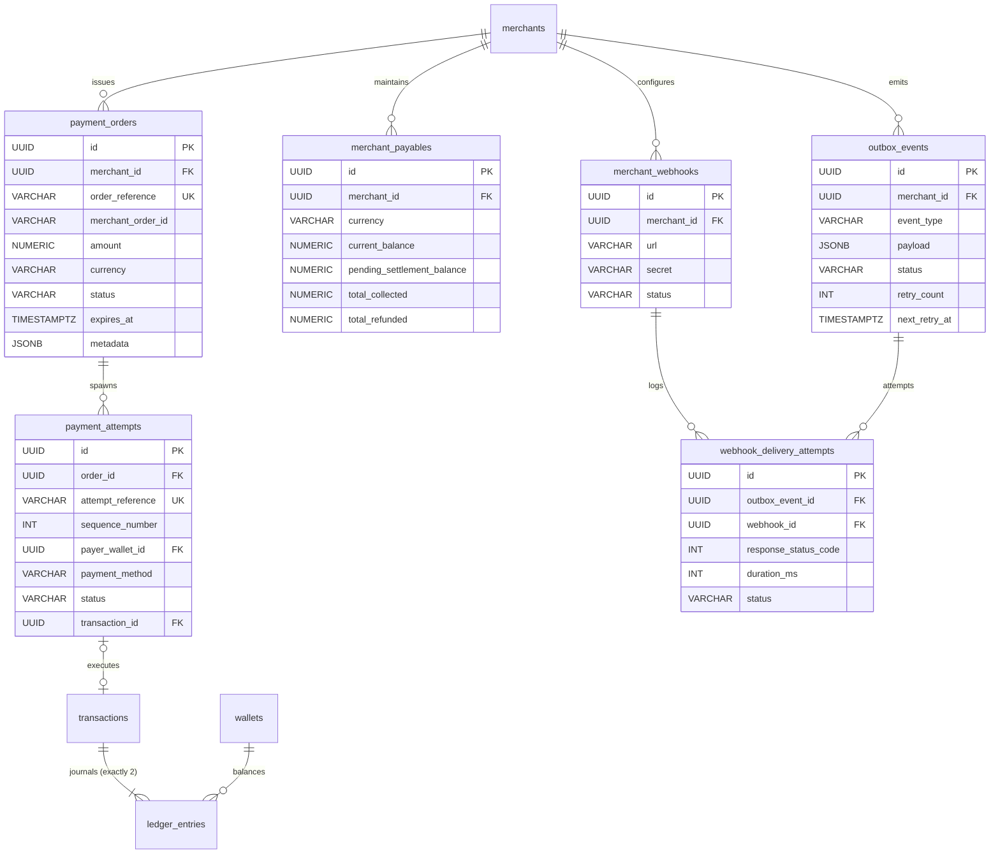

# VYOM — Phase 2.0: Database Schema & Migration Blueprint (V10 Design)

**Document Target:** Proposed Database Schema, Constraint Specifications & Migration Plan (V10)  
**Target Milestone:** Phase 2.0 Architecture Blueprint  
**Auditor:** VYOM Platform Architecture & Security Council  
**Date:** November 19, 2026  
**Status:** **APPROVED SCHEMA BLUEPRINT (NO DDL CREATED IN THIS PHASE)**  

---

## 1. Schema Architecture & Entity Relationship Diagram

The proposed schema for Phase 2 introduces the commercial transaction entities, the merchant payable subledger, and the asynchronous webhook outbox pipeline. All changes are strictly additive and 100% backward-compatible with Flyway migrations V1 through V9.



---

## 2. Table Specifications & Constraint Definitions

### 2.1 Table: `payment_orders`
Stores commercial orders generated by merchants.

```sql
CREATE TABLE payment_orders (
    id UUID PRIMARY KEY DEFAULT gen_random_uuid(),
    merchant_id UUID NOT NULL REFERENCES merchants(id) ON DELETE RESTRICT,
    order_reference VARCHAR(32) NOT NULL UNIQUE,
    merchant_order_id VARCHAR(64) NOT NULL,
    customer_reference VARCHAR(100),
    amount NUMERIC(19, 4) NOT NULL,
    currency VARCHAR(3) NOT NULL,
    description VARCHAR(255),
    status VARCHAR(20) NOT NULL DEFAULT 'CREATED',
    expires_at TIMESTAMPTZ NOT NULL,
    metadata JSONB DEFAULT '{}'::jsonb,
    created_by UUID NOT NULL REFERENCES users(id) ON DELETE RESTRICT,
    version BIGINT NOT NULL DEFAULT 0,
    created_at TIMESTAMPTZ NOT NULL DEFAULT clock_timestamp(),
    updated_at TIMESTAMPTZ NOT NULL DEFAULT clock_timestamp(),

    CONSTRAINT chk_orders_amount_positive CHECK (amount > 0.0000 AND amount <= 10000000.0000),
    CONSTRAINT chk_orders_currency_format CHECK (currency ~ '^[A-Z]{3}$'),
    CONSTRAINT chk_orders_status CHECK (
        status IN ('CREATED', 'PENDING', 'PAID', 'FAILED', 'CANCELLED', 'EXPIRED')
    ),
    CONSTRAINT uq_merchant_order_id UNIQUE (merchant_id, merchant_order_id)
);

CREATE INDEX idx_orders_merchant_created ON payment_orders(merchant_id, created_at DESC);
CREATE INDEX idx_orders_status_expires ON payment_orders(status, expires_at) WHERE status IN ('CREATED', 'PENDING');
CREATE INDEX idx_orders_reference ON payment_orders(order_reference);
```

---

### 2.2 Table: `payment_attempts`
Records every customer attempt to pay an order.

```sql
CREATE TABLE payment_attempts (
    id UUID PRIMARY KEY DEFAULT gen_random_uuid(),
    order_id UUID NOT NULL REFERENCES payment_orders(id) ON DELETE RESTRICT,
    attempt_reference VARCHAR(32) NOT NULL UNIQUE,
    sequence_number INT NOT NULL,
    customer_user_id UUID NOT NULL REFERENCES users(id) ON DELETE RESTRICT,
    payer_wallet_id UUID NOT NULL REFERENCES wallets(id) ON DELETE RESTRICT,
    payment_method VARCHAR(30) NOT NULL,
    status VARCHAR(20) NOT NULL DEFAULT 'INITIATED',
    failure_code VARCHAR(50),
    failure_reason VARCHAR(255),
    transaction_id UUID REFERENCES transactions(id) ON DELETE RESTRICT,
    created_at TIMESTAMPTZ NOT NULL DEFAULT clock_timestamp(),
    completed_at TIMESTAMPTZ,

    CONSTRAINT chk_attempts_seq_positive CHECK (sequence_number >= 1),
    CONSTRAINT chk_attempts_method CHECK (
        payment_method IN ('CUSTOMER_WALLET', 'SIMULATED_UPI', 'SIMULATED_NETBANKING')
    ),
    CONSTRAINT chk_attempts_status CHECK (
        status IN ('INITIATED', 'PROCESSING', 'SUCCESS', 'FAILED', 'ABANDONED')
    ),
    CONSTRAINT uq_order_attempt_seq UNIQUE (order_id, sequence_number)
);

CREATE INDEX idx_attempts_order ON payment_attempts(order_id);
CREATE INDEX idx_attempts_customer ON payment_attempts(customer_user_id, created_at DESC);
CREATE INDEX idx_attempts_transaction ON payment_attempts(transaction_id) WHERE transaction_id IS NOT NULL;
```

---

### 2.3 Table: `merchant_payables`
The subledger tracking unsettled commercial funds owed to each merchant.

```sql
CREATE TABLE merchant_payables (
    id UUID PRIMARY KEY DEFAULT gen_random_uuid(),
    merchant_id UUID NOT NULL REFERENCES merchants(id) ON DELETE RESTRICT,
    currency VARCHAR(3) NOT NULL,
    current_balance NUMERIC(19, 4) NOT NULL DEFAULT 0.0000,
    pending_settlement_balance NUMERIC(19, 4) NOT NULL DEFAULT 0.0000,
    total_collected NUMERIC(19, 4) NOT NULL DEFAULT 0.0000,
    total_refunded NUMERIC(19, 4) NOT NULL DEFAULT 0.0000,
    version BIGINT NOT NULL DEFAULT 0,
    updated_at TIMESTAMPTZ NOT NULL DEFAULT clock_timestamp(),

    CONSTRAINT uq_merchant_payable_currency UNIQUE (merchant_id, currency),
    CONSTRAINT chk_payable_balance_non_negative CHECK (current_balance >= 0.0000),
    CONSTRAINT chk_payable_currency_format CHECK (currency ~ '^[A-Z]{3}$')
);

CREATE INDEX idx_merchant_payables_merchant ON merchant_payables(merchant_id);
```

---

### 2.4 Table: `merchant_webhooks`
Stores registered merchant listener endpoints and signing secrets.

```sql
CREATE TABLE merchant_webhooks (
    id UUID PRIMARY KEY DEFAULT gen_random_uuid(),
    merchant_id UUID NOT NULL REFERENCES merchants(id) ON DELETE RESTRICT,
    url VARCHAR(500) NOT NULL,
    secret VARCHAR(128) NOT NULL,
    previous_secret VARCHAR(128),
    previous_secret_expires_at TIMESTAMPTZ,
    status VARCHAR(20) NOT NULL DEFAULT 'ACTIVE',
    subscribed_events TEXT[] NOT NULL,
    consecutive_failures INT NOT NULL DEFAULT 0,
    created_at TIMESTAMPTZ NOT NULL DEFAULT clock_timestamp(),
    updated_at TIMESTAMPTZ NOT NULL DEFAULT clock_timestamp(),

    CONSTRAINT chk_webhook_url_https CHECK (url ~* '^https://.+'),
    CONSTRAINT chk_webhook_status CHECK (status IN ('ACTIVE', 'PAUSED', 'SUSPENDED'))
);

CREATE INDEX idx_webhooks_merchant ON merchant_webhooks(merchant_id);
```

---

### 2.5 Table: `outbox_events`
Transactional outbox staging table for decoupled event delivery.

```sql
CREATE TABLE outbox_events (
    id UUID PRIMARY KEY DEFAULT gen_random_uuid(),
    merchant_id UUID NOT NULL REFERENCES merchants(id) ON DELETE RESTRICT,
    event_type VARCHAR(50) NOT NULL,
    aggregate_type VARCHAR(30) NOT NULL,
    aggregate_id UUID NOT NULL,
    payload JSONB NOT NULL,
    status VARCHAR(20) NOT NULL DEFAULT 'PENDING',
    retry_count INT NOT NULL DEFAULT 0,
    next_retry_at TIMESTAMPTZ NOT NULL DEFAULT clock_timestamp(),
    created_at TIMESTAMPTZ NOT NULL DEFAULT clock_timestamp(),
    processed_at TIMESTAMPTZ,

    CONSTRAINT chk_outbox_status CHECK (status IN ('PENDING', 'PROCESSING', 'DELIVERED', 'FAILED')),
    CONSTRAINT chk_outbox_retries CHECK (retry_count >= 0)
);

CREATE INDEX idx_outbox_polling ON outbox_events (status, next_retry_at) 
WHERE status IN ('PENDING', 'PROCESSING');
CREATE INDEX idx_outbox_merchant ON outbox_events(merchant_id, created_at DESC);
```

---

### 2.6 Table: `webhook_delivery_attempts`
Telemetry audit log recording individual HTTP delivery dispatches.

```sql
CREATE TABLE webhook_delivery_attempts (
    id UUID PRIMARY KEY DEFAULT gen_random_uuid(),
    outbox_event_id UUID NOT NULL REFERENCES outbox_events(id) ON DELETE CASCADE,
    webhook_id UUID NOT NULL REFERENCES merchant_webhooks(id) ON DELETE RESTRICT,
    attempt_number INT NOT NULL,
    request_headers JSONB NOT NULL,
    request_payload JSONB NOT NULL,
    response_status_code INT,
    response_body TEXT,
    duration_ms INT NOT NULL,
    status VARCHAR(20) NOT NULL,
    error_message VARCHAR(255),
    created_at TIMESTAMPTZ NOT NULL DEFAULT clock_timestamp(),

    CONSTRAINT chk_delivery_status CHECK (status IN ('SUCCESS', 'TRANSIENT_FAILURE', 'PERMANENT_FAILURE'))
);

CREATE INDEX idx_delivery_outbox ON webhook_delivery_attempts(outbox_event_id);
CREATE INDEX idx_delivery_webhook ON webhook_delivery_attempts(webhook_id, created_at DESC);
```

---

## 3. Data Retention & Archival Strategy

1. **`outbox_events` Retention:** Delivered outbox events (`status = 'DELIVERED'`) can be purged or moved to cold storage after **30 days**. Un-delivered/failed events are retained indefinitely for manual audit.
2. **`webhook_delivery_attempts` Retention:** Telemetry records are retained for **90 days** for compliance and dispute resolution, then automatically pruned via scheduled partition drop.
3. **`payment_attempts` Retention:** Retained permanently for financial and audit non-repudiation.

---

## 4. Role-Based Least-Privilege Grants (for `vyom_app`)

When Migration V10 is executed in Phase 2 implementation, permissions will be granted to runtime user `vyom_app`:

```sql
GRANT SELECT, INSERT, UPDATE ON TABLE payment_orders TO vyom_app;
GRANT SELECT, INSERT, UPDATE ON TABLE payment_attempts TO vyom_app;
GRANT SELECT, INSERT, UPDATE ON TABLE merchant_payables TO vyom_app;
GRANT SELECT, INSERT, UPDATE, DELETE ON TABLE merchant_webhooks TO vyom_app;
GRANT SELECT, INSERT, UPDATE, DELETE ON TABLE outbox_events TO vyom_app;
GRANT SELECT, INSERT ON TABLE webhook_delivery_attempts TO vyom_app;
```
*(Notice: `webhook_delivery_attempts` explicitly forbids `UPDATE` and `DELETE`, ensuring an immutable delivery audit log).*

---

## 5. Schema Design Sign-Off

The proposed V10 schema strictly respects existing financial invariants, provides clean subledger accounting, guarantees multi-tenant referential integrity, and enforces least privilege.

**Status: RATIFIED FOR PHASE 2 MIGRATION AUTHORING.**
