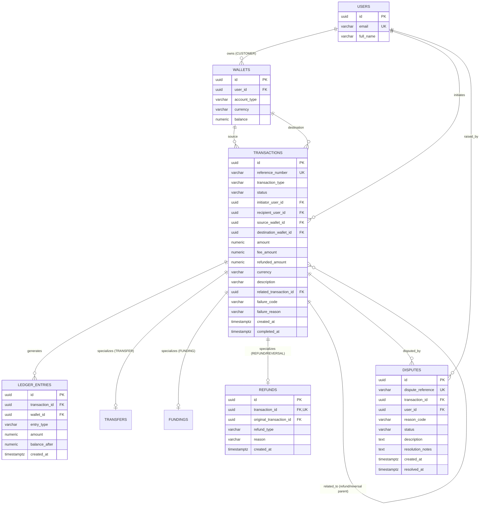

# VYOM — Phase 2.0: Database Design & Schema Evolution

**Document Version:** 1.0.0  
**Status:** DRAFT / PENDING APPROVAL  
**Scope:** PostgreSQL relational schema design, V5 migration plan, entity relationships, constraints, indexing strategy, and legacy data migration for Phase 2.0.

---

## 1. Existing Schema Forensic Review (V1 to V4)

| Migration | Primary Objects Introduced | Constraints & Invariants Enforced |
| :--- | :--- | :--- |
| **`V1__initial_schema.sql`** | `wallets`, `transfers`, `ledger_entries`, `idempotency_records` | `chk_wallets_balance_non_negative`, `chk_transfers_distinct_wallets`, `uq_ledger_transfer_entry_type`, `uq_idempotency_key`. Fixed `NUMERIC(19, 4)` scale. |
| **`V2__wallet_funding_and_ledger_protection.sql`** | `fundings` table, append-only trigger `trg_protect_ledger_entries` | `ledger_entries` extended with `funding_id`. Direct UPDATE/DELETE prohibited on `ledger_entries`. `operation_type` added to idempotency records. |
| **`V3__idempotency_ownership_fencing.sql`** | `owner_token UUID`, `version BIGINT` on `idempotency_records` | Atomic lease reclamation and optimistic fencing for in-flight requests. |
| **`V4__system_settlement_auth_and_user_idempotency.sql`** | `users` table, `wallets.account_type`, `user_id` scoping | Seeded deterministic system settlement wallets. Changed idempotency uniqueness to composite `(user_id, idempotency_key)`. Double-entry funding with system account debits. |

### Architectural Deficiencies Identified in Current Schema:
1. **Disconnected Financial Entities:** `transfers` and `fundings` have separate ID namespaces. There is no unified `transaction_id` or public human-readable reference number (`TXN-20261118-XXXX`).
2. **Dual Foreign Keys on Ledger:** `ledger_entries` maintains two mutually exclusive nullable columns: `transfer_id` and `funding_id`. Adding refunds and reversals would require adding `refund_id` and `reversal_id`, leading to sparse column bloat and fragmented foreign keys.
3. **Absence of Parent-Child Linkage:** No mechanism exists to link a compensating refund back to its original transfer.
4. **No Refund Tracking Columns:** The original transfer has no column tracking cumulative refunded amounts (`refunded_amount`) or remaining refundable balance.

---

## 2. Architecture Decision: The Core Transaction Anchor Model

To resolve these deficiencies without modifying historical migrations (V1–V4), we adopt the **Core Transaction Anchor Model**.

### 2.1 Entity Relationship Model


---

## 3. Proposed PostgreSQL Schema Specification (V5 Migration Draft)

```sql
-- ============================================================================
-- Migration V5: Unified Transaction Anchor, Refunds, Reversals & Disputes
-- ============================================================================

-- 1. Create Core Transactions Table
CREATE TABLE transactions (
    id UUID PRIMARY KEY DEFAULT gen_random_uuid(),
    reference_number VARCHAR(32) NOT NULL,
    transaction_type VARCHAR(20) NOT NULL,
    status VARCHAR(20) NOT NULL,
    initiator_user_id UUID REFERENCES users(id) ON DELETE SET NULL,
    recipient_user_id UUID REFERENCES users(id) ON DELETE SET NULL,
    source_wallet_id UUID NOT NULL REFERENCES wallets(id) ON DELETE RESTRICT,
    destination_wallet_id UUID NOT NULL REFERENCES wallets(id) ON DELETE RESTRICT,
    amount NUMERIC(19, 4) NOT NULL,
    fee_amount NUMERIC(19, 4) NOT NULL DEFAULT 0.0000,
    refunded_amount NUMERIC(19, 4) NOT NULL DEFAULT 0.0000,
    currency VARCHAR(3) NOT NULL,
    description VARCHAR(255),
    related_transaction_id UUID REFERENCES transactions(id) ON DELETE RESTRICT,
    failure_code VARCHAR(50),
    failure_reason VARCHAR(255),
    created_at TIMESTAMPTZ NOT NULL DEFAULT clock_timestamp(),
    completed_at TIMESTAMPTZ,
    
    CONSTRAINT uq_transactions_reference_number UNIQUE (reference_number),
    CONSTRAINT chk_transactions_type CHECK (transaction_type IN ('TRANSFER', 'FUNDING', 'REFUND', 'REVERSAL')),
    CONSTRAINT chk_transactions_status CHECK (status IN ('INITIATED', 'PROCESSING', 'SUCCESS', 'FAILED', 'REVERSED', 'PARTIALLY_REFUNDED', 'REFUNDED')),
    CONSTRAINT chk_transactions_amount_positive CHECK (amount > 0.0000),
    CONSTRAINT chk_transactions_fee_non_negative CHECK (fee_amount >= 0.0000),
    CONSTRAINT chk_transactions_refunded_bounds CHECK (refunded_amount >= 0.0000 AND refunded_amount <= amount),
    CONSTRAINT chk_transactions_currency_format CHECK (currency ~ '^[A-Z]{3}$'),
    CONSTRAINT chk_transactions_distinct_wallets CHECK (source_wallet_id <> destination_wallet_id)
);

-- 2. Create Specialized Refunds Satellite Table
CREATE TABLE refunds (
    id UUID PRIMARY KEY DEFAULT gen_random_uuid(),
    transaction_id UUID NOT NULL REFERENCES transactions(id) ON DELETE RESTRICT,
    original_transaction_id UUID NOT NULL REFERENCES transactions(id) ON DELETE RESTRICT,
    refund_type VARCHAR(20) NOT NULL,
    reason VARCHAR(255) NOT NULL,
    created_at TIMESTAMPTZ NOT NULL DEFAULT clock_timestamp(),
    
    CONSTRAINT uq_refunds_transaction_id UNIQUE (transaction_id),
    CONSTRAINT chk_refunds_type CHECK (refund_type IN ('PARTIAL', 'FULL', 'REVERSAL'))
);

-- 3. Create Operational Disputes Table
CREATE TABLE disputes (
    id UUID PRIMARY KEY DEFAULT gen_random_uuid(),
    dispute_reference VARCHAR(32) NOT NULL,
    transaction_id UUID NOT NULL REFERENCES transactions(id) ON DELETE RESTRICT,
    user_id UUID NOT NULL REFERENCES users(id) ON DELETE RESTRICT,
    reason_code VARCHAR(50) NOT NULL,
    status VARCHAR(20) NOT NULL DEFAULT 'OPEN',
    description TEXT NOT NULL,
    resolution_notes TEXT,
    created_at TIMESTAMPTZ NOT NULL DEFAULT clock_timestamp(),
    resolved_at TIMESTAMPTZ,
    
    CONSTRAINT uq_disputes_reference UNIQUE (dispute_reference),
    CONSTRAINT chk_disputes_status CHECK (status IN ('OPEN', 'UNDER_REVIEW', 'RESOLVED_UPHELD', 'RESOLVED_REJECTED', 'CANCELLED'))
);

-- Only one active dispute per transaction
CREATE UNIQUE INDEX uq_active_dispute_per_transaction 
    ON disputes (transaction_id) 
    WHERE status IN ('OPEN', 'UNDER_REVIEW');

-- 4. Extend Existing Specialized Tables & Ledger Entries
ALTER TABLE transfers ADD COLUMN transaction_id UUID REFERENCES transactions(id) ON DELETE RESTRICT;
ALTER TABLE fundings ADD COLUMN transaction_id UUID REFERENCES transactions(id) ON DELETE RESTRICT;

-- Extend ledger_entries to directly reference the canonical transactions table
ALTER TABLE ledger_entries ADD COLUMN transaction_id UUID REFERENCES transactions(id) ON DELETE RESTRICT;

-- Extend idempotency_records to support transaction_id reference
ALTER TABLE idempotency_records ADD COLUMN transaction_id UUID REFERENCES transactions(id) ON DELETE SET NULL;
ALTER TABLE idempotency_records DROP CONSTRAINT IF EXISTS chk_idempotency_operation_type;
ALTER TABLE idempotency_records ADD CONSTRAINT chk_idempotency_operation_type 
    CHECK (operation_type IN ('TRANSFER', 'FUNDING', 'REFUND', 'REVERSAL'));

-- 5. Backfill Historical Records into transactions Anchor Table
-- Backfill historical transfers
INSERT INTO transactions (
    id, reference_number, transaction_type, status,
    initiator_user_id, recipient_user_id,
    source_wallet_id, destination_wallet_id,
    amount, currency, description, created_at, completed_at
)
SELECT 
    t.id,
    'TXN-LEGACY-TRF-' || UPPER(SUBSTRING(t.id::text FROM 1 FOR 8)),
    'TRANSFER',
    CASE WHEN t.status = 'COMPLETED' THEN 'SUCCESS' ELSE 'FAILED' END,
    sw.user_id,
    dw.user_id,
    t.source_wallet_id,
    t.destination_wallet_id,
    t.amount,
    t.currency,
    t.description,
    t.created_at,
    t.created_at
FROM transfers t
JOIN wallets sw ON t.source_wallet_id = sw.id
JOIN wallets dw ON t.destination_wallet_id = dw.id;

UPDATE transfers SET transaction_id = id WHERE transaction_id IS NULL;

-- Backfill historical fundings
INSERT INTO transactions (
    id, reference_number, transaction_type, status,
    initiator_user_id, recipient_user_id,
    source_wallet_id, destination_wallet_id,
    amount, currency, description, created_at, completed_at
)
SELECT 
    f.id,
    'TXN-LEGACY-FND-' || UPPER(SUBSTRING(f.id::text FROM 1 FOR 8)),
    'FUNDING',
    CASE WHEN f.status = 'COMPLETED' THEN 'SUCCESS' ELSE 'FAILED' END,
    cw.user_id,
    cw.user_id,
    sysw.id,
    f.wallet_id,
    f.amount,
    f.currency,
    f.description,
    f.created_at,
    f.created_at
FROM fundings f
JOIN wallets cw ON f.wallet_id = cw.id
JOIN wallets sysw ON sysw.account_type = 'SYSTEM_SETTLEMENT' AND sysw.currency = f.currency;

UPDATE fundings SET transaction_id = id WHERE transaction_id IS NULL;

-- Backfill transaction_id on historical ledger_entries
UPDATE ledger_entries
SET transaction_id = transfer_id
WHERE transfer_id IS NOT NULL AND transaction_id IS NULL;

UPDATE ledger_entries
SET transaction_id = funding_id
WHERE funding_id IS NOT NULL AND transaction_id IS NULL;

-- 6. Indexing Strategy for High-Performance Queries
CREATE INDEX idx_transactions_initiator_created ON transactions (initiator_user_id, created_at DESC);
CREATE INDEX idx_transactions_recipient_created ON transactions (recipient_user_id, created_at DESC);
CREATE INDEX idx_transactions_source_wallet ON transactions (source_wallet_id, created_at DESC);
CREATE INDEX idx_transactions_dest_wallet ON transactions (destination_wallet_id, created_at DESC);
CREATE INDEX idx_transactions_status ON transactions (status);
CREATE INDEX idx_transactions_related_id ON transactions (related_transaction_id) WHERE related_transaction_id IS NOT NULL;
CREATE INDEX idx_transactions_created_at ON transactions (created_at DESC);

CREATE INDEX idx_ledger_transaction_id ON ledger_entries (transaction_id);
CREATE INDEX idx_refunds_original_transaction ON refunds (original_transaction_id);
CREATE INDEX idx_disputes_transaction ON disputes (transaction_id);
CREATE INDEX idx_disputes_user ON disputes (user_id);
```

---

## 4. Query Performance & Indexing Analysis

### 4.1 Index Justifications

1. **`idx_transactions_initiator_created` & `idx_transactions_recipient_created`**:
   - Query: User-scoped transaction history with date filters.
   - Mechanism: PostgreSQL executes a fast Bitmap Index Scan over both indexes using `WHERE initiator_user_id = :userId OR recipient_user_id = :userId`, perfectly avoiding sequential table scans.
2. **`idx_transactions_reference_number` (Unique)**:
   - Query: Receipt lookup and search by reference (`TXN-20261118-XXXX`).
   - Mechanism: Exact single-record B-Tree seek in $<1$ ms.
3. **`idx_transactions_related_id` (Partial Index)**:
   - Query: Retrieve all refunds and reversals for a parent transaction.
   - Mechanism: Scans only compensating child transactions (`WHERE related_transaction_id IS NOT NULL`), keeping index size minimal.
4. **`uq_active_dispute_per_transaction` (Partial Unique Index)**:
   - Constraint: Prevents duplicate active disputes on a transaction at the database engine level without table-level locking.

---

## 5. Migration Safety & Zero Data Loss Guarantee

1. **Non-Destructive Evolution:** No existing columns are renamed or dropped. Historical tables `transfers`, `fundings`, and `ledger_entries` continue to satisfy all legacy V1–V4 constraints.
2. **Backfill Determinism:** Historical transfers and fundings are assigned identical UUIDs as their corresponding `transactions` anchor record (`transactions.id = transfers.id`), maintaining complete referential continuity.
3. **Rollback Safety:** If V5 needs to be rolled back during staging tests, dropping `transactions`, `refunds`, and `disputes` and their foreign key columns restores the database to the exact V4 state without data loss.
