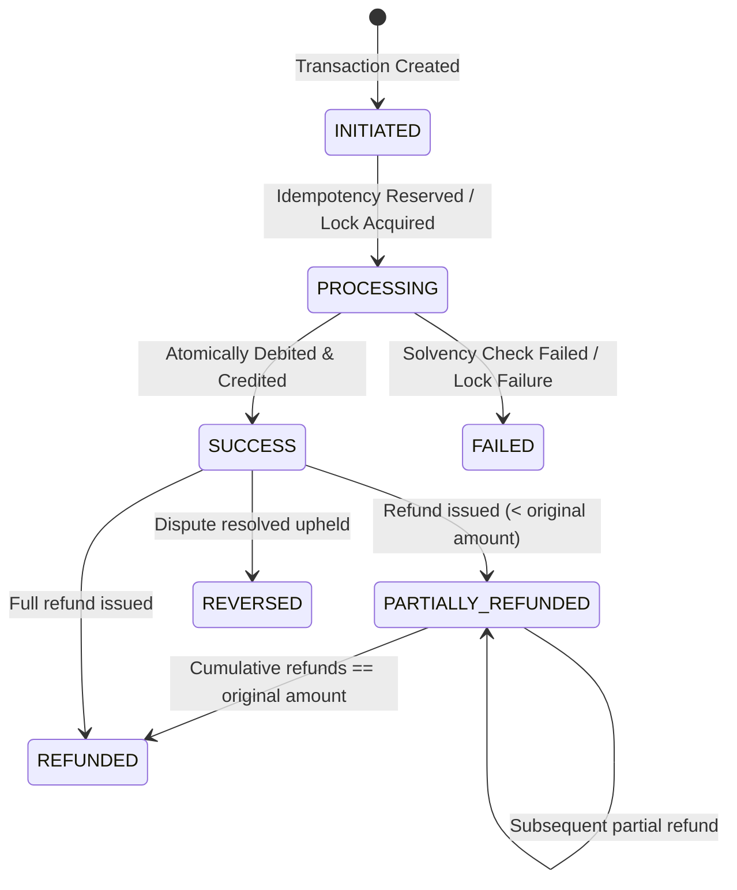

# VYOM — Phase 2.0: Existing Financial Architecture & Invariants Audit

**Document Target:** Comprehensive Architectural Audit of VYOM Core Financial Systems  
**Audited Codebase Snapshot:** Git HEAD `176994b` (Branch: `main`)  
**Scope:** Wallets, Ledgers, Invariants, State Machines, Concurrency, Idempotency, Refunds, Disputes, RBAC, Gateway  
**Auditor:** VYOM Platform Architecture & Security Council  
**Date:** November 19, 2026  
**Status:** **APPROVED BASELINE ARCHITECTURE**  

---

## 1. Executive Summary & Objective

The objective of this architectural audit is to establish an authoritative, source-code-grounded baseline of the existing financial and domain systems in VYOM (Virtual Yatra of Money) prior to designing the **Phase 2: Merchant Commercial Payments, Checkout & Webhooks** subsystem.

VYOM is an enterprise-grade modular-monolith payments platform built on Java 21, Spring Boot 3.4.3, PostgreSQL 18.4, and a Node.js Express API Gateway. Over Phases 0, 0.1, 1, and 1.1, the platform established strict double-entry ledger immutability, mathematical reconciliation invariants, deterministic concurrency controls, multi-tenant merchant identity, and fine-grained RBAC.

This audit evaluates the 12 core architectural dimensions of the existing platform, proves why the existing consumer-to-consumer wallet model is insufficient for merchant commercial payments, and establishes the strict boundaries that Phase 2 must respect.

---

## 2. In-Depth Architectural Inventory

### 2.1 Current Wallet and Account Model
The account structure is governed by [Wallet.java](file:///d:/VYOM/src/main/java/com/vyom/entity/Wallet.java) and enforced by schema migrations `V1`, `V2`, `V4`, and `V7`:

1. **Table Schema (`wallets`):**
   - `id UUID PRIMARY KEY DEFAULT gen_random_uuid()`
   - `user_id UUID REFERENCES users(id) ON DELETE RESTRICT`
   - `account_type VARCHAR(20) NOT NULL` (`CUSTOMER` or `SYSTEM_SETTLEMENT`)
   - `owner_name VARCHAR(100) NOT NULL`
   - `currency VARCHAR(3) NOT NULL` (enforced regex `^[A-Z]{3}$`)
   - `balance NUMERIC(19, 4) NOT NULL DEFAULT 0.0000`
   - `created_at TIMESTAMPTZ`, `updated_at TIMESTAMPTZ`

2. **Core Invariants & Constraints:**
   - **Customer Solvency:** `CONSTRAINT chk_wallets_balance_non_negative CHECK (account_type <> 'CUSTOMER' OR balance >= 0.0000)`. Customer wallets can never have a negative balance under any circumstance.
   - **System Settlement Accounts:** System settlement accounts (`account_type = 'SYSTEM_SETTLEMENT'`) are deterministic, unowned (`user_id IS NULL`), and maintain a non-positive balance reflecting cumulative net injected liquidity into the consumer ecosystem (`00000000-0000-0000-0000-000000000001` for INR, `...0002` for USD, etc.).
   - **Uniqueness:** `CREATE UNIQUE INDEX uq_wallets_system_settlement_currency ON wallets (currency) WHERE account_type = 'SYSTEM_SETTLEMENT'`.

3. **Current Role:** Exclusively models consumer store-of-value wallets and platform settlement liquidity anchors. **No merchant balances or commercial accounts exist in this table.**

---

### 2.2 Ledger-Entry Schema and Transaction Relationships
The ledger architecture is governed by [LedgerEntry.java](file:///d:/VYOM/src/main/java/com/vyom/entity/LedgerEntry.java), [Transaction.java](file:///d:/VYOM/src/main/java/com/vyom/entity/Transaction.java), and migrations `V1`, `V2`, `V5`, `V7`, and `V8`:

1. **Table Schema (`transactions`):**
   - Canonical anchor table representing a financial business operation.
   - Attributes: `reference_number VARCHAR(32) UNIQUE`, `transaction_type` (`TRANSFER`, `FUNDING`, `REFUND`, `REVERSAL`), `status`, `initiator_user_id`, `recipient_user_id`, `source_wallet_id`, `destination_wallet_id`, `amount NUMERIC(19,4)`, `fee_amount NUMERIC(19,4)`, `refunded_amount NUMERIC(19,4)`, `currency VARCHAR(3)`, `related_transaction_id UUID REFERENCES transactions(id)`.

2. **Table Schema (`ledger_entries`):**
   - Immutable double-entry bookkeeping journal.
   - Attributes: `id UUID PRIMARY KEY`, `transaction_id UUID REFERENCES transactions(id)`, `transfer_id UUID REFERENCES transfers(id)`, `funding_id UUID REFERENCES fundings(id)`, `wallet_id UUID REFERENCES wallets(id)`, `entry_type VARCHAR(10)` (`DEBIT` or `CREDIT`), `amount NUMERIC(19,4)`, `balance_after NUMERIC(19,4)`, `created_at TIMESTAMPTZ`.

3. **Relationships:**
   - Each completed financial transaction links to exactly two rows in `ledger_entries` (one `DEBIT` row and one `CREDIT` row).
   - `transfer_id` and `funding_id` are legacy satellite references preserved for backward compatibility under `CONSTRAINT chk_ledger_operation_reference`.

---

### 2.3 Existing Double-Entry Accounting Implementation
Financial mutations execute across three isolated execution services:
- [TransferExecutionService.java](file:///d:/VYOM/src/main/java/com/vyom/service/TransferExecutionService.java) (Peer-to-peer customer transfers)
- [FundingExecutionService.java](file:///d:/VYOM/src/main/java/com/vyom/service/FundingExecutionService.java) (Customer wallet top-up from system settlement)
- [RefundExecutionService.java](file:///d:/VYOM/src/main/java/com/vyom/service/RefundExecutionService.java) (Full and partial refunds, dispute reversals)

**PostgreSQL Constraint Triggers (Migration V8):**
In `V8__enforce_complete_transaction_ledger_invariants.sql`, PostgreSQL executes `fn_verify_transaction_ledger_invariants()` as a deferred constraint trigger (`AFTER INSERT OR UPDATE OR DELETE DEFERRABLE INITIALLY DEFERRED`) on both `transactions` and `ledger_entries`.

For every transaction marked `SUCCESS`, `REVERSED`, `PARTIALLY_REFUNDED`, or `REFUNDED`, the database strictly validates:
1. `COUNT(DEBIT) == 1` and `COUNT(CREDIT) == 1`.
2. `SUM(DEBIT) == SUM(CREDIT)`.
3. `SUM(DEBIT) == transaction.amount`.
4. `DEBIT.wallet_id == transaction.source_wallet_id`.
5. `CREDIT.wallet_id == transaction.destination_wallet_id`.
6. `DEBIT.currency == CREDIT.currency == transaction.currency`.
7. Non-finalized transactions (`INITIATED`, `PROCESSING`, `FAILED`) must have **0** ledger entries.

Any violation causes PostgreSQL to abort the transaction with an uncatchable exception during commit.

---

### 2.4 Transaction State Machine
The core financial lifecycle in `transactions` follows this deterministic state transition graph:

**State Guarantees:**
- Terminal States: `FAILED` and `REVERSED`.
- Mutability: Once in `SUCCESS`, monetary amounts (`amount`, `currency`) are immutable. Only `status` and `refunded_amount` can be updated during compensation.

---

### 2.5 Idempotency Implementation and Concurrency Controls
The platform uses a persistent, high-concurrency idempotency protocol managed by [IdempotencyService.java](file:///d:/VYOM/src/main/java/com/vyom/service/IdempotencyService.java) and [IdempotencyRecord.java](file:///d:/VYOM/src/main/java/com/vyom/entity/IdempotencyRecord.java):

1. **User-Scoped Idempotency:**
   - Keys are scoped by user: `CONSTRAINT uq_idempotency_user_key UNIQUE (user_id, idempotency_key)`.
   - Prevents cross-tenant denial-of-service or key collisions between different users.

2. **Payload Fingerprinting:**
   - Evaluates SHA-256 hash over normalized request parameters (`userId`, wallet IDs, currency, scaled 4-decimal amount).
   - Replaying the same key with altered parameters raises `IdempotencyConflictException` (`409 Conflict`).

3. **Three-Phase Lifecycle & Fencing:**
   - **Phase 1 (Reserve):** Inserts row with `status = 'PROCESSING'` and generates a cryptographically random `owner_token UUID` in a separate `REQUIRES_NEW` transaction.
   - **Phase 2 (Execute):** Executes business logic under pessimistic write locks.
   - **Phase 3 (Complete):** Sets `status = 'COMPLETED'`, caches response payload, and binds `transaction_id`. Fences against lease loss using conditional update `WHERE owner_token = :token`.

4. **Deadlock Prevention via Lexicographical Locking:**
   - In `TransferExecutionService` and `RefundExecutionService`, multiple wallet locks are acquired using `SELECT ... FOR UPDATE` in strictly ascending UUID order:
     `UUID firstLockId = sourceId.compareTo(destId) < 0 ? sourceId : destId;`
   - Completely eliminates circular-wait deadlocks across concurrent transfers.

---

### 2.6 Refund and Reversal Workflows
Managed by [RefundExecutionService.java](file:///d:/VYOM/src/main/java/com/vyom/service/RefundExecutionService.java):
1. **Parent-Child Relation:**
   - Refunds do not edit historical ledger entries.
   - A refund creates a new independent child `Transaction` with `transaction_type = 'REFUND'`, `related_transaction_id = parent.id`, and its own two balanced ledger entries (DEBIT recipient, CREDIT original sender).
2. **Cumulative Refund Ceiling:**
   - Tracks `original.refunded_amount + requested_amount <= original.amount`.
   - Exceeding the original amount triggers `OverRefundException` (`422 Unprocessable Entity`).
3. **Dispute Reversals:**
   - Administrative reversals (`transaction_type = 'REVERSAL'`) require platform `ROLE_ADMIN` and atomically settle the dispute record while reversing funds.

---

### 2.7 Dispute Handling
Governed by [Dispute.java](file:///d:/VYOM/src/main/java/com/vyom/entity/Dispute.java) and [DisputeService.java](file:///d:/VYOM/src/main/java/com/vyom/service/DisputeService.java):
- Unique active dispute constraint: `CREATE UNIQUE INDEX uq_active_dispute_per_transaction ON disputes (transaction_id) WHERE status IN ('OPEN', 'UNDER_REVIEW')`.
- Optimistic locking via `@Version` column (`version BIGINT NOT NULL DEFAULT 0`) preventing concurrent resolution races.
- Transitions: `OPEN` &rarr; `UNDER_REVIEW` &rarr; `RESOLVED_UPHELD` / `RESOLVED_REJECTED` / `CANCELLED`.

---

### 2.8 Transaction Receipts and History
Governed by [TransactionReceiptResponse.java](file:///d:/VYOM/src/main/java/com/vyom/dto/response/TransactionReceiptResponse.java) and [ReferenceGenerator.java](file:///d:/VYOM/src/main/java/com/vyom/util/ReferenceGenerator.java):
- References formatted as `TXN-YYYYMMDD-XXXXXX` generated outside transaction locks.
- PII masking on receipt responses (masked emails `a***e@domain.com`, masked wallet UUIDs `****-****-****-1234`).
- Comprehensive attribution displaying initiator, recipient, active dispute status, and compensation trail.

---

### 2.9 Database Constraints and Triggers
Summary of active database-level protections:
1. `chk_wallets_balance_non_negative`: Customer wallet balance $\ge 0.0000$.
2. `chk_transfers_distinct_wallets`: Source $\ne$ Destination wallet.
3. `chk_transfers_amount_positive`: Transfer amount $> 0.0000$.
4. `trg_protect_ledger_entries`: `BEFORE UPDATE OR DELETE ON ledger_entries` raising exception to enforce physical row immutability.
5. `trg_defer_verify_transaction_ledger`: Deferred constraint trigger on `ledger_entries` verifying 1 DEBIT + 1 CREDIT.
6. `trg_defer_verify_transaction_invariants`: Deferred constraint trigger on `transactions` verifying that finalized transactions match ledger entries exactly.

---

### 2.10 Merchant Entities, Memberships, RBAC, and Lifecycle Controls
Implemented in Phase 1 / 1.1:
1. **Entities:**
   - `merchants`: Business identity, legal name, category, `onboarding_status` (`DRAFT`, `SUBMITTED`, `UNDER_REVIEW`, `APPROVED`, `REJECTED`), `account_status` (`INACTIVE`, `ACTIVE`, `SUSPENDED`, `CLOSED`).
   - `merchant_members`: User-to-merchant mapping, `merchant_role` (`MERCHANT_OWNER`, `MERCHANT_ADMIN`, `MERCHANT_OPERATOR`, `MERCHANT_VIEWER`), `membership_status` (`ACTIVE`, `REVOKED`), unique `(merchant_id, user_id)`.
   - `merchant_audit_logs`: Immutable audit log with JSONB metadata and UTC clock timestamp.
2. **Pessimistic Locking on Merchant Entity:**
   - `MerchantRepository.findByIdWithLock` (`SELECT ... FOR UPDATE`) prevents concurrent owner demotions or race conditions from leaving a merchant with zero active owners.

---

### 2.11 Authentication and Authorization Boundaries
1. **Platform Authentication:** Stateless JWT signed with HMAC-SHA256 containing `userId`, `email`, `role` (`ROLE_USER` or `ROLE_ADMIN`). Validated on every non-public request by `JwtAuthenticationFilter`.
2. **Multi-Tenant Authorization:** Decoupled from platform JWT. Validated in `MerchantSecurityService`:
   - Checks active membership in `merchant_members`.
   - Prohibits cross-tenant access with anti-enumeration `404 NOT_FOUND` (`MEMBERSHIP_NOT_FOUND`).
   - Blocks operational mutations if `account_status == SUSPENDED`.

---

### 2.12 Gateway Routing and Frontend API Integration
1. **Express API Gateway (`gateway/src/app.js`):**
   - Reverse-proxies `/api/v1/**` to Spring Boot.
   - Universal sliding-window rate limiting (`defaultLimiter`).
   - Security headers: CSP (`default-src 'self'`), `X-Frame-Options: DENY`, `X-Content-Type-Options: nosniff`, HSTS over TLS.
   - URI parameter sanitization via `encodeURIComponent()`.
   - Preserves client `X-Request-Id` or generates sanitized `req-uuid`.
2. **Frontend SPA:**
   - Completely separated state: `activeWallet` (consumer) vs `currentMerchantMembership` (merchant).
   - Aborts pending requests on view changes to prevent stale DOM updates.
   - Displays honest empty states (`₹0.00`) for commercial payments in compliance with Phase 1 constraints.

---

## 3. The Strict Financial Invariant: Source of Truth

The VYOM platform's financial source of truth is governed by five absolute rules:

$$\sum \text{DEBIT} = \sum \text{CREDIT}$$

1. **Exactly Two Entries per Transaction:** Every finalized financial transaction MUST produce exactly one `DEBIT` and exactly one `CREDIT` row in `ledger_entries`.
2. **Zero Net Creation:** Financial transactions move value; they do not create or destroy money. Top-ups debit the system settlement account and credit the consumer wallet.
3. **Physical Immutability:** Ledger entries cannot be updated or deleted. Database triggers throw exceptions on any mutation attempt.
4. **Atomic Mutations:** Wallet balance updates and ledger entry persistence execute inside the same database transaction boundary.
5. **Fail-Closed Reconciliation:** The reconciliation suite (`benchmark/reconcile.js`) runs 9 automated mathematical consistency queries across all wallets and journals. Any discrepancy halts platform certification.

---

## 4. Why the Existing Consumer Wallet Model is Insufficient for Commercial Payments

A critical finding of this audit is that **the existing consumer wallet model CANNOT be blindly re-used for merchant commercial payments.**

| Functional Requirement | Existing Consumer Model | Commercial Merchant Payment Reality | Architectural Gap |
| :--- | :--- | :--- | :--- |
| **Payment Workflow** | Single-step instantaneous P2P push | Multi-step pull: Order creation &rarr; Customer Checkout &rarr; Payment Attempt &rarr; Settlement | Existing system lacks Order and Payment Attempt domain models. |
| **Payer/Payee Context** | P2P transfer between two individuals | Customer paying a commercial business entity | Merchants are organizations (`merchants`), not individual wallet owners. |
| **Accounting Invariant** | Immediate 1:1 transfer between two consumer wallets | Commercial funds are owed to the merchant business (Payable), not a consumer spendable wallet | Merchants must not receive spendable consumer balances before settlement batches run. |
| **Fees and Deductions** | Fee column exists on `transactions`, but fees are $0.00 and no fee split journal entries exist | Platform take-rate / processing fees (e.g. 2%) split gross amount | Two-entry invariant forbids a 3-way split (Debit Customer 100, Credit Merchant 98, Credit Fee 2). |
| **Order Expiry & Retries** | Idempotency key per transfer; no order expiry | Orders expire after 15 minutes; multiple customer attempts permitted until paid | Reusing transfer idempotency for orders would cause duplicate order collisions or block legitimate customer retries. |
| **Webhooks** | No notification system; synchronous response | Asynchronous merchant notification with HMAC-SHA256 signature and retry schedule | Zero webhook or outbox infrastructure currently exists. |

---

## 5. Architectural Audit Conclusion

The existing VYOM financial engine is robust, mathematically consistent, and strictly protected by database triggers. 

However, introducing merchant payments requires designing a distinct **Commercial Payment Domain** (Orders, Payment Attempts, Checkout Sessions, Webhooks) and resolving the **Accounting Model Decision** without breaking the existing double-entry invariants or reconciliation checks.

This audit establishes the foundation for the Phase 2.0 technical blueprint.
