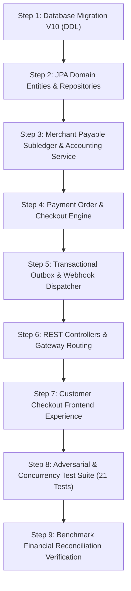

# VYOM — Phase 2.0: Final Architecture Review & Implementation Blueprint

**Document Target:** Comprehensive Architecture Review, Gap Analysis & Phased Implementation Roadmap  
**Target Milestone:** Phase 2.0 Completion & Architecture Gate  
**Auditor:** VYOM Platform Architecture & Security Council  
**Date:** November 19, 2026  
**Status:** **APPROVED & AWAITING USER SIGN-OFF TO BEGIN PHASE 2 IMPLEMENTATION**  

---

## 1. Inventory of Inspected Files & Architecture Audit

The architecture design for Phase 2 was grounded entirely in empirical inspection of the actual VYOM source tree:

### 1.1 Core Financial & Ledger Codebase
- [Wallet.java](file:///d:/VYOM/src/main/java/com/vyom/entity/Wallet.java): Inspected account types (`CUSTOMER`, `SYSTEM_SETTLEMENT`), non-negative balance checks, and currency constraints.
- [Transaction.java](file:///d:/VYOM/src/main/java/com/vyom/entity/Transaction.java): Inspected transaction anchor columns, references, and statuses.
- [LedgerEntry.java](file:///d:/VYOM/src/main/java/com/vyom/entity/LedgerEntry.java): Inspected entry types (`DEBIT`, `CREDIT`), immutable balance-after attribution, and constraints.
- [TransferExecutionService.java](file:///d:/VYOM/src/main/java/com/vyom/service/TransferExecutionService.java): Inspected deterministic lexicographical row locking (`firstLockId`, `secondLockId`) preventing deadlocks.
- [FundingExecutionService.java](file:///d:/VYOM/src/main/java/com/vyom/service/FundingExecutionService.java): Inspected system settlement liquidity injection.
- [RefundExecutionService.java](file:///d:/VYOM/src/main/java/com/vyom/service/RefundExecutionService.java): Inspected child refund transactions and cumulative refund limit enforcement.
- [IdempotencyService.java](file:///d:/VYOM/src/main/java/com/vyom/service/IdempotencyService.java): Inspected user-scoped SHA-256 fingerprinting, lease timeouts, and atomic reclamation.
- [DisputeService.java](file:///d:/VYOM/src/main/java/com/vyom/service/DisputeService.java): Inspected dispute states and `@Version` optimistic locking.

### 1.2 Database Migrations & Triggers
- `V1__initial_schema.sql` through `V8__enforce_complete_transaction_ledger_invariants.sql`:
  - Inspected `fn_verify_transaction_ledger_invariants()`: PostgreSQL deferred constraint trigger enforcing exactly one DEBIT and one CREDIT per transaction ($\sum \text{DEBIT} = \sum \text{CREDIT} = \text{amount}$).
  - Inspected `trg_protect_ledger_entries`: Physical row immutability trigger raising exceptions on updates or deletes.
- `V9__merchant_ecosystem_foundation.sql`: Inspected merchant tables, role checks, and `vyom_app` least-privilege role grants.

### 1.3 Merchant Subsystem & Security
- [Merchant.java](file:///d:/VYOM/src/main/java/com/vyom/entity/Merchant.java), [MerchantMember.java](file:///d:/VYOM/src/main/java/com/vyom/entity/MerchantMember.java), [MerchantAuditLog.java](file:///d:/VYOM/src/main/java/com/vyom/entity/MerchantAuditLog.java): Inspected domain entities.
- [MerchantSecurityService.java](file:///d:/VYOM/src/main/java/com/vyom/service/MerchantSecurityService.java): Inspected anti-enumeration 404 gating (`MEMBERSHIP_NOT_FOUND`), operational suspension checks, and last-owner protection.
- [MerchantRepository.java](file:///d:/VYOM/src/main/java/com/vyom/repository/MerchantRepository.java): Inspected `@Lock(PESSIMISTIC_WRITE) findByIdWithLock` preventing concurrent owner demotion races.

### 1.4 API Gateway & Client Orchestrator
- [gateway/src/app.js](file:///d:/VYOM/gateway/src/app.js): Inspected CSP security headers, reverse-proxy trust policy, and sliding-window rate limiter.
- [gateway/src/routes/api.js](file:///d:/VYOM/gateway/src/routes/api.js): Inspected URL sanitization via `encodeURIComponent()` and header forwarding.
- [gateway/public/js/app.js](file:///d:/VYOM/gateway/public/js/app.js): Inspected context switching between consumer wallet and merchant workspace.

---

## 2. Synthesis of Existing vs Proposed Architecture

| Dimension | Verified Existing Architecture (Phase 0 – 1.1) | Proposed Future Architecture (Phase 2.0 Blueprint) |
| :--- | :--- | :--- |
| **Transaction Model** | Consumer-to-consumer P2P transfers & system top-ups | Commercial pull payments initiated by merchant payment orders |
| **Payment Orders** | Does not exist | Dedicated `payment_orders` entity with TTL expiry and strict metadata bounds |
| **Payment Attempts** | Single transfer execution | Multi-attempt lifecycle (`payment_attempts`) recording failure diagnostics |
| **Accounting Ledger** | Exactly 2 entries per transaction (`DEBIT` + `CREDIT`) | **Preserved:** Linked 2-entry commercial payable model with subledger |
| **Merchant Balance** | Zero merchant wallets | `MERCHANT_PAYABLE` account + synchronized `merchant_payables` subledger |
| **Platform Fees** | Fee column on `transactions`, but always 0.00 | Model A: Gross payment-time collection; net deduction at settlement |
| **Checkout Experience**| Direct P2P transfer modal | Cryptographic checkout session with authoritative backend state derivation |
| **Merchant Notifications**| Synchronous API responses | Asynchronous Transactional Outbox with HMAC-SHA256 signatures & retries |
| **SSRF Defenses** | Not applicable | Strict DNS pre-resolution, private IP CIDR blacklisting, socket pinning |

---

## 3. Core Architectural Decisions Summary

### 3.1 The Accounting Model: Alternative 1
- **Decision:** VYOM adopts the **Linked Two-Entry Commercial Payable Architecture with Merchant Subledger**.
- **Justification:** Avoids breaking PostgreSQL deferred triggers (`fn_verify_transaction_ledger_invariants()`), preserves all 9 checks in `benchmark/reconcile.js`, keeps consumer wallets clean, and strictly prevents merchants from holding fake spendable consumer balances.
- **Posting:**
  $$\text{DEBIT: Customer Wallet } (X) \quad \longleftrightarrow \quad \text{CREDIT: Commercial Payable Account } (X)$$

### 3.2 The Asynchronous Outbox
- **Decision:** Outbox events are persisted inside the **same** database transaction as the financial payment execution.
- **Justification:** Guarantees zero phantom webhooks on transaction rollback, zero lost events on payment commit, and prevents slow merchant listeners from exhausting database connection pools.

### 3.3 Strict Anti-SSRF Socket Pinning
- **Decision:** Pre-resolve domain, validate against forbidden RFC 1918 and cloud metadata (`169.254.169.254`) IP ranges, and pin the resolved IP for socket connection with zero redirects allowed.

---

## 4. Unresolved Risks & Architectural Mitigations

| Identified Risk | Severity | Proposed Architectural Mitigation |
| :--- | :---: | :--- |
| **Merchant Listener Timeout Flooding** | Medium | Asynchronous outbox dispatcher enforces a 3-second HTTP connect/read timeout per attempt; circuit breaker suspends endpoints failing 50 consecutive times. |
| **Customer Concurrent Double-Click** | High | Persistent user-scoped idempotency lease in `idempotency_records` with atomic status transitions. |
| **Outbox Table Bloat** | Low | Implement automated archival/pruning daemon for delivered events older than 30 days. |
| **DNS Rebinding Attacks on Webhook URLs** | High | Socket connection pins the IP verified during pre-resolution; does not re-resolve DNS during HTTP connection. |
| **Subledger Desynchronization** | Critical | `merchant_payables` update executes inside the exact same database transaction and thread as the `ledger_entries` insert. |

---

## 5. Explicit Phase 2 Implementation Sequence

Upon user sign-off and approval of this blueprint, Phase 2 implementation will execute in the following strict order:

1. **Step 1: Database Migration V10:**
   - Author `src/main/resources/db/migration/V10__merchant_commercial_payments_and_webhooks.sql` containing tables, check constraints, foreign keys with `ON DELETE RESTRICT`, indexes, and `vyom_app` grants.
2. **Step 2: Domain Entities & Repositories:**
   - Implement `PaymentOrder`, `PaymentAttempt`, `MerchantPayable`, `MerchantWebhook`, `OutboxEvent`, `WebhookDeliveryAttempt`.
3. **Step 3: Accounting & Subledger Service:**
   - Implement `MerchantPayableService` enforcing atomic payable updates and two-entry `MERCHANT_PAYMENT` ledger entries.
4. **Step 4: Payment Order & Checkout Engine:**
   - Implement `PaymentOrderService` (order creation, expiry, cancellation).
   - Implement `CheckoutService` (session token validation, solvency checks, atomic execution).
5. **Step 5: Transactional Outbox & Webhook Dispatcher:**
   - Implement `OutboxEventService`, `WebhookSigningService` (HMAC-SHA256), `SsrfValidatorService`, and asynchronous scheduled dispatcher daemon.
6. **Step 6: REST Controllers & Gateway Routing:**
   - Implement `MerchantOrderController`, `CheckoutController`, `MerchantWebhookController`.
   - Update `gateway/src/routes/api.js` with sanitized route forwarders.
7. **Step 7: Customer Checkout Frontend Experience:**
   - Build customer-facing checkout page in `gateway/public/` with wallet selector, confirmation, progress lock-in, and receipt modal.
8. **Step 8: Adversarial & Concurrency Test Suite:**
   - Implement and execute all 21 test suites (`TEST-P2-01` to `TEST-P2-21`).
9. **Step 9: Financial Reconciliation Certification:**
   - Execute `node benchmark/reconcile.js` to certify 100% financial integrity across wallets and journals.

---

## 6. Assumptions Requiring Approval

1. **Default Order Expiration Window:** Configured to **15 minutes** (configurable between 5 and 1440 minutes).
2. **Fee Model:** Model A (Gross payment-time collection with net deduction at settlement) is adopted to keep Phase 2 payment execution clean and 100% compliant with the 2-entry invariant.
3. **Webhook Dispatch Concurrency:** In-memory scheduled task polling via PostgreSQL `SELECT ... FOR UPDATE SKIP LOCKED` (zero external message broker dependencies, preserving the modular monolith).

---

## 7. Architecture Sign-Off & Stop Condition

This completes the technical investigation, domain design, accounting decision, and implementation blueprint for **Phase 2.0**.

**STOP CONDITION MET:** Zero production migrations or implementation code were authored in this phase. The repository working tree remains completely preserved.

**Awaiting user review and approval to proceed with Phase 2 implementation.**
