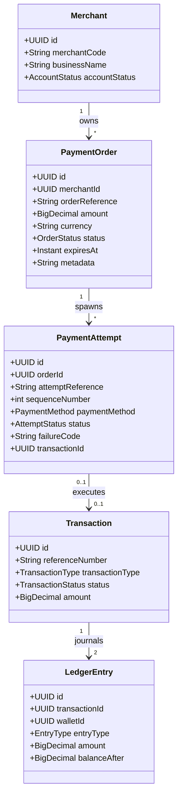
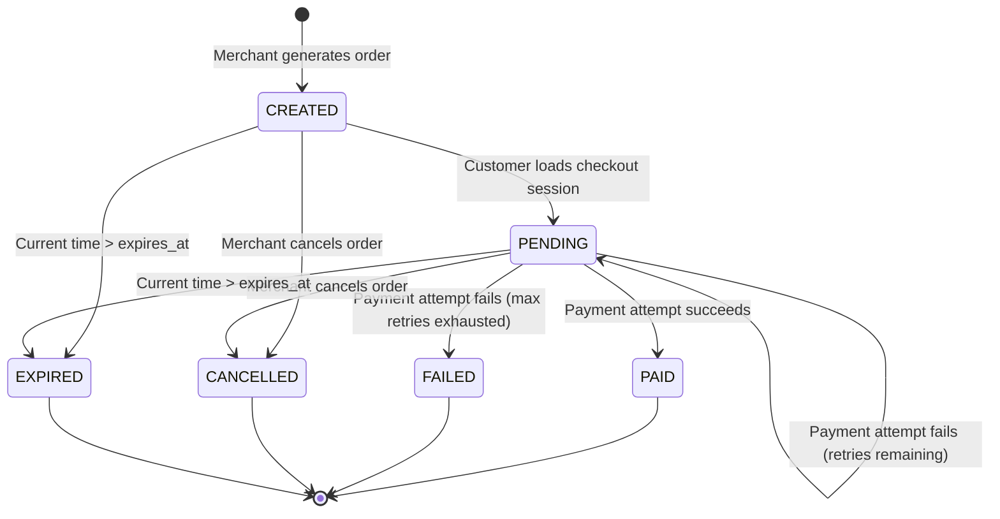

# VYOM — Phase 2.0: Merchant Payment Domain Design & Lifecycle Specification

**Document Target:** Comprehensive Domain Model & Execution Engine for Merchant Commercial Payments  
**Target Milestone:** Phase 2.0 Architectural Blueprint  
**Auditor:** VYOM Platform Architecture & Security Council  
**Date:** November 19, 2026  
**Status:** **APPROVED DOMAIN SPECIFICATION**  

---

## 1. Domain Modeling Overview & Separation of Concerns

A foundational architectural requirement in enterprise payment systems is the absolute separation between:
1. **Commercial Intent (Payment Order):** What the merchant requests the customer to pay (amount, currency, item description, expiry, metadata).
2. **Transaction Attempt (Payment Attempt):** A specific execution effort by a customer to fulfill an order (payment method, sequence, retry, failure diagnostics).
3. **Financial Value Movement (Ledger Transaction):** The immutable double-entry journal movement that debits customer funds and records the merchant payable.

Mixing these three concepts into a single entity is the primary cause of race conditions, phantom debits, duplicate charges, and reconciliation discrepancies.

---

## 2. Component A: Merchant Payment Orders

### 2.1 Entity Definition & Attributes
A `PaymentOrder` represents a merchant's demand for commercial payment.

| Field Name | Type | Constraints / Bounds | Purpose |
| :--- | :--- | :--- | :--- |
| `id` | `UUID` | Primary Key, `gen_random_uuid()` | Canonical system identifier |
| `merchant_id` | `UUID` | Foreign Key `merchants(id) ON DELETE RESTRICT` | Owning merchant entity |
| `order_reference` | `VARCHAR(32)` | Unique, Non-nullable | Merchant-facing external order number |
| `merchant_order_id` | `VARCHAR(64)` | Non-nullable, Unique per merchant `(merchant_id, merchant_order_id)` | Merchant's internal POS/E-commerce invoice ID |
| `customer_reference` | `VARCHAR(100)`| Nullable | Merchant's identifier for customer (email/ID) |
| `amount` | `NUMERIC(19,4)`| `amount > 0.0000`, max `10,000,000.0000` | Commercial gross amount |
| `currency` | `VARCHAR(3)` | Format `^[A-Z]{3}$` (Default: `INR`) | ISO currency code |
| `description` | `VARCHAR(255)`| Max 255 chars, sanitized | Order summary displayed on checkout |
| `status` | `VARCHAR(20)` | `CHECK status IN ('CREATED', 'PENDING', 'PAID', 'FAILED', 'CANCELLED', 'EXPIRED')` | Lifecycle state |
| `expires_at` | `TIMESTAMPTZ` | Non-nullable, default `now() + 15 minutes` | Strict expiration timestamp (TTL) |
| `metadata` | `JSONB` | Max 4096 bytes (4KB), strict sanitization | Arbitrary custom metadata |
| `created_by` | `UUID` | Foreign Key `users(id) ON DELETE RESTRICT` | Merchant team member who generated order |
| `created_at` | `TIMESTAMPTZ` | Non-nullable, `clock_timestamp()` | Creation timestamp |
| `updated_at` | `TIMESTAMPTZ` | Non-nullable, `clock_timestamp()` | Last mutation timestamp |
| `version` | `BIGINT` | Non-nullable, default 0 | Optimistic concurrency locking token |

### 2.2 Order Lifecycle State Machine

### 2.3 State Transition Rules & Concurrency Fencing
1. **Terminal State Immutability:** Once an order reaches `PAID`, `CANCELLED`, `FAILED`, or `EXPIRED`, it transitions to an immutable terminal state. No subsequent checkout session, payment attempt, or cancellation can be processed against it.
2. **Cancellation Gating:** An order cannot be cancelled if an active payment attempt is in `PROCESSING` state or if the order is already `PAID`.
3. **Expiration Fencing:** Even if a customer has loaded the checkout page, if `Instant.now() > order.expires_at`, any payment submission is rejected immediately with `ORDER_EXPIRED` (`409 Conflict`).
4. **Metadata Safeguards:** Metadata JSON is parsed and validated for:
   - Max byte length: 4096 bytes.
   - Prohibited key names (preventing injection of fake authorization claims): `role`, `status`, `balance`, `token`, `auth`.
   - Stripping of script tags and raw HTML.

---

## 3. Component B: Payment Attempts

An order may experience multiple payment attempts before reaching fulfillment or abandonment (e.g. customer's first wallet has insufficient balance, customer retries with another wallet).

### 3.1 Entity Definition & Attributes
A `PaymentAttempt` records the telemetry and state of a single execution effort.

| Field Name | Type | Constraints / Bounds | Purpose |
| :--- | :--- | :--- | :--- |
| `id` | `UUID` | Primary Key, `gen_random_uuid()` | Attempt identifier |
| `order_id` | `UUID` | Foreign Key `payment_orders(id) ON DELETE RESTRICT` | Associated payment order |
| `attempt_reference` | `VARCHAR(32)`| Unique, Non-nullable | Reference format `ATT-YYYYMMDD-XXXXXX` |
| `sequence_number` | `INT` | Non-nullable, $\ge 1$ | 1 for 1st attempt, 2 for 2nd, etc. |
| `customer_user_id`| `UUID` | Foreign Key `users(id) ON DELETE RESTRICT` | Customer executing payment |
| `payer_wallet_id` | `UUID` | Foreign Key `wallets(id) ON DELETE RESTRICT` | Source customer wallet |
| `payment_method` | `VARCHAR(30)` | `CHECK IN ('CUSTOMER_WALLET', 'SIMULATED_UPI', 'SIMULATED_NETBANKING')` | Simulated payment rail |
| `status` | `VARCHAR(20)` | `CHECK IN ('INITIATED', 'PROCESSING', 'SUCCESS', 'FAILED', 'ABANDONED')` | Attempt lifecycle status |
| `failure_code` | `VARCHAR(50)`| Nullable | Reason code (`INSUFFICIENT_FUNDS`, etc.) |
| `failure_reason` | `VARCHAR(255)`| Nullable | Human-readable diagnostic message |
| `transaction_id` | `UUID` | Foreign Key `transactions(id) ON DELETE RESTRICT` | Linked financial transaction (SUCCESS only) |
| `created_at` | `TIMESTAMPTZ` | Non-nullable, `clock_timestamp()` | Attempt creation timestamp |
| `completed_at` | `TIMESTAMPTZ` | Nullable | Attempt finalization timestamp |

### 3.2 Failure Reason Taxonomy
To ensure non-repudiation and telemetry accuracy, attempts record standardized failure codes:
- `INSUFFICIENT_FUNDS`: Customer source wallet has balance $<$ order amount.
- `WALLET_LOCKED`: Customer wallet locked by concurrent transfer.
- `ORDER_EXPIRED`: Order expiry window elapsed before execution.
- `ORDER_ALREADY_PAID`: Another attempt completed simultaneously.
- `MERCHANT_SUSPENDED`: Merchant account suspended prior to checkout completion.
- `IDEMPOTENCY_COLLISION`: Replay of identical attempt payload.

### 3.3 Strict Invariant: Attempt $\ne$ Ledger Transaction
- A `PaymentAttempt` with `status = FAILED` or `status = ABANDONED` **NEVER** creates a row in `transactions` and **NEVER** writes rows to `ledger_entries`.
- Zero wallet balances are altered on a failed attempt.
- Only when an attempt transitions to `SUCCESS` does it bind to a newly created, atomically executed `Transaction`.

---

## 4. Component C: Merchant Payment Execution Flow

The execution workflow is an atomic multi-step pipeline governed by rigorous database transaction boundaries.

```mermaid
sequenceDiagram
    autonumber
    actor Customer
    participant Gateway as API Gateway
    participant CheckoutService as Checkout / Payment Service
    participant IdempotencyService as Idempotency Service
    participant WalletRepo as Wallet Repository (Pessimistic Lock)
    participant LedgerRepo as Ledger & Transaction Engine
    participant OutboxService as Transactional Outbox
    participant DB as PostgreSQL 18.4

    Customer->>Gateway: POST /api/v1/checkout/orders/{id}/pay (JWT, Idemp-Key)
    Gateway->>CheckoutService: Forward pay request
    CheckoutService->>IdempotencyService: Reserve Key (PROCESSING, REQUIRES_NEW)
    IdempotencyService-->>CheckoutService: Lease acquired (ownerToken)
    
    rect rgb(20, 30, 45)
    Note over CheckoutService,DB: ATOMIC FINANCIAL TRANSACTION (@Transactional)
    CheckoutService->>DB: SELECT * FROM payment_orders WHERE id = ? FOR UPDATE
    Note over CheckoutService: Validate Order: status IN (CREATED, PENDING) & now() < expires_at
    CheckoutService->>DB: INSERT INTO payment_attempts (status='PROCESSING')
    CheckoutService->>WalletRepo: SELECT * FROM wallets WHERE id = payer_wallet_id FOR UPDATE
    Note over CheckoutService: Validate Solvency: balance >= order.amount
    CheckoutService->>WalletRepo: UPDATE wallets (deduct balance)
    CheckoutService->>DB: UPDATE merchant_payables (credit payable balance)
    CheckoutService->>LedgerRepo: INSERT INTO transactions (status='SUCCESS', type='MERCHANT_PAYMENT')
    CheckoutService->>LedgerRepo: INSERT INTO ledger_entries (1 DEBIT customer, 1 CREDIT payable)
    CheckoutService->>DB: UPDATE payment_orders SET status='PAID'
    CheckoutService->>DB: UPDATE payment_attempts SET status='SUCCESS', transaction_id=?
    CheckoutService->>OutboxService: INSERT INTO outbox_events (event='order.paid')
    CheckoutService->>IdempotencyService: Complete Key (COMPLETED, transactionId)
    CheckoutService->>DB: COMMIT (Triggers fn_verify_transaction_ledger_invariants)
    end

    CheckoutService-->>Gateway: 200 OK (Payment Receipt)
    Gateway-->>Customer: Render Success Screen & Receipt
```

### 4.1 Detailed 10-Step Execution Pipeline

1. **Step 1: Customer Checkout Request:**
   Customer authenticates with JWT and submits checkout confirmation with an `Idempotency-Key` header and target customer wallet UUID.
2. **Step 2: Idempotency Reservation:**
   `IdempotencyService.reserveKey` persists a lease record in `idempotency_records` (`status = 'PROCESSING'`) in a standalone `REQUIRES_NEW` transaction, guarding against concurrent duplicate requests.
3. **Step 3: Pessimistic Locking of Payment Order:**
   The service initiates the financial transaction and executes `SELECT * FROM payment_orders WHERE id = :id FOR UPDATE`.
   - Validates `status == CREATED || status == PENDING`. If `PAID`, fails immediately with `ORDER_ALREADY_PAID`.
   - Validates `Instant.now() < expires_at`. If expired, marks order `EXPIRED` and fails with `ORDER_EXPIRED`.
4. **Step 4: Merchant Operational Gating:**
   Validates owning merchant's `account_status == ACTIVE`. If `SUSPENDED`, throws `MerchantAccountSuspendedException`.
5. **Step 5: Attempt Creation & Customer Wallet Locking:**
   - Creates `PaymentAttempt` with `status = 'PROCESSING'`.
   - Acquires exclusive write lock on customer wallet: `SELECT * FROM wallets WHERE id = :walletId FOR UPDATE`.
6. **Step 6: Solvency Verification:**
   Verifies `customerWallet.balance >= order.amount`. If insolvent:
   - Updates attempt `status = 'FAILED'`, `failure_code = 'INSUFFICIENT_FUNDS'`.
   - Commits attempt record for customer diagnostic feedback.
   - Throws `InsufficientFundsException` (Zero financial entries created).
7. **Step 7: Atomic Financial Execution & Ledger Invariant Enforcement:**
   - Deducts `order.amount` from customer wallet balance.
   - Persists canonical `Transaction` with `transaction_type = 'MERCHANT_PAYMENT'`, `status = 'SUCCESS'`.
   - Writes exactly two balanced `ledger_entries`:
     1. `DEBIT`: Customer wallet (amount = `order.amount`, balance_after = `newCustomerBalance`).
     2. `CREDIT`: Commercial payable account (amount = `order.amount`, balance_after = `newPayableBalance`).
8. **Step 8: Order & Attempt Finalization:**
   - Updates `payment_orders`: `status = 'PAID'`, `updated_at = now()`.
   - Updates `payment_attempts`: `status = 'SUCCESS'`, `completed_at = now()`, `transaction_id = txn.id`.
9. **Step 9: Transactional Outbox Scheduling:**
   Within the **same** database transaction, inserts a record into `outbox_events` with payload `order.paid` and destination merchant webhook endpoint.
10. **Step 10: Idempotency Completion & Receipt Return:**
    Marks idempotency record `COMPLETED`, returns authoritative `PaymentReceiptResponse` to gateway.

---

## 5. Concurrency & Adversarial Defenses

| Threat / Risk | Attack Vector | Enforced Architectural Defense |
| :--- | :--- | :--- |
| **Double Charging** | Customer clicks "Pay" twice rapidly in browser | First request acquires `idempotency_records` lease. Second request receives `409 Conflict: Request actively processing`. |
| **Split-Second Attempt Race** | Two browser tabs pay the same order simultaneously | Order row is locked with `SELECT ... FOR UPDATE`. First attempt succeeds and marks order `PAID`. Second attempt unblocks, reads `PAID`, aborts with `409 Conflict`. |
| **Expired Order Payment** | Customer leaves tab open for 20 minutes, then clicks pay | Server checks `Instant.now() > order.expiresAt` under order lock. Aborts before touching customer wallet. |
| **Cross-Merchant Hijacking** | Malicious merchant submits order ID belonging to another merchant | Backend verifies `order.merchantId == authenticatedMerchantId` or verifies customer checkout session token bound to exact order. |
| **Customer Overdraft** | Multiple payments drain wallet below zero | Wallet locked with `SELECT ... FOR UPDATE`; PostgreSQL database constraint `chk_wallets_balance_non_negative` physically rejects negative balances. |
| **Partial Execution Desync** | Database crashes after wallet deduct but before order update | All operations execute within `@Transactional(isolation = Isolation.READ_COMMITTED)`. Entire transaction rolls back atomically. |

---

## 6. Domain Design Conclusion

The proposed Merchant Payment Domain introduces clean separation between commercial orders, execution attempts, and immutable ledger entries. Every state transition is rigorously fenced against concurrency races, double charging, and order expiration.

**Status: READY FOR ACCOUNTING MODEL INTEGRATION.**
