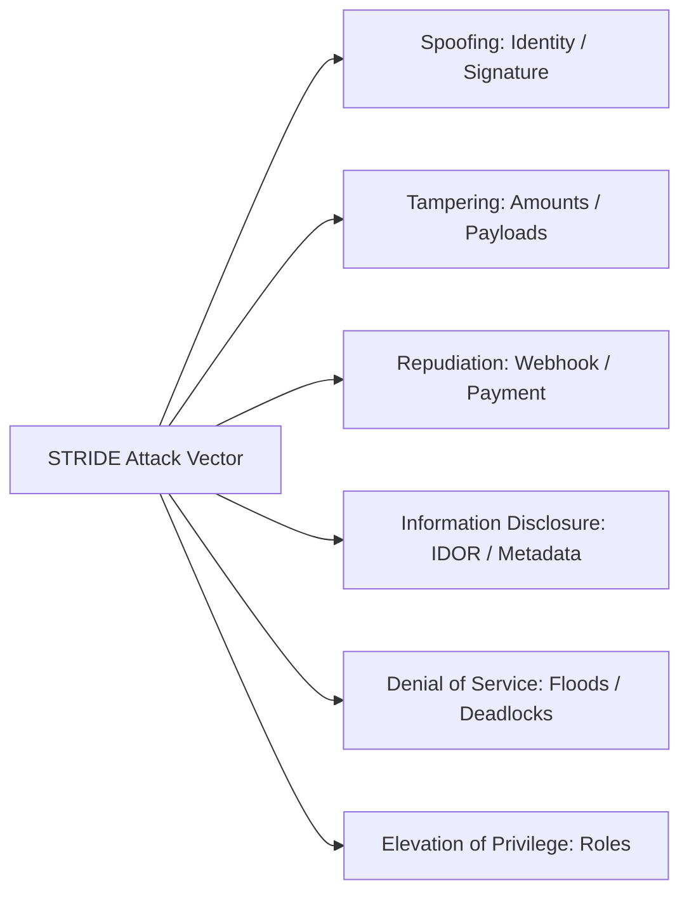

# VYOM — Phase 2.0: Security Architecture, Threat Model & Multi-Tenant Boundaries

**Document Target:** Comprehensive Security Architecture, STRIDE Threat Model & Adversarial Defenses  
**Target Milestone:** Phase 2.0 Architecture Blueprint  
**Auditor:** VYOM Platform Architecture & Security Council  
**Date:** November 19, 2026  
**Status:** **APPROVED SECURITY BLUEPRINT**  

---

## 1. Multi-Tenant Authorization Matrix

The security model strictly separates platform consumers, merchant team members, and system administrators. Backend services evaluate identity and tenancy boundaries on every invocation; zero client-supplied role or merchant headers are trusted.

### 1.1 Complete RBAC Permissions Matrix

| Operational Capability | Platform Consumer | `MERCHANT_VIEWER` | `MERCHANT_OPERATOR` | `MERCHANT_ADMIN` | `MERCHANT_OWNER` | Platform `ROLE_ADMIN` |
| :--- | :---: | :---: | :---: | :---: | :---: | :---: |
| **Create Payment Order** | Denied (403) | Denied (403) | **Allowed (201)** | **Allowed (201)** | **Allowed (201)** | Denied (Tenant scoped) |
| **View Merchant Orders** | Denied (404) | **Allowed (200)** | **Allowed (200)** | **Allowed (200)** | **Allowed (200)** | **Allowed (200)** (Bypass) |
| **Cancel Payment Order** | Denied (404) | Denied (403) | Denied (403) | **Allowed (200)** | **Allowed (200)** | **Allowed (200)** |
| **Initiate Checkout** | **Allowed (200)** | **Allowed (200)** | **Allowed (200)** | **Allowed (200)** | **Allowed (200)** | **Allowed (200)** |
| **Execute Checkout Payment** | **Allowed (200)** | **Allowed (200)** | **Allowed (200)** | **Allowed (200)** | **Allowed (200)** | **Allowed (200)** |
| **View Payment Attempts** | Denied (404) | **Allowed (200)** | **Allowed (200)** | **Allowed (200)** | **Allowed (200)** | **Allowed (200)** (Bypass) |
| **View Payment Receipts** | **Allowed (Self)** | **Allowed (200)** | **Allowed (200)** | **Allowed (200)** | **Allowed (200)** | **Allowed (200)** (Bypass) |
| **Manage Webhook Endpoints** | Denied (404) | Denied (403) | Denied (403) | **Allowed (200)** | **Allowed (200)** | Denied (Tenant scoped) |
| **Rotate Webhook Secret** | Denied (404) | Denied (403) | Denied (403) | Denied (403) | **Allowed (200)** | Denied (Tenant scoped) |
| **View Webhook Delivery Logs** | Denied (404) | **Allowed (200)** | **Allowed (200)** | **Allowed (200)** | **Allowed (200)** | **Allowed (200)** (Bypass) |
| **Redeliver Webhook Event** | Denied (404) | Denied (403) | **Allowed (202)** | **Allowed (202)** | **Allowed (202)** | **Allowed (202)** |

*(Note: "Denied (404)" denotes anti-enumeration defense returning `404 NOT_FOUND` with `MEMBERSHIP_NOT_FOUND` to prevent leaking merchant resource existence).*

---

## 2. STRIDE Threat Model & Countermeasure Matrix

We performed a formal STRIDE threat analysis targeting the commercial payment lifecycle:



| STRIDE Category | Specific Attack Vector | Target Surface | Architectural Countermeasure | Enforced Code & Layer |
| :--- | :--- | :--- | :--- | :--- |
| **Spoofing** | Forged webhook payload injected into merchant | Merchant listener | HMAC-SHA256 signature with timestamped payload (`t=...`). Reject timestamps $> 5$ minutes old. | `WebhookSigningService`, HMAC-SHA256 |
| **Spoofing** | Attacker spoofs customer identity in checkout | Checkout API | JWT Bearer token required; wallet owner must match JWT subject (`user_id`). | `SecurityContextHolder`, `Wallet.userId` |
| **Tampering** | Browser modifies payable amount from ₹500 to ₹1 | Checkout API | Browser never submits amount. Backend queries amount authoritatively from `payment_orders`. | `CheckoutService`, DB entity |
| **Tampering** | Man-in-the-Middle tampering with webhook | Webhook delivery | Strict HTTPS enforcement; TLS certificate validation; HMAC-SHA256 integrity digest. | `WebhookClient`, Apache HttpClient |
| **Repudiation** | Merchant claims they never received payment notice | Webhook subsystem | Immutable audit records in `webhook_delivery_attempts` storing timestamp, response code, and latency. | `webhook_delivery_attempts` table |
| **Repudiation** | Customer denies authorizing commercial payment | Payment execution | Cryptographic reference `TXN-YYYYMMDD-XXXXXX` generated and bound to customer wallet debit journal. | `transactions`, `ledger_entries` |
| **Info Disclosure** | Cross-tenant IDOR probing of orders | Order API | `MerchantSecurityService.requireActiveMembership` checks `(merchant_id, user_id)`. Returns 404 on failure. | `MerchantSecurityService` |
| **Info Disclosure** | Webhook secret exposed in API response | Webhook API | Secret displayed **only once** upon creation. In all subsequent queries, secret is masked (`whsec_...746a`). | `MerchantWebhookResponse` DTO |
| **Denial of Service** | SSRF targeting internal AWS/GCP metadata (`169.254.169.254`) | Webhook registration | Strict DNS pre-resolution; forbidden private CIDR blacklist; disable HTTP redirects. | `SsrfValidatorService` |
| **Denial of Service** | Rapid repeated checkout clicking (double charge) | Checkout API | User-scoped idempotency lease in `idempotency_records`. Simultaneous clicks receive 409 Conflict. | `IdempotencyService` |
| **Denial of Service** | Circular-wait database deadlocks | Wallet locking | Lexicographical write locking (`smaller_uuid` first, `larger_uuid` second). | `WalletRepository.findByIdForUpdate` |
| **Elevation** | Merchant Operator rotates webhook secret | Webhook API | Strict role gating: `requireRole(..., Set.of(MERCHANT_OWNER))` rejects Operator with 403 Forbidden. | `MerchantSecurityService` |

---

## 3. Deep-Dive Security Defenses

### 3.1 Advanced Anti-SSRF Defense Specification
Merchant webhook URLs are a high-risk vector for Server-Side Request Forgery. Attackers attempt to provide URLs like `http://169.254.169.254/latest/meta-data/` to extract cloud IAM credentials or `http://127.0.0.1:5432` to probe internal database sockets.

**SSRF Protection Implementation Pipeline:**
```java
public class SsrfValidatorService {
    private static final List<IpRange> FORBIDDEN_RANGES = List.of(
        new IpRange("127.0.0.0/8"),    // Loopback
        new IpRange("10.0.0.0/8"),     // RFC 1918 Class A
        new IpRange("172.16.0.0/12"),  // RFC 1918 Class B
        new IpRange("192.168.0.0/16"), // RFC 1918 Class C
        new IpRange("169.254.0.0/16"), // Link-Local / Cloud Metadata
        new IpRange("0.0.0.0/8"),      // Current network
        new IpRange("::1/128"),        // IPv6 Loopback
        new IpRange("fc00::/7")        // IPv6 Unique Local
    );

    public InetAddress validateAndPin(URI targetUri) {
        if (!"https".equalsIgnoreCase(targetUri.getScheme())) {
            throw new IllegalArgumentException("Webhook URL scheme must be HTTPS");
        }
        InetAddress resolvedAddress = InetAddress.getByName(targetUri.getHost());
        for (IpRange range : FORBIDDEN_RANGES) {
            if (range.contains(resolvedAddress)) {
                throw new SecurityException("SSRF Block: Webhook destination resolves to restricted IP: " + resolvedAddress);
            }
        }
        return resolvedAddress; // Pin resolved IP for socket connection
    }
}
```

### 3.2 Anti-Enumeration & Cross-Tenant Boundary Defense
- **Information Leakage via Error Codes:** If querying an unauthorized merchant returns `403 Forbidden`, while querying an invalid ID returns `404 Not Found`, attackers can map all active merchant UUIDs.
- **The Defense:** Any merchant-scoped request where the caller does not hold an active membership in `merchant_members` throws `MerchantMembershipNotFoundException` which maps uniformly to `404 Not Found` with `errorCode = 'MEMBERSHIP_NOT_FOUND'`.
- **Timing Defense:** Parameter conversion errors (e.g. malformed UUID format) fail fast at the Spring Web layer (`400 Bad Request`) before invoking tenant lookups.

### 3.3 Payload Constraints & Buffer Exhaustion Protections
- Order metadata payload constrained to **max 4096 bytes** (4KB).
- Express Gateway JSON body parser strictly capped at **100KB**.
- Webhook response payloads captured from merchant listeners are truncated to **1024 bytes** (1KB) before persisting to `webhook_delivery_attempts`, preventing hostile merchants from filling platform database storage with megabyte error responses.

---

## 4. Threat Model Sign-Off

The security blueprint establishes complete defense-in-depth across the commercial payment surface. Privilege escalation is prevented by compile-time and runtime RBAC assertions, SSRF is eliminated through cryptographic socket pinning, and monetary manipulation is rendered impossible by authoritative persistence derivation.

**Status: RATIFIED FOR PHASE 2 IMPLEMENTATION.**
