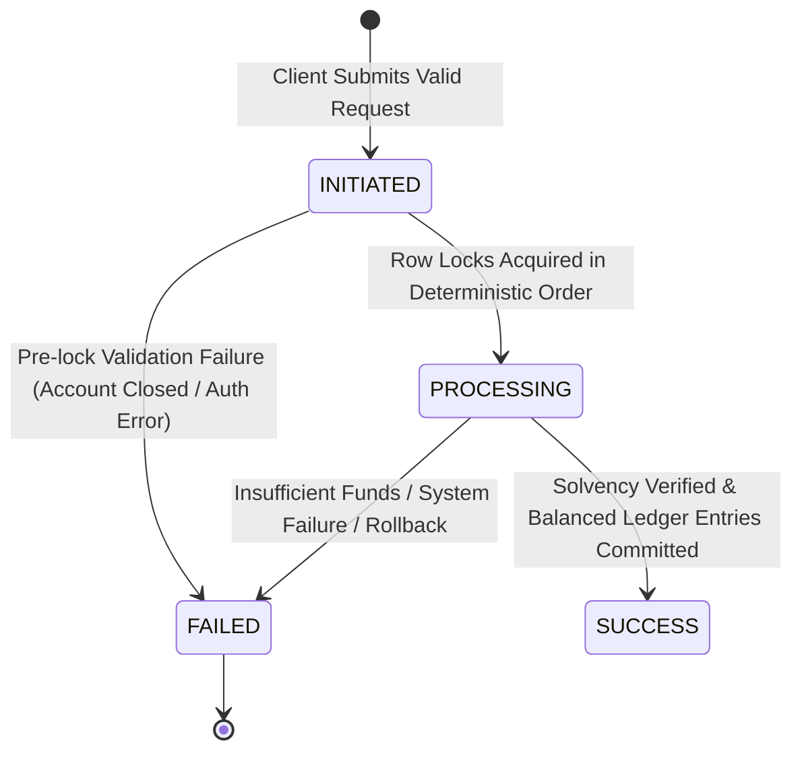
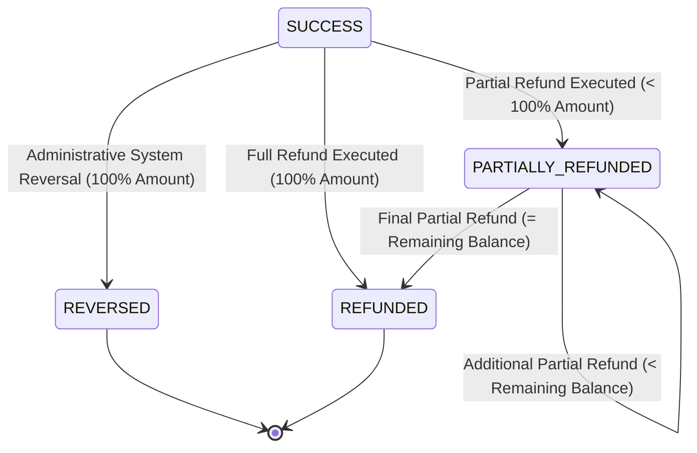

# VYOM — Phase 2.0: Transaction State Machine & Lifecycle Specification

**Document Version:** 1.0.0  
**Status:** DRAFT / PENDING APPROVAL  
**Scope:** Formal definition of transaction states, transition invariants, terminal rules, compensation flows, and the explicit distinction between transaction business state and idempotency request state.

---

## 1. Candidate State Evaluation & Selection

We evaluate each candidate state against the requirements of VYOM's financial platform model:

| Candidate State | Included? | Evaluation & Justification |
| :--- | :---: | :--- |
| **`INITIATED`** | **YES** | **Required:** Represents the initial durable creation of a transaction intent before locking accounts or evaluating balance solvency. Provides traceability if a network partition or system crash occurs during lock acquisition. |
| **`PROCESSING`** | **YES** | **Required:** Represents active row-level locking and ledger generation. Distinguishes a transaction that is currently executing inside an active database transaction from one that is merely initiated. |
| **`SUCCESS`** | **YES** | **Required:** Definitive terminal execution state. Signifies that wallet balances have mutated, balanced double-entry ledger entries are persisted, and the database transaction has committed. |
| **`FAILED`** | **YES** | **Required:** Definitive terminal execution state for unsuccessful transactions (insufficient funds, currency mismatch, closed account, validation failure). Guaranteed: No ledger entries created, no balances mutated. |
| **`PENDING`** | **NO** | **Excluded from Core Simulated Model:** VYOM operates as an internal ledger engine with immediate synchronous database transactions (`READ_COMMITTED` with pessimistic row locking). External asynchronous banking rails (e.g. NEFT/RTGS batch processing, UPI external gateway webhooks) are not present. Introducing `PENDING` into the synchronous simulated core would introduce unnecessary state ambiguity. (If external asynchronous payment gateways are added in future phases, `PENDING` will be introduced specifically for asynchronous gateway webhooks). |
| **`REVERSED`** | **YES** | **Required:** Terminal business lifecycle state. Applies to a previously `SUCCESS` transaction whose full monetary value was cancelled and returned via compensating double-entry ledger entries due to a system correction or administrative void. |
| **`PARTIALLY_REFUNDED`** | **YES** | **Required:** Non-terminal business lifecycle state. Indicates that a `SUCCESS` transaction has had one or more valid partial refund transactions executed against it, but the cumulative refunded amount is strictly less than the original transaction amount. The transaction remains open for further partial refunds up to the original amount. |
| **`REFUNDED`** | **YES** | **Required:** Terminal business lifecycle state. Indicates that a `SUCCESS` transaction has had 100% of its original financial value returned via compensating refund transactions. No further refunds can be initiated against it. |

---

## 2. Core Separation: Transaction Lifecycle vs Idempotency Lifecycle

A common architectural flaw in financial systems is conflating the **idempotency request lifecycle** with the **transaction business lifecycle**. They operate on different abstractions, have different scopes, and have different lifecycles:

```mermaid
flowchart LR
    subgraph Client Request Layer [Idempotency Lifecycle (Request Deduplication)]
        R_PROC[PROCESSING<br>Lease Owned] -->|Success| R_COMP[COMPLETED<br>Cached Response]
        R_PROC -->|Failure| R_FAIL[FAILED<br>Permanent Reject]
        R_PROC -->|Timeout >120s| R_STALE[STALE LEASE<br>Reclaimable]
        R_STALE -->|Reclaimed| R_PROC
    end

    subgraph Core Financial Engine [Transaction Business Lifecycle]
        T_INIT[INITIATED] --> T_PROC[PROCESSING]
        T_PROC -->|Commit| T_SUCC[SUCCESS]
        T_PROC -->|Abort/Error| T_FAIL[FAILED]
        T_SUCC -->|Compensating Full Reversal| T_REV[REVERSED]
        T_SUCC -->|Compensating Partial Refund| T_PART[PARTIALLY_REFUNDED]
        T_PART -->|Additional Partial Refund| T_PART
        T_PART -->|Final Compensating Refund| T_REF[REFUNDED]
        T_SUCC -->|Compensating Full Refund| T_REF
    end

    Client Request Layer -.->|Controls Execution Of| Core Financial Engine
```

### Key Differences:
1. **Scope:** Idempotency is scoped to `(user_id, idempotency_key)` and protects an *incoming HTTP invocation*. The transaction lifecycle belongs to the durable *financial asset / journal transaction*.
2. **Cardinality:** A single original transaction may experience multiple distinct HTTP requests over time (e.g., initial transfer with key $K_1$, first partial refund with key $K_2$, second partial refund with key $K_3$). Each has its own distinct idempotency record.
3. **Immutability:** An idempotency record in `COMPLETED` never transitions again; it simply replays the cached payload. The underlying transaction can subsequently transition from `SUCCESS` to `PARTIALLY_REFUNDED` and `REFUNDED`.

---

## 3. Formal State Definitions & Invariants

### 3.1 State Attribute Matrix

| State Name | State Classification | Ledger Created? | Balance Mutated? | Is Terminal? | Client Retry Permitted? |
| :--- | :--- | :---: | :---: | :---: | :--- |
| **`INITIATED`** | In-flight / Transient | **NO** | **NO** | No | Yes (via existing idempotency key) |
| **`PROCESSING`** | In-flight / Locks Held | **NO** | **NO** | No | No (returns 409 Conflict if in-flight) |
| **`SUCCESS`** | Execution Terminal | **YES (Balanced)** | **YES** | No* | Yes (returns cached success response) |
| **`FAILED`** | Execution Terminal | **NO** | **NO** | **YES** | No (must use new idempotency key) |
| **`PARTIALLY_REFUNDED`** | Business Lifecycle | **YES (via Child)** | **YES (via Child)** | No | N/A (state of original transaction) |
| **`REFUNDED`** | Business Terminal | **YES (via Child)** | **YES (via Child)** | **YES** | N/A (state of original transaction) |
| **`REVERSED`** | Business Terminal | **YES (via Child)** | **YES (via Child)** | **YES** | N/A (state of original transaction) |

*\*Note: `SUCCESS` is terminal with respect to the initial payment execution, but acts as the starting point for post-settlement business workflows (refunds/reversals).*

---

## 4. State Transition Table

| Current State | Event / Trigger | Next State | Guard Conditions / Rules | Side Effects |
| :--- | :--- | :--- | :--- | :--- |
| *None* | `SUBMIT_TRANSACTION` | `INITIATED` | Valid request payload, authenticated user, idempotency key reserved. | Generates stable transaction reference (`reference_number`). |
| `INITIATED` | `ACQUIRE_LOCKS` | `PROCESSING` | Source and destination wallet locks successfully acquired in deterministic order. | Updates status to `PROCESSING`. |
| `PROCESSING` | `EXECUTE_AND_COMMIT` | `SUCCESS` | Balance solvency verified, double-entry ledger created, database transaction commits. | Materialized balances updated, balanced ledger entries written, idempotency marked `COMPLETED`. |
| `INITIATED` | `VALIDATION_FAILURE` | `FAILED` | Wallet not found, ownership violation, currency mismatch, or malformed input. | Database transaction rolled back; failure reason recorded in audit log. |
| `PROCESSING` | `EXECUTION_FAILURE` | `FAILED` | Insufficient funds, database deadlock, or constraint violation. | Database transaction rolled back; zero balances altered; idempotency marked `FAILED`. |
| `SUCCESS` | `EXECUTE_PARTIAL_REFUND` | `PARTIALLY_REFUNDED` | Refund amount $>0$ and cumulative refunds $<$ original transaction amount. Solvency of refund source verified. | Creates compensating child `REFUND` transaction and balanced ledger entries. |
| `PARTIALLY_REFUNDED` | `EXECUTE_ADDITIONAL_PARTIAL_REFUND` | `PARTIALLY_REFUNDED` | Cumulative refunds $+$ new amount $<$ original transaction amount. | Creates compensating child `REFUND` transaction and balanced ledger entries. |
| `PARTIALLY_REFUNDED` | `EXECUTE_FINAL_REFUND` | `REFUNDED` | Cumulative refunds $+$ new amount $=$ original transaction amount. | Creates compensating child `REFUND` transaction; transitions parent to `REFUNDED`. |
| `SUCCESS` | `EXECUTE_FULL_REFUND` | `REFUNDED` | Refund amount $=$ original transaction amount. Recipient has sufficient balance. | Creates compensating child `REFUND` transaction; transitions parent to `REFUNDED`. |
| `SUCCESS` | `EXECUTE_REVERSAL` | `REVERSED` | System correction authorized; transaction has no prior refunds (`cumulative_refunded = 0`). | Creates compensating child `REVERSAL` transaction; transitions parent to `REVERSED`. |

---

## 5. State Transition Diagrams

### 5.1 Primary Transaction Execution Lifecycle


### 5.2 Post-Settlement Business Lifecycle (Refunds & Reversals)


---

## 6. Critical Lifecycle Invariants

1. **The Zero Balance Leaking Invariant:**  
   Under no circumstance shall a transaction in state `FAILED`, `INITIATED`, or `PROCESSING` cause a net modification to any customer or system account balance.
2. **The Balanced Ledger Invariant:**  
   Every transaction transitioning to `SUCCESS`, `PARTIALLY_REFUNDED`, `REFUNDED`, or `REVERSED` MUST have an exact, balanced journal:
   $$\sum \text{DEBIT} - \sum \text{CREDIT} = 0.0000$$
3. **The Non-Over-Refund Invariant:**  
   For any transaction $T$ with original amount $A$:
   $$\sum_{i=1}^{k} \text{refund\_amount}_i \le A$$
   Any attempt to execute a refund where $\sum \text{refund\_amount} > A$ must be rejected with HTTP 422 `OVER_REFUND_EXCEEDED` before any balance lock is held.
4. **Reversal Mutual Exclusivity:**  
   A transaction that has experienced any partial or full refund CANNOT be reversed. A transaction that has been reversed CANNOT experience refunds.
5. **Atomic State Transition Rule:**  
   The state change of a parent transaction (e.g. `SUCCESS` $\to$ `PARTIALLY_REFUNDED` $\to$ `REFUNDED`) and the persistence of the compensating child transaction and ledger entries MUST execute in a single, atomic database transaction. If any step fails, the entire transition rolls back.
