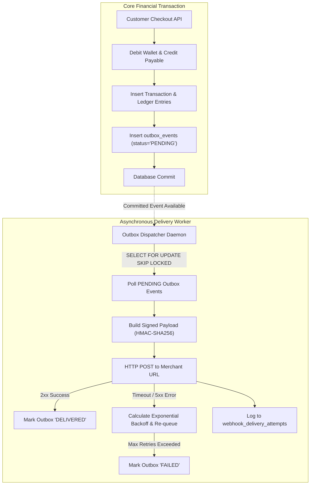
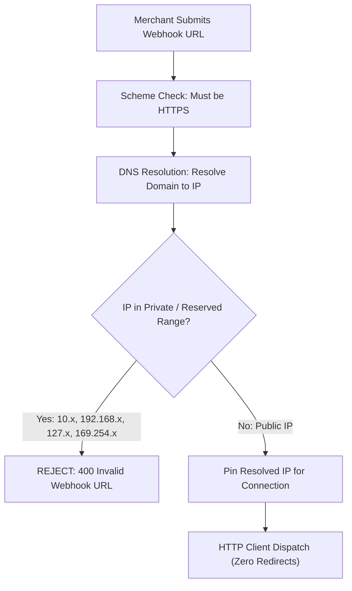

# VYOM — Phase 2.0: Asynchronous Webhook & Transactional Outbox Architecture

**Document Target:** Enterprise Webhook Notification Subsystem & Outbox Pattern Specification  
**Target Milestone:** Phase 2.0 Architecture Blueprint  
**Auditor:** VYOM Platform Architecture & Security Council  
**Date:** November 19, 2026  
**Status:** **APPROVED SUBSYSTEM ARCHITECTURE**  

---

## 1. System Objectives & High-Level Architecture

In commercial payment processing, merchants require immediate, automated notification when a customer completes checkout. However, external HTTP network calls must **never** be executed synchronously within the critical path of the financial transaction.

### 1.1 Non-Negotiable Reliability Guarantees
1. **Decoupled Financial Processing:** A committed financial transaction must never fail, roll back, or delay because a merchant's HTTP server is down, slow, or returning errors.
2. **Transactional Outbox Guarantee:** Payment execution and webhook event staging are atomic. If the database transaction commits, the event is guaranteed to be persisted. If the transaction rolls back, zero phantom webhooks are scheduled.
3. **At-Least-Once Delivery Semantics:** Network partitions and timeouts mean exactly-once delivery across the internet is mathematically impossible. VYOM guarantees **at-least-once** delivery. Merchants deduplicate events using stable event IDs.
4. **Zero Lock Contention:** External HTTP timeouts (up to 5 seconds) must never hold open database transaction locks or connection pools.



---

## 2. The Transactional Outbox Pattern

### 2.1 Schema Design: `outbox_events`
Stores staged events generated by core domain mutations:

| Column Name | Data Type | Constraints | Description |
| :--- | :--- | :--- | :--- |
| `id` | `UUID` | Primary Key, `gen_random_uuid()` | Canonical event ID (`eventId`) |
| `merchant_id` | `UUID` | Foreign Key `merchants(id)` | Owning merchant |
| `event_type` | `VARCHAR(50)` | Non-nullable | Event identifier (e.g. `order.paid`) |
| `aggregate_type`| `VARCHAR(30)` | Non-nullable | Aggregate name (`ORDER`, `REFUND`) |
| `aggregate_id` | `UUID` | Non-nullable | Subject entity UUID |
| `payload` | `JSONB` | Non-nullable | Canonical event payload |
| `status` | `VARCHAR(20)` | Default `'PENDING'` | `'PENDING'`, `'PROCESSING'`, `'DELIVERED'`, `'FAILED'` |
| `retry_count` | `INT` | Default `0` | Number of dispatch attempts made |
| `next_retry_at` | `TIMESTAMPTZ` | Non-nullable, default `now()` | Polling timestamp index |
| `created_at` | `TIMESTAMPTZ` | Non-nullable, `clock_timestamp()` | Creation timestamp |
| `processed_at` | `TIMESTAMPTZ` | Nullable | Final delivery or abandonment timestamp |

**Indexes for High-Performance Polling:**
```sql
CREATE INDEX idx_outbox_polling ON outbox_events (status, next_retry_at) 
WHERE status IN ('PENDING', 'PROCESSING');
```

### 2.2 Asynchronous Dispatcher Mechanics
1. **Polling Query:** The outbox worker polls using PostgreSQL's high-concurrency row-level skip lock:
   ```sql
   SELECT id, merchant_id, event_type, payload, retry_count
   FROM outbox_events
   WHERE status = 'PENDING' AND next_retry_at <= clock_timestamp()
   ORDER BY next_retry_at ASC
   LIMIT 50
   FOR UPDATE SKIP LOCKED;
   ```
2. **Isolation:** Multiple worker instances or threads can poll simultaneously without blocking each other or causing duplicate deliveries.

---

## 3. Cryptographic Signature & Webhook Security

Every webhook request contains a cryptographic signature in the `Vyom-Signature` HTTP header, allowing merchants to verify authenticity, integrity, and replay resistance.

### 3.1 Signature Algorithm: HMAC-SHA256
The header format follows the standard timestamped protocol:
```http
POST /merchant-webhook HTTP/1.1
Host: api.merchant.com
Content-Type: application/json; charset=utf-8
Vyom-Signature: t=1763575200,v1=7f3a8b2c4d6e9f1a0b3c5d7e9f2a4b6c8d0e1f3a5b7c9d1e3f5a7b9c1d3e5f7a
User-Agent: VYOM-Webhook-Dispatcher/2.0
```

### 3.2 Signature Generation & Verification Formula
1. Extract current Unix timestamp $t$ (seconds).
2. Construct the signed string:
   $$\text{signed\_payload} = t \,||\, "." \,||\, \text{raw\_json\_body}$$
3. Compute the cryptographic hash:
   $$v_1 = \text{HMAC-SHA256}(\text{key} = \text{webhook\_secret}, \, \text{data} = \text{signed\_payload})$$
4. **Replay Protection Window:** The merchant validates:
   $$|t_{\text{current}} - t| \le 300\text{ seconds (5 minutes)}$$
   Any request with a timestamp older than 5 minutes is rejected as an adversarial replay attempt.

### 3.3 Secret Lifecycle & Storage
- **Generation:** Generated via `SecureRandom` as 32-byte hexadecimal strings prefixed with `whsec_live_`.
- **At-Rest Storage:** Stored in database table `merchant_webhooks`.
- **Display Gating:** The raw secret is returned **only once** upon initial registration or secret rotation. In all subsequent API list/get responses, the secret is masked: `whsec_live_9f82...746a`.
- **Zero-Downtime Rotation:** When an owner rotates a secret, the old secret remains valid for a 24-hour grace period ($v_{1,\text{old}}$ and $v_{1,\text{new}}$ both accepted), preventing service disruption.

---

## 4. Anti-SSRF Webhook Validation Engine

Merchant-specified webhook endpoints represent a severe **Server-Side Request Forgery (SSRF)** risk if not rigorously validated prior to dispatch.



### 4.1 Strict SSRF Validation Rules
1. **HTTPS Enforcement:** Only `https://` URLs are permitted in production environments (`http://` strictly rejected).
2. **DNS Resolution & IP Blacklisting:** Prior to registration and before every dispatch, the dispatcher resolves the hostname and validates the target IP against forbidden ranges:
   - Loopback: `127.0.0.0/8`, `::1`
   - Private Networks: `10.0.0.0/8`, `172.16.0.0/12`, `192.168.0.0/16`
   - Link-Local & Cloud Metadata: `169.254.0.0/16` (protects AWS/GCP instance metadata `/computeMetadata/v1/` or `169.254.169.254`)
   - Carrier-Grade NAT: `100.64.0.0/10`
   - Broadcast & Multicast: `224.0.0.0/4`, `240.0.0.0/4`
3. **DNS Rebinding Defense:** The resolved and verified IP address is pinned for the HTTP socket connection to prevent DNS rebinding attacks between validation and request execution.
4. **Redirect Prohibition:** HTTP redirects ($301, 302, 307$) are strictly **disabled** (`followRedirects = false`). An attacker cannot redirect a benign external endpoint to an internal VPC service.

---

## 5. Retry Schedule, Exponential Backoff & Circuit Breaker

### 5.1 Retry Schedule & Backoff Formula
When a merchant endpoint fails (connection timeout, 5xx server error, or 429 rate limit), VYOM applies a truncated exponential backoff schedule across 5 attempts:

$$T_{\text{wait}} = \min(B \times 2^{\text{attempt}} + \text{jitter}, \, T_{\text{max}})$$

| Attempt | Delay Interval | Total Cumulative Time | Failure Classification |
| :---: | :---: | :---: | :--- |
| **1** | Immediate | $0\text{s}$ | Initial dispatch |
| **2** | 60 seconds | $1\text{m}$ | Transient blip |
| **3** | 300 seconds (5 min) | $6\text{m}$ | Short server restart |
| **4** | 1,800 seconds (30 min) | $36\text{m}$ | Extended deployment outage |
| **5** | 7,200 seconds (2 hours) | $2\text{h } 36\text{m}$ | Major merchant infrastructure outage |
| **Terminal**| Mark `FAILED` | After 5 failed attempts | Alert logged; requires manual retry |

### 5.2 HTTP Response Classification
- **Success (`200`, `201`, `202`, `204`):** Delivery marked `SUCCESS`. Outbox status set to `DELIVERED`.
- **Transient Failures (`429`, `500`, `502`, `503`, `504`, Socket Timeout):** Schedules next retry with exponential backoff.
- **Client Errors (`400`, `401`, `403`, `404`, `405`, `410`):** Merchant configuration error. Retries continue up to attempt 3, then halted early to avoid spamming broken endpoints.

### 5.3 Endpoint Circuit Breaker (Automatic Suspension)
To prevent network denial-of-service against dead domains:
- If an endpoint records **50 consecutive delivery failures** with 0 successes over a rolling 24-hour window, the endpoint status is automatically transitioned to `SUSPENDED`.
- An audit log event `WEBHOOK_ENDPOINT_SUSPENDED` is emitted.
- Outbox events for suspended endpoints are held in `PENDING` state without dispatch until the merchant owner tests and reactivates the endpoint.

---

## 6. Event Schema & Versioning

All event payloads follow a uniform, immutable JSON structure:

```json
{
  "id": "evt_98765432-0000-0000-0000-000000000001",
  "apiVersion": "2026-11-01",
  "eventType": "order.paid",
  "createdAt": "2026-11-19T18:05:12Z",
  "merchantId": "99aaabf1-0000-0000-0000-000000000099",
  "data": {
    "orderReference": "ORD-20261119-748291",
    "merchantOrderId": "INV-2026-0091",
    "amount": "500.0000",
    "currency": "INR",
    "status": "PAID",
    "transactionReference": "TXN-20261119-482910",
    "payerMaskedWallet": "****-****-****-0033",
    "paidAt": "2026-11-19T18:05:12Z",
    "metadata": {
      "posTerminal": "POS-BLR-01"
    }
  }
}
```

### 6.1 Supported Commercial Event Catalog
1. `order.paid`: Emitted when payment successfully completes and funds are credited to merchant payable.
2. `order.failed`: Emitted when all customer payment attempts have failed or maximum attempts are reached.
3. `order.cancelled`: Emitted when a merchant explicitly cancels an order.
4. `order.expired`: Emitted when an order TTL lapses without fulfillment.
5. `refund.created`: Emitted when a merchant or admin issues a commercial refund.

---

## 7. Webhook Subsystem Sign-Off

The Transactional Outbox and Webhook Dispatcher design guarantees decoupled financial processing, resilient at-least-once delivery, strict SSRF immunity, and cryptographic non-repudiation.

**Status: RATIFIED FOR PHASE 2 IMPLEMENTATION.**
