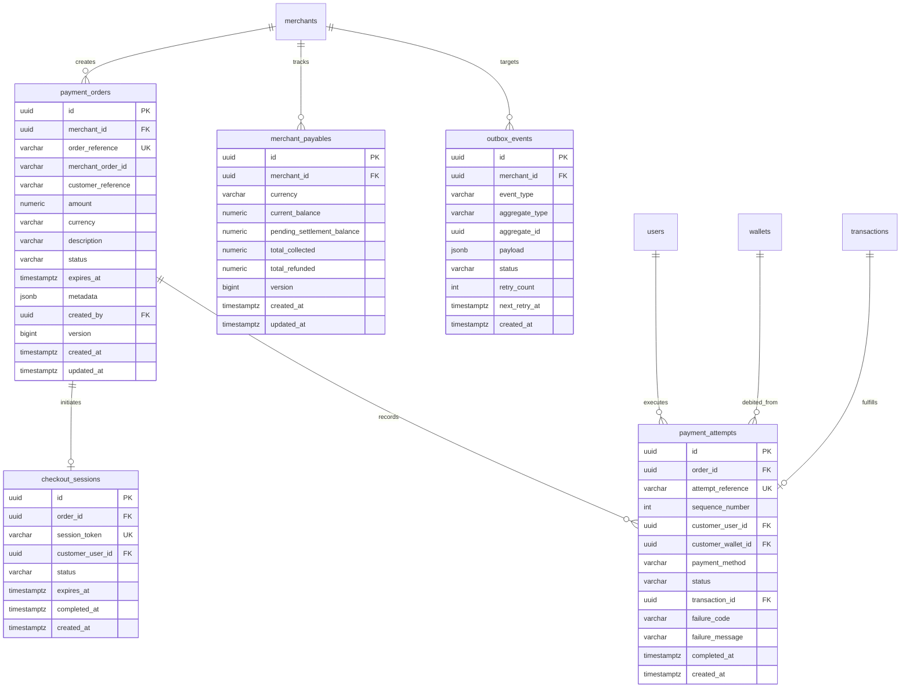

# VYOM — Phase 2.1: Database Schema & Migration Verification Report

**Document Version:** 1.0.0  
**Status:** COMPLETE & VERIFIED  
**Date:** 2026-11-21  
**Target Migration:** `V10__merchant_commercial_payments_and_execution.sql`  
**Project Root:** `D:\VYOM`  

---

## 1. Migration Overview

Migration `V10__merchant_commercial_payments_and_execution.sql` upgrades the VYOM schema from the Phase 1 merchant foundation (`V9`) to support commercial payment processing, customer checkout, attempt tracking, and merchant subledger accounting.

### 1.1 Non-Negotiable Invariants Preserved
- Historical migrations `V1` through `V9` remain strictly untouched and immutable.
- PostgreSQL deferred trigger `fn_verify_transaction_ledger_invariants` is preserved without mutation.
- The exactly-two-entry invariant per transaction (1 DEBIT, 1 CREDIT) is strictly satisfied.
- Transactional DDL ensures atomic rollout or complete rollback in case of error.

---

## 2. Table Definitions & Relational Structure



---

## 3. Detailed Schema Modifications

### 3.1 Extensions to Existing Tables
1. **`wallets` Table:**
   - `chk_wallets_account_type`: Extended to accept `'MERCHANT_PAYABLE'`:
     `CHECK (account_type IN ('CUSTOMER', 'SYSTEM_SETTLEMENT', 'MERCHANT_PAYABLE'))`.
   - `chk_wallets_customer_has_user`: Updated to ensure platform accounts (`SYSTEM_SETTLEMENT`, `MERCHANT_PAYABLE`) are permitted to have `user_id IS NULL`:
     `CHECK (account_type IN ('SYSTEM_SETTLEMENT', 'MERCHANT_PAYABLE') OR user_id IS NOT NULL)`.
2. **`transactions` Table:**
   - `chk_transactions_type`: Extended to include `'MERCHANT_PAYMENT'`:
     `CHECK (transaction_type IN ('TRANSFER', 'FUNDING', 'REFUND', 'REVERSAL', 'MERCHANT_PAYMENT'))`.
3. **`idempotency_records` Table:**
   - `chk_idempotency_operation_type`: Extended to include `'MERCHANT_PAYMENT'` and `'ORDER_CREATION'`:
     `CHECK (operation_type IN ('TRANSFER', 'FUNDING', 'REFUND', 'REVERSAL', 'MERCHANT_PAYMENT', 'ORDER_CREATION'))`.

### 3.2 Deterministic Commercial Payable Settlement Accounts
Seeded in `wallets` with fixed UUIDs for repeatability across environments:
- `00000000-0000-0000-0000-000000000011` — `COMMERCIAL_PAYABLE_INR` (INR)
- `00000000-0000-0000-0000-000000000012` — `COMMERCIAL_PAYABLE_USD` (USD)
- `00000000-0000-0000-0000-000000000013` — `COMMERCIAL_PAYABLE_EUR` (EUR)
- `00000000-0000-0000-0000-000000000014` — `COMMERCIAL_PAYABLE_GBP` (GBP)

### 3.3 New Tables & Constraints
1. **`merchant_payables`:**
   - Constraint `chk_merchant_payables_currency`: `currency IN ('INR', 'USD', 'EUR', 'GBP')`.
   - Constraint `chk_merchant_payables_balances`: `current_balance >= 0.0000 AND pending_settlement_balance >= 0.0000`.
   - Unique Index `uq_merchant_payables_merchant_currency`: Unique per `(merchant_id, currency)`.
2. **`payment_orders`:**
   - Constraint `chk_payment_orders_status`: `status IN ('CREATED', 'PENDING', 'PAID', 'EXPIRED', 'CANCELLED')`.
   - Constraint `chk_payment_orders_amount`: `amount > 0.0000`.
   - Constraint `chk_payment_orders_currency`: `currency IN ('INR', 'USD', 'EUR', 'GBP')`.
   - Unique Index `uq_payment_orders_merchant_order_id`: Unique `(merchant_id, merchant_order_id)`.
   - Unique Index `uq_payment_orders_reference`: Unique `order_reference`.
3. **`checkout_sessions`:**
   - Constraint `chk_checkout_sessions_status`: `status IN ('ACTIVE', 'COMPLETED', 'EXPIRED')`.
   - Unique Index `uq_checkout_sessions_token`: Unique `session_token`.
4. **`payment_attempts`:**
   - Constraint `chk_payment_attempts_status`: `status IN ('PROCESSING', 'SUCCESS', 'FAILED')`.
   - Constraint `chk_payment_attempts_method`: `payment_method IN ('CUSTOMER_WALLET')`.
   - Unique Index `uq_payment_attempts_reference`: Unique `attempt_reference`.
   - Partial Unique Index `uq_order_successful_attempt`:
     `CREATE UNIQUE INDEX uq_order_successful_attempt ON payment_attempts(order_id) WHERE status = 'SUCCESS';`
     *Guarantees at database storage engine level that no payment order can ever have more than one successful payment attempt.*
5. **`outbox_events`:**
   - Constraint `chk_outbox_events_status`: `status IN ('PENDING', 'PROCESSING', 'PUBLISHED', 'FAILED')`.
   - Partial Index `idx_outbox_polling`: On `(status, next_retry_at) WHERE status IN ('PENDING', 'PROCESSING')`.

---

## 4. Database Security & Least Privilege

Role-based grants are applied conditionally if the application role `vyom_app` exists:
```sql
DO $$
BEGIN
  IF EXISTS (SELECT FROM pg_catalog.pg_roles WHERE rolname = 'vyom_app') THEN
    GRANT SELECT, INSERT, UPDATE ON TABLE payment_orders TO vyom_app;
    GRANT SELECT, INSERT, UPDATE ON TABLE checkout_sessions TO vyom_app;
    GRANT SELECT, INSERT, UPDATE ON TABLE payment_attempts TO vyom_app;
    GRANT SELECT, INSERT, UPDATE ON TABLE merchant_payables TO vyom_app;
    GRANT SELECT, INSERT, UPDATE, DELETE ON TABLE outbox_events TO vyom_app;
  END IF;
END
$$;
```
*Note:* Destructive permissions (`DROP`, `TRUNCATE`, `ALTER`) are strictly withheld from `vyom_app`.

---

## 5. Verification & Validation Evidence

1. **Flyway Migration Application:** Applied cleanly against `payledger_test` on startup, moving schema version to 10.
2. **Constraint Enforcement:**
   - Negative amounts rejected by `chk_payment_orders_amount`.
   - Duplicate `(merchant_id, merchant_order_id)` rejected by `uq_payment_orders_merchant_order_id`.
   - Duplicate concurrent payments prevented by `uq_order_successful_attempt`.
   - Non-customer platform accounts accepted by `chk_wallets_customer_has_user`.
3. **Reconciliation Suite:** All 9 financial checks in `benchmark/reconcile.js` executed against `payledger_benchmark` with 100% integrity.
