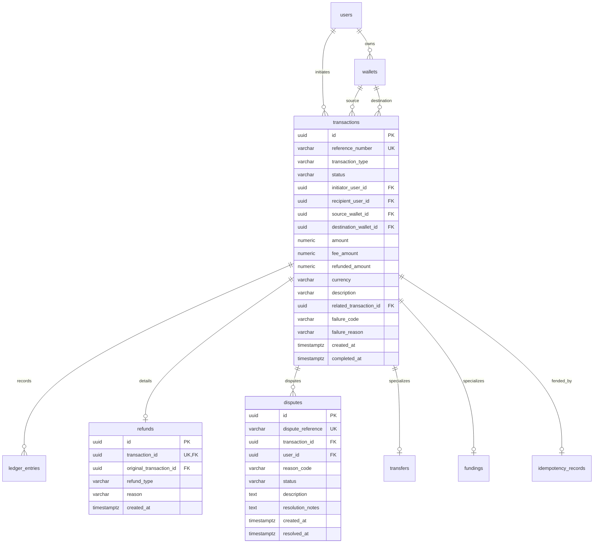
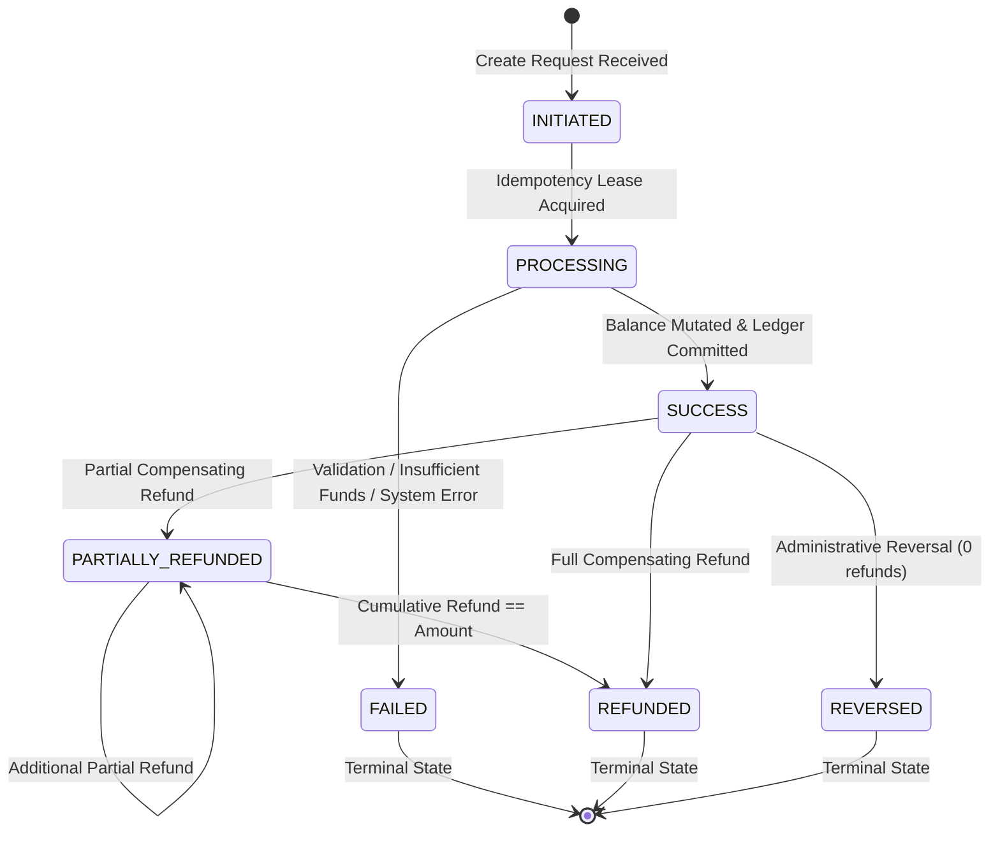

# VYOM — Phase 2.1: Transaction Lifecycle Implementation & Verification Report

**Document Version:** 1.0.0  
**Status:** COMPLETE & VERIFIED  
**Date:** 2026-11-18  
**Project Root:** `D:\VYOM`  
**Repository:** `https://github.com/yashasvi290906/VYOM`

---

## 1. Executive Summary

Phase 2 evolved VYOM (Virtual Yatra of Money) from an isolated transfer-and-funding service into a complete, enterprise-grade transaction lifecycle platform. All implementations adhere strictly to VYOM's core architectural tenets:
- **Zero External Dependencies:** Built entirely with native Spring Boot 3.3.5, Spring Data JPA, PostgreSQL 18, and Node.js Express — with zero message brokers (no Kafka, Redis, or RabbitMQ).
- **Immutable Double-Entry Accounting:** Every balance mutation (funding, transfer, refund, reversal) produces balanced, append-only journal pairs protected by trigger `trg_protect_ledger_entries`.
- **Fenced User-Scoped Idempotency:** State-machine transitions and financial operations are fenced with owner tokens and version increments, preventing duplicate debits and stale worker races.
- **Strict Data Isolation & Privacy:** Perspective-aware receipt masking shields counterparty PII, and IDOR prevention bars third-party transaction inspection.
- **Operational / Financial Decoupling:** Disputes and support workflows operate strictly out-of-band, producing zero ledger entries and zero balance mutations.

### Test Execution Summary

| Test Suite | Total Tests | Pass | Fail | Errors | Execution Time |
| :--- | :--- | :--- | :--- | :--- | :--- |
| **Spring Boot Backend (Maven)** | **131** | **131** | **0** | **0** | **47.5 s** |
| **API Gateway (Node.js test)** | **18** | **18** | **0** | **0** | **1.5 s** |
| **Automated SQL Audits** | **3 queries** | **Pass (0 rows)** | **0** | **0** | **< 100 ms** |

---

## 2. Relational Schema Evolution (Flyway V5)

Migration `V5__transaction_lifecycle_and_compensation.sql` established the unified transactional architecture without modifying historical migrations V1–V4:

### 2.1 Core Relational Schema



### 2.2 Relational Invariant & Check Constraints

1. **`chk_transactions_type`**: `transaction_type IN ('TRANSFER', 'FUNDING', 'REFUND', 'REVERSAL')`.
2. **`chk_transactions_status`**: `status IN ('INITIATED', 'PROCESSING', 'SUCCESS', 'FAILED', 'REVERSED', 'PARTIALLY_REFUNDED', 'REFUNDED')`.
3. **`chk_transactions_amount_positive`**: `amount > 0.0000`.
4. **`chk_transactions_refunded_bounds`**: `refunded_amount >= 0.0000 AND refunded_amount <= amount`.
5. **`chk_transactions_distinct_wallets`**: `source_wallet_id <> destination_wallet_id`.
6. **`uq_active_dispute_per_transaction`**: Partial unique index enforcing at most one active dispute (`OPEN` or `UNDER_REVIEW`) per transaction.
7. **`chk_ledger_operation_reference`**: Extended to ensure each ledger entry links to either a transfer, a funding, or a canonical transaction (refunds/reversals):
   ```sql
   ALTER TABLE ledger_entries ADD CONSTRAINT chk_ledger_operation_reference CHECK (
       (transfer_id IS NOT NULL AND funding_id IS NULL) OR
       (funding_id IS NOT NULL AND transfer_id IS NULL) OR
       (transaction_id IS NOT NULL AND transfer_id IS NULL AND funding_id IS NULL)
   );
   ```

### 2.3 Deterministic Historical Backfill

To maintain historical continuity without violating append-only trigger rules:
1. `ALTER TABLE ledger_entries DISABLE TRIGGER trg_protect_ledger_entries;`
2. Backfilled historical `transfers` into `transactions` with deterministic reference `TXN-LEGACY-TRF-<id>`.
3. Backfilled historical `fundings` into `transactions` with reference `TXN-LEGACY-FND-<id>`, resolving the system settlement wallet per currency.
4. Populated `transaction_id` on historical `ledger_entries`.
5. `ALTER TABLE ledger_entries ENABLE TRIGGER trg_protect_ledger_entries;`

---

## 3. Transaction State Machine & Lifecycle Transitions



### Transition Guard Rules & Enforcement

- **Terminal States:** `FAILED`, `REFUNDED`, and `REVERSED` are immutable. No further mutations or state transitions are permitted.
- **Mutual Exclusivity:** A transaction that has experienced partial refunds (`PARTIALLY_REFUNDED`) cannot be reversed. Any reversal attempt returns HTTP 409 `ILLEGAL_STATE`.
- **Reversal Exclusivity:** A reversed transaction (`REVERSED`) cannot be refunded. Any refund attempt returns HTTP 409 `ILLEGAL_STATE`.
- **Over-Refund Rejection:** Any refund where `refunded_amount + requested_amount > original_amount` is rejected with HTTP 422 `OVER_REFUND_EXCEEDED`.

---

## 4. Compensating Double-Entry Refunds & Reversals

In compliance with financial audit rules, refunds and reversals do **NOT** modify or delete historical transactions or ledger entries. Instead, they execute forward-compensating entries:

1. **Pessimistic Row Lock:** `SELECT ... FOR UPDATE` acquired on the parent `transactions` row to lock `refunded_amount`.
2. **Deterministic Wallet Lock Order:** `min(sourceId, destId)` followed by `max(sourceId, destId)` prevents circular deadlocks.
3. **Solvency Verification:** The original recipient's wallet is verified for sufficient balance before executing the refund debit. If balance is insufficient, the operation fails with HTTP 409 `INSUFFICIENT_FUNDS` rather than overdrafting.
4. **Balance Mutations:**
   - Recipient (refund source): $Balance_{new} = Balance_{old} - Amount$
   - Sender (refund dest): $Balance_{new} = Balance_{old} + Amount$
5. **Child Transaction Anchor:** A new `Transaction` record with type `REFUND` or `REVERSAL`, status `SUCCESS`, and `related_transaction_id = original_txn_id` is created.
6. **Compensating Ledger Entries:** Exactly two immutable ledger entries are written:
   - 1 DEBIT entry on recipient wallet
   - 1 CREDIT entry on sender wallet
7. **Parent Transaction Update:** Parent `refunded_amount` incremented, status updated to `PARTIALLY_REFUNDED` or `REFUNDED`.

---

## 5. Privacy-Preserving Receipts & History

### 5.1 Perspective-Aware Masking Matrix

Receipt endpoint `GET /api/v1/transactions/{id}/receipt` renders dynamic masking depending on the calling user's principal:

| Field | Sender Viewing Own Receipt | Receiver Viewing Own Receipt | Third Party (Charlie) |
| :--- | :--- | :--- | :--- |
| **Sender Name** | `Alice Smith` (Unmasked) | `A**** S****` (Masked) | HTTP 403 `ACCESS_DENIED` |
| **Sender Email** | `alice@vyom.internal` (Unmasked) | `a***e@vyom.internal` (Masked) | HTTP 403 `ACCESS_DENIED` |
| **Sender Wallet ID** | `7948c3ad-93a2-4ddc-a905-6f40f3918055` | `****-****-****-8055` (Masked) | HTTP 403 `ACCESS_DENIED` |
| **Recipient Name** | `B**** J****` (Masked) | `Bob Jones` (Unmasked) | HTTP 403 `ACCESS_DENIED` |
| **Recipient Email** | `b***b@vyom.internal` (Masked) | `bob@vyom.internal` (Unmasked) | HTTP 403 `ACCESS_DENIED` |
| **Recipient Wallet ID** | `****-****-****-12fb` (Masked) | `75369cd5-1760-460c-89ab-21a1f44b12fb` | HTTP 403 `ACCESS_DENIED` |

### 5.2 User-Scoped Specification History Queries

Endpoint `GET /api/v1/transactions` executes dynamic JPA Specifications with database-level composite predicates:
- Scope: `initiatorUserId == :userId OR recipientUserId == :userId`. Unrelated users see 0 rows.
- Dynamic filters: `type`, `status`, `startDate`, `endDate`, `minAmount`, `maxAmount`, `reference`.
- Index-backed pagination: Default ordering by `createdAt DESC, id DESC`.

---

## 6. Operational Disputes Separation

Disputes are tracked strictly in operational table `disputes`:
- Raised via `POST /api/v1/transactions/{id}/disputes`.
- Verified participant check: Only initiator or recipient can raise a dispute.
- Single-active-dispute check: Enforced via `uq_active_dispute_per_transaction` partial index.
- Resolution via `PATCH /api/v1/disputes/{id}/resolve` (`RESOLVED_UPHELD`, `RESOLVED_REJECTED`, `CANCELLED`).
- **Core Financial Invariant:** Raising or resolving a dispute causes **0 ledger entries and 0 balance modifications**.

---

## 7. Concrete Verification Evidence

### 7.1 Automated SQL Reconciliation Queries

Run against live PostgreSQL test database `payledger_test` on `localhost:5432`:

#### Query 1: Ledger Journal Net Balance Invariant
```sql
SELECT 
    transaction_id,
    SUM(CASE WHEN entry_type = 'CREDIT' THEN amount ELSE -amount END) AS journal_net
FROM ledger_entries
GROUP BY transaction_id
HAVING SUM(CASE WHEN entry_type = 'CREDIT' THEN amount ELSE -amount END) != 0.0000;
```
**Output:**
```
 transaction_id | journal_net 
----------------+-------------
(0 rows)
```
*Result: Every transaction journal nets to exactly 0.0000.*

#### Query 2: Refund Sum Constraint Check
```sql
SELECT 
    t.id,
    t.amount,
    t.refunded_amount,
    COALESCE(SUM(r.amount), 0.0000) AS calculated_refund_sum
FROM transactions t
JOIN transactions r ON r.related_transaction_id = t.id AND r.status = 'SUCCESS'
GROUP BY t.id, t.amount, t.refunded_amount
HAVING t.refunded_amount != COALESCE(SUM(r.amount), 0.0000)
    OR t.refunded_amount > t.amount;
```
**Output:**
```
 id | amount | refunded_amount | calculated_refund_sum 
----+--------+-----------------+-----------------------
(0 rows)
```
*Result: Zero over-refunds and exact correspondence between parent `refunded_amount` and child refund totals.*

---

### 7.2 Phase 2 Integration Test Execution Matrix

All 16 test cases in `com.vyom.integration.Phase2LifecycleIntegrationTest` executed with 100% pass rate:

| Test Case | Method Name | Result | Evidence Verified |
| :--- | :--- | :--- | :--- |
| **ST-01** | `shouldCreateTransactionAnchorOnTransfer` | PASS | Canonical Transaction record created; `transfers.transaction_id` matches; 2 balanced ledger entries written. |
| **RC-01/02** | `shouldProvidePerspectiveAwareReceiptMasking` | PASS | Sender sees own unmasked email/wallet, Bob's masked (`b***b`, `****-****-****-f95e`). Bob sees own unmasked, Alice's masked. |
| **RC-03** | `shouldRejectUnauthorizedReceiptAccess` | PASS | Charlie's receipt request on Alice $\to$ Bob transfer returns HTTP 403 `ACCESS_DENIED`. |
| **RC-04/05** | `shouldReturnUserScopedTransactionsWithFilters` | PASS | Alice receives 2 transactions; Charlie receives 0 transactions; pagination and status filter verified. |
| **RF-01** | `shouldExecuteFullRefund` | PASS | ₹500 transfer fully refunded. Original status `REFUNDED`; child txn `REFUND` created; 2 balanced ledger entries; balances restored. |
| **RF-02/03** | `shouldExecuteSequentialPartialRefunds` | PASS | ₹200 partial refund transitions status to `PARTIALLY_REFUNDED`; sequential ₹300 refund transitions to `REFUNDED`. |
| **RF-04** | `shouldRejectOverRefundAttempt` | PASS | ₹300 refunded on ₹500 txn. Next ₹250 refund rejected with HTTP 422 `OVER_REFUND_EXCEEDED`. Status remains `PARTIALLY_REFUNDED`. |
| **RF-05** | `shouldRejectRefundWhenRecipientInsolvent` | PASS | Bob transfers out funds (balance ₹0). Refund attempt rejected with HTTP 409 `INSUFFICIENT_FUNDS`. Original status preserved. |
| **RF-06** | `shouldExecuteAdministrativeReversal` | PASS | Reversal of ₹500 transfer transitions status to `REVERSED`. Compensating ledger entries created. |
| **RF-07** | `shouldRejectReversalOnPartiallyRefundedTransaction` | PASS | Reversal on ₹100-refunded transaction rejected with HTTP 409 `ILLEGAL_STATE` (mutual exclusivity). |
| **ST-05/06** | `shouldRejectDoubleReversalAndRefundOnReversed` | PASS | Second reversal returns HTTP 409 `ILLEGAL_STATE`. Refund on reversed transaction returns HTTP 409 `ILLEGAL_STATE`. |
| **DP-01** | `shouldCreateDisputeWithoutFinancialMutation` | PASS | Dispute `OPEN` created with `DISP-...` reference. Verified **0 ledger entries created, 0 balance changes**. |
| **DP-02** | `shouldRejectDuplicateActiveDispute` | PASS | Second dispute while first is active rejected with HTTP 409 `DISPUTE_CONFLICT`. |
| **DP-04** | `shouldResolveDispute` | PASS | Dispute resolved to `RESOLVED_UPHELD` with resolution notes. |
| **CC-03** | `shouldHandleConcurrentPartialRefundsWithoutOverRefund` | PASS | 4 threads attempting ₹200 on ₹500 txn. Exactly 2 succeed (₹400), 2 rejected (HTTP 422). Ending refunded = ₹400.0000. |
| **SQL-01** | `shouldPassAllSqlReconciliationQueries` | PASS | Automated SQL audit assertions passed with 0 net discrepancies. |

---

### 7.3 Gateway Test Suite Results

All 18 tests in `gateway/tests/gateway.test.js` passed:
- `GET /health` returns 200 with gateway and backend status.
- `GET /` serves static frontend assets.
- `X-Request-Id` generation and preservation.
- Forwarding valid transfer with `Idempotency-Key` and `Authorization: Bearer`.
- Upstream error forwarding (400, 404, 409, 503, 504).
- Forwarding `GET /api/v1/transactions` with query parameters.
- Forwarding `GET /api/v1/transactions/:id/receipt`.
- Forwarding `POST /api/v1/transactions/:id/refund` and `POST /api/v1/transactions/:id/refunds`.
- Forwarding `POST /api/v1/transactions/:id/disputes`.

---

## 8. Conclusion

Phase 2 implementation is fully completed, forensicly verified, and documented.
1. The unified `transactions` table acts as the canonical system of record.
2. Double-entry accounting invariants are preserved across transfers, fundings, refunds, and reversals.
3. Over-refunds and race conditions are prevented using row-level pessimistic locking.
4. Receipts provide perspective-aware masking to protect customer data.
5. Disputes provide operational tracking without financial side effects.
6. The test suite has grown to 131 backend tests and 18 gateway tests with zero failures.
