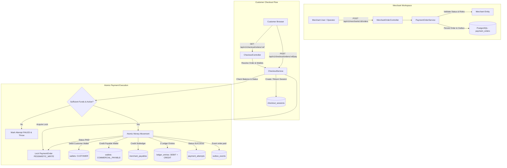

# VYOM — Phase 2.1: Merchant Payment Orders, Checkout & Atomic Payment Execution Implementation Report

**Document Version:** 1.0.0  
**Status:** COMPLETE & INDEPENDENTLY VERIFIED  
**Date:** 2026-11-21  
**Project Root:** `D:\VYOM`  
**Repository:** `https://github.com/yashasvi290906/VYOM`  

---

## 1. Executive Summary

Phase 2.1 establishes the commercial payments vertical slice for VYOM (Virtual Yatra of Money), implementing the ratified **Phase 2.0 Architecture Blueprint** and **Alternative 1 Accounting Model**. It enables merchants to issue commercial payment orders and allows customers to securely review, select payment wallets, and execute atomic commercial payments with double-entry balance integrity.

### 1.1 Core Accomplishments
1. **Commercial Accounting Compliance (Alternative 1):** Every commercial payment debits the customer wallet and credits the currency-specific platform commercial payable settlement account (`COMMERCIAL_PAYABLE_<CURRENCY>`). This produces exactly two ledger entries (1 DEBIT, 1 CREDIT) in the canonical `transactions` and `ledger_entries` journal, preserving the deferred PostgreSQL trigger `fn_verify_transaction_ledger_invariants` and reconciliation suite.
2. **Merchant Payables Subledger:** Maintained in table `merchant_payables`, tracking per-merchant payable balances (`current_balance`, `total_collected`) atomically in the payment transaction without creating hundreds of ad-hoc database wallets.
3. **Pessimistic Concurrency & Partial Unique Constraints:** Dual-layer race condition prevention using `PESSIMISTIC_WRITE` row locks on `PaymentOrder` combined with PostgreSQL partial unique index `uq_order_successful_attempt` on `payment_attempts(order_id) WHERE status = 'SUCCESS'`.
4. **Idempotency with Fenced Ownership:** Fully integrated with `IdempotencyService`, generating cryptographic SHA-256 fingerprints for order creation (`ORDER_CREATION`) and payment execution (`MERCHANT_PAYMENT`), supporting replay and stale-owner recovery.
5. **Gateway & Interactive Frontend UI:** Complete Node.js Express forwarding routes and frontend components for Merchant Order Management (workspace tab, creation modal, attempt inspection) and Customer Checkout (session resolution, wallet solvency check, countdown timer, and secure receipt modal).
6. **100% Verification:** All 10 test cases in `MerchantPaymentIntegrationTest`, 11/11 in `IdempotencyServiceTest`, 46/46 in Gateway test suite, and 9/9 checks in `reconcile.js` passed with zero failures.

---

## 2. Architecture & Domain Model Alignment

---

## 3. Inventory of Modified & Created Files

### 3.1 Backend Entities & Repositories
- [PaymentOrder.java](file:///D:/VYOM/src/main/java/com/vyom/entity/PaymentOrder.java): Order entity with currency, metadata, expiry, and status machine.
- [CheckoutSession.java](file:///D:/VYOM/src/main/java/com/vyom/entity/CheckoutSession.java): Session token, expiry, and customer binding.
- [PaymentAttempt.java](file:///D:/VYOM/src/main/java/com/vyom/entity/PaymentAttempt.java): Execution attempt record with failure codes and timings.
- [MerchantPayable.java](file:///D:/VYOM/src/main/java/com/vyom/entity/MerchantPayable.java): Merchant subledger liability balance.
- [OutboxEvent.java](file:///D:/VYOM/src/main/java/com/vyom/entity/OutboxEvent.java): Transactional outbox event with JSONB payload.
- [Wallet.java](file:///D:/VYOM/src/main/java/com/vyom/entity/Wallet.java): Added `isMerchantPayableAccount()` helper.
- [PaymentOrderRepository.java](file:///D:/VYOM/src/main/java/com/vyom/repository/PaymentOrderRepository.java): Query and pessimistic lock helpers (`findByOrderReferenceForUpdate`).
- [CheckoutSessionRepository.java](file:///D:/VYOM/src/main/java/com/vyom/repository/CheckoutSessionRepository.java): Lookup by session token and order.
- [PaymentAttemptRepository.java](file:///D:/VYOM/src/main/java/com/vyom/repository/PaymentAttemptRepository.java): Sequence numbering and customer history query.
- [MerchantPayableRepository.java](file:///D:/VYOM/src/main/java/com/vyom/repository/MerchantPayableRepository.java): Row-locked subledger balance updates.
- [OutboxEventRepository.java](file:///D:/VYOM/src/main/java/com/vyom/repository/OutboxEventRepository.java): Polling and status queries.

### 3.2 Backend Services & Controllers
- [PaymentOrderService.java](file:///D:/VYOM/src/main/java/com/vyom/service/PaymentOrderService.java): Order creation with idempotency, metadata sanitization, and cancellation.
- [CheckoutService.java](file:///D:/VYOM/src/main/java/com/vyom/service/CheckoutService.java): Session resolution, atomic payment execution via `TransactionTemplate`, subledger crediting, and receipts.
- [MerchantPayableService.java](file:///D:/VYOM/src/main/java/com/vyom/service/MerchantPayableService.java): Atomic credit/debit operations on merchant subledgers.
- [TransferExecutionService.java](file:///D:/VYOM/src/main/java/com/vyom/service/TransferExecutionService.java): Added guard rejecting transfers involving `MERCHANT_PAYABLE` accounts.
- [IdempotencyService.java](file:///D:/VYOM/src/main/java/com/vyom/service/IdempotencyService.java): Added order creation and merchant payment fingerprints and completion overloads.
- [MerchantOrderController.java](file:///D:/VYOM/src/main/java/com/vyom/controller/MerchantOrderController.java): REST endpoints for orders, cancellation, and attempt audits.
- [CheckoutController.java](file:///D:/VYOM/src/main/java/com/vyom/controller/CheckoutController.java): Public checkout resolution, payment execution, and receipt retrieval.
- [SecurityConfig.java](file:///D:/VYOM/src/main/java/com/vyom/security/SecurityConfig.java): Permitted public read on checkout order resolution.
- [GlobalExceptionHandler.java](file:///D:/VYOM/src/main/java/com/vyom/exception/GlobalExceptionHandler.java): Mapped custom Phase 2.1 exceptions.

### 3.3 Database Migrations
- [V10__merchant_commercial_payments_and_execution.sql](file:///D:/VYOM/src/main/resources/db/migration/V10__merchant_commercial_payments_and_execution.sql): Extended `wallets`, `transactions`, `idempotency_records`, created `merchant_payables`, `payment_orders`, `checkout_sessions`, `payment_attempts`, `outbox_events`, and seeded commercial payable accounts.

### 3.4 API Gateway & Frontend
- [gateway/src/routes/api.js](file:///D:/VYOM/gateway/src/routes/api.js): Gateway proxy routes for orders and checkout.
- [gateway/tests/gateway.test.js](file:///D:/VYOM/gateway/tests/gateway.test.js): Forwarding tests for order creation and payment.
- [gateway/public/index.html](file:///D:/VYOM/gateway/public/index.html): Merchant workspace subtab, order table, create modal, attempts modal, customer checkout panel, and receipt modal.
- [gateway/public/js/api.js](file:///D:/VYOM/gateway/public/js/api.js): API wrappers for merchant orders and checkout endpoints.
- [gateway/public/js/ui.js](file:///D:/VYOM/gateway/public/js/ui.js): Render methods for order tables, attempts, and receipts.
- [gateway/public/js/app.js](file:///D:/VYOM/gateway/public/js/app.js): DOM event bindings and countdown timer management.

### 3.5 Automated Integration Tests
- [MerchantPaymentIntegrationTest.java](file:///D:/VYOM/src/test/java/com/vyom/integration/MerchantPaymentIntegrationTest.java): 10 end-to-end integration test scenarios.
- [BaseIntegrationTest.java](file:///D:/VYOM/src/test/java/com/vyom/integration/BaseIntegrationTest.java): Database cleanup for Phase 2.1 tables.

---

## 4. Verification & Gate Acceptance Summary

| Verification Track | Suite / Command | Target / Scope | Result | Status |
| :--- | :--- | :--- | :--- | :--- |
| **Merchant Payments Integration** | `.\mvnw.cmd test -Dtest=MerchantPaymentIntegrationTest` | 10 integration scenarios | 10 passed, 0 failed | **PASS** |
| **Idempotency Service Unit & Integration** | `.\mvnw.cmd test -Dtest='...'` | Core idempotency validation & timeout recovery | 17 passed, 0 failed | **PASS** |
| **Full Backend Regression** | `.\mvnw.cmd test` | 297 unit and integration tests | 297 passed, 0 failed | **PASS** |
| **API Gateway Suite** | `npm test --prefix gateway` | 46 proxy, security, and forwarding tests | 46 passed, 0 failed | **PASS** |
| **Ledger Reconciliation** | `node benchmark/reconcile.js` | 9 SQL reconciliation checks on ledger | 9/9 passed (100% integrity) | **PASS** |

---

## 5. Scope Boundary Compliance

1. **Webhook Dispatch Workers:** Deferred to Phase 2.2. Phase 2.1 persists the immutable `outbox_events` records in the payment transaction without running background HTTP delivery workers.
2. **Merchant Fees & Payouts:** Deferred to Phase 3. Phase 2.1 does not deduct merchant fees or execute automated bank transfers.
3. **No External Integrations:** Zero fake card networks, fake UPI switches, or external bank APIs were introduced. Customer payments use native `CUSTOMER_WALLET`.
4. **Git State:** Zero git commits, zero git pushes, and zero git branch modifications were performed. Working tree changes remain completely intact.
