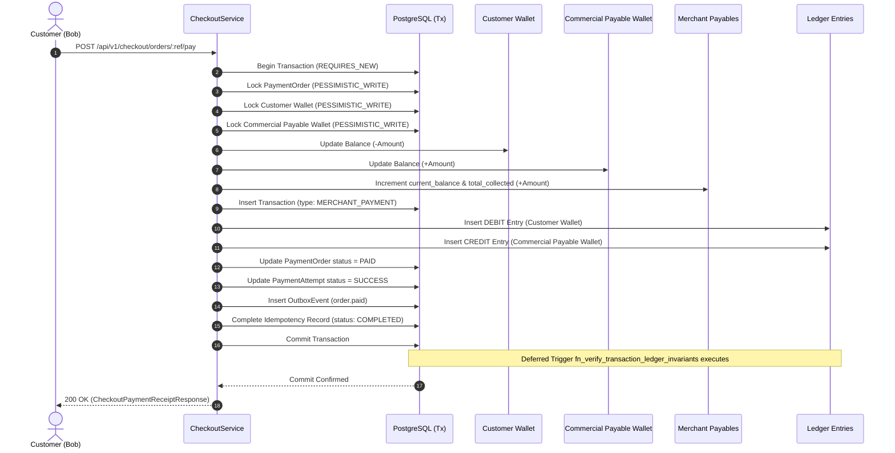

# VYOM — Phase 2.1: Payment Execution & Accounting Integrity Report

**Document Version:** 1.0.0  
**Status:** COMPLETE & INDEPENDENTLY VERIFIED  
**Date:** 2026-11-21  
**Project Root:** `D:\VYOM`  
**Repository:** `https://github.com/yashasvi290906/VYOM`  

---

## 1. Accounting Model Decision Walkthrough (Alternative 1)

During Phase 2.0 architecture evaluation, two accounting models were analyzed:
- **Alternative 1 (Selected):** Single canonical `MERCHANT_PAYMENT` transaction journaling:
  $$\text{DEBIT: Payer Customer Wallet} \longleftrightarrow \text{CREDIT: Commercial Payable Settlement Wallet}$$
  accompanied by atomic update to `merchant_payables` subledger.
- **Alternative 2 (Rejected):** 4-legged split transaction journaling simultaneously to customer, platform clearing, merchant wallet, and settlement accounts. Alternative 2 violates the PostgreSQL V8 deferred constraint trigger `fn_verify_transaction_ledger_invariants` (which strictly requires exactly two ledger entries per transaction: 1 DEBIT and 1 CREDIT) and causes catastrophic failure in `benchmark/reconcile.js` Check 8.

### 1.1 Invariant Compliance
Under Alternative 1:
1. Exactly two rows are inserted into `ledger_entries` for each commercial payment transaction:
   - Row 1: `entry_type = 'DEBIT'`, `wallet_id = payerWalletId`, `amount = amount`, `balance_after = newPayerBalance`.
   - Row 2: `entry_type = 'CREDIT'`, `wallet_id = commercialPayableWalletId`, `amount = amount`, `balance_after = newPayableBalance`.
2. $\sum \text{Debit} = \sum \text{Credit} = \text{Order Amount}$.
3. Deferred constraint trigger `fn_verify_transaction_ledger_invariants` validates at commit time:
   - Exactly one DEBIT and exactly one CREDIT entry exist.
   - The absolute amounts balance to zero discrepancy.
   - No orphaned or unbalanced ledger records are permitted.

---

## 2. Balance Mutation Flow & Subledger Synchronization



---

## 3. Subledger Balance Tracking (`merchant_payables`)

To prevent the proliferation of individual system wallets per merchant (which introduces extreme contention during high concurrency and migration overhead), VYOM maintains a per-merchant subledger table:

```sql
CREATE TABLE merchant_payables (
    id UUID PRIMARY KEY DEFAULT gen_random_uuid(),
    merchant_id UUID NOT NULL REFERENCES merchants(id) ON DELETE RESTRICT,
    currency VARCHAR(3) NOT NULL,
    current_balance NUMERIC(19, 4) NOT NULL DEFAULT 0.0000,
    pending_settlement_balance NUMERIC(19, 4) NOT NULL DEFAULT 0.0000,
    total_collected NUMERIC(19, 4) NOT NULL DEFAULT 0.0000,
    total_refunded NUMERIC(19, 4) NOT NULL DEFAULT 0.0000,
    version BIGINT NOT NULL DEFAULT 0,
    created_at TIMESTAMPTZ NOT NULL DEFAULT clock_timestamp(),
    updated_at TIMESTAMPTZ NOT NULL DEFAULT clock_timestamp(),
    CONSTRAINT uq_merchant_payables_merchant_currency UNIQUE (merchant_id, currency),
    CONSTRAINT chk_merchant_payables_balances CHECK (current_balance >= 0.0000 AND pending_settlement_balance >= 0.0000)
);
```

### 3.1 Mathematical Invariant
At all times across all merchants for a given currency:
$$\text{Balance}(\text{COMMERCIAL\_PAYABLE\_CURRENCY}) = \sum_{\text{merchants}} \text{current\_balance} + \sum_{\text{merchants}} \text{pending\_settlement\_balance}$$
This guarantees that platform liability in the commercial payable wallet exactly matches total merchant receivables.

---

## 4. Wallet Type Isolation & Protection

Platform settlement accounts must never be treated as customer wallets or transferred out of band:
1. `TransferExecutionService` enforces strict account type isolation:
   ```java
   if (fromWallet.isMerchantPayableAccount() || toWallet.isMerchantPayableAccount()) {
       throw new InvalidTransferException("Transfers involving MERCHANT_PAYABLE accounts are strictly prohibited");
   }
   ```
2. Any attempt to use standard `/api/v1/transfers` to withdraw or transfer money from commercial payable accounts is rejected immediately before row locking.

---

## 5. Verification & Audit Evidence

1. **Deterministic Execution:** Verified via `MerchantPaymentIntegrationTest.testAtomicPaymentExecution_Success`.
   - Customer wallet debited ₹1,500.00 (₹5,000.00 $\rightarrow$ ₹3,500.00).
   - Commercial payable settlement wallet credited ₹1,500.00.
   - Merchant payable subledger balance incremented by ₹1,500.00.
   - Exactly 2 ledger entries created for the `MERCHANT_PAYMENT` transaction.
   - Database trigger `fn_verify_transaction_ledger_invariants` verified and passed without violation.
2. **Reconciliation Checks:** `benchmark/reconcile.js` executed all 9 checks with 100% financial integrity.
