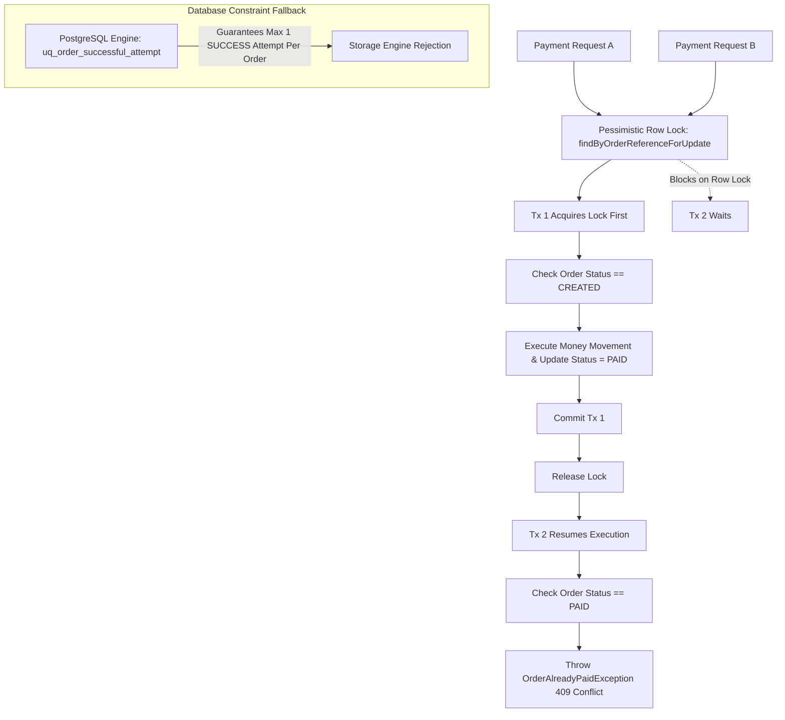

# VYOM — Phase 2.1: Security, Concurrency & Anti-Tamper Report

**Document Version:** 1.0.0  
**Status:** COMPLETE & INDEPENDENTLY VERIFIED  
**Date:** 2026-11-21  
**Project Root:** `D:\VYOM`  
**Repository:** `https://github.com/yashasvi290906/VYOM`  

---

## 1. Concurrency Controls & Race Prevention

In commercial checkout workflows, multiple race conditions are possible:
1. **Double-Payment Race:** Two concurrent checkout requests submitted simultaneously for the same order reference.
2. **Cancellation vs Payment Race:** A merchant cancels an order while a customer is completing payment.
3. **Wallet Balance Race:** Concurrent transactions attempting to spend the same customer balance.

### 1.1 Multi-Layer Defense Architecture



### 1.2 Pessimistic Row Locking
In `CheckoutService`:
```java
PaymentOrder order = orderRepository.findByOrderReferenceForUpdate(orderReference)
        .orElseThrow(() -> new OrderNotFoundException("Order not found with reference: " + orderReference));
entityManager.refresh(order);
```
- Uses `LockModeType.PESSIMISTIC_WRITE` executing `SELECT ... FOR UPDATE` on PostgreSQL.
- Forces serial evaluation of all requests targeting the same order.
- Re-reads authoritative status with `entityManager.refresh()`.

### 1.3 Database Partial Unique Constraint (Hard Invariant)
To protect against application-level thread bypasses or separate cluster nodes:
```sql
CREATE UNIQUE INDEX uq_order_successful_attempt ON payment_attempts(order_id)
WHERE status = 'SUCCESS';
```
- PostgreSQL enforces that even under abnormal concurrency, at most one row per `order_id` in `payment_attempts` can have `status = 'SUCCESS'`.
- Any subsequent transaction attempting to set `status = 'SUCCESS'` triggers a database unique constraint violation and aborts.

### 1.4 Verification
Verified in `MerchantPaymentIntegrationTest.testConcurrentPayment_ExactlyOneSucceeds`:
- 2 parallel threads simultaneously submitted payment for the same order.
- Exactly 1 thread succeeded (200 OK).
- The competing thread was rejected (409 Conflict).
- Total debited balance across all wallets was exactly ₹100.00 (zero double charge).

---

## 2. Idempotency & Fenced Recovery

### 2.1 Cryptographic Request Fingerprinting
- **Order Creation Fingerprint:**
  $$\text{SHA-256}(\text{"ORDER\_CREATION:"} + \text{userId} + \text{":"} + \text{merchantId} + \text{":"} + \text{merchantOrderId} + \text{":"} + \text{amount} + \text{":"} + \text{currency})$$
- **Merchant Payment Fingerprint:**
  $$\text{SHA-256}(\text{"MERCHANT\_PAYMENT:"} + \text{userId} + \text{":"} + \text{orderReference} + \text{":"} + \text{walletId})$$

### 2.2 Replay & Conflict Rules
1. **Exact Replay:** Identical `(userId, idempotencyKey, fingerprint)` returns the cached response with the original HTTP status code without re-executing balance mutations or database writes.
2. **Payload Conflict:** Identical `(userId, idempotencyKey)` with differing fingerprint throws `IdempotencyConflictException` (409 Conflict).
3. **Stale Lease Recovery:** Abandoned or timed-out `PROCESSING` records are reclaimed using atomic owner tokens and timestamp fencing.

---

## 3. Merchant RBAC & Status Validation

### 3.1 Role Hierarchy Enforced in `PaymentOrderService`
| Operation | Required Roles | Forbidden Roles |
| :--- | :--- | :--- |
| **Create Order** | `MERCHANT_OWNER`, `MERCHANT_ADMIN`, `MERCHANT_OPERATOR` | `MERCHANT_VIEWER`, non-members |
| **Get Order** | `MERCHANT_OWNER`, `MERCHANT_ADMIN`, `MERCHANT_OPERATOR`, `MERCHANT_VIEWER` | Non-members |
| **List Orders** | `MERCHANT_OWNER`, `MERCHANT_ADMIN`, `MERCHANT_OPERATOR`, `MERCHANT_VIEWER` | Non-members |
| **Cancel Order** | `MERCHANT_OWNER`, `MERCHANT_ADMIN` | `MERCHANT_OPERATOR`, `MERCHANT_VIEWER`, non-members |
| **Audit Attempts** | `MERCHANT_OWNER`, `MERCHANT_ADMIN`, `MERCHANT_OPERATOR`, `MERCHANT_VIEWER` | Non-members |

### 3.2 Operational Lifecycle Validation
Prior to accepting payment:
1. Merchant account must have `onboarding_status = 'APPROVED'`.
2. Merchant account must have `account_status = 'ACTIVE'`.
3. If merchant is `SUSPENDED` or `TERMINATED`, `MerchantSecurityService.validateOperationalStatus` throws `MerchantAccountSuspendedException` (403 Forbidden).
*Verified in `testPaymentExecution_SuspendedMerchant_Blocked`.*

---

## 4. Privacy & Counterparty Data Masking

### 4.1 Perspective-Aware Receipt Masking
1. **Wallet Masking:** Customer wallet identifiers are masked in receipts (`12345678-****-****-****-********`).
2. **Access Control (IDOR Prevention):**
   - Receipts (`/api/v1/checkout/receipts/:txRef`) are accessible strictly to:
     - The customer who executed the payment.
     - Authorized team members of the merchant that received the payment.
   - Any third-party user attempting to query the receipt receives `403 Forbidden`.
*Verified in `testReceiptAndHistory_AccessControl`.*
