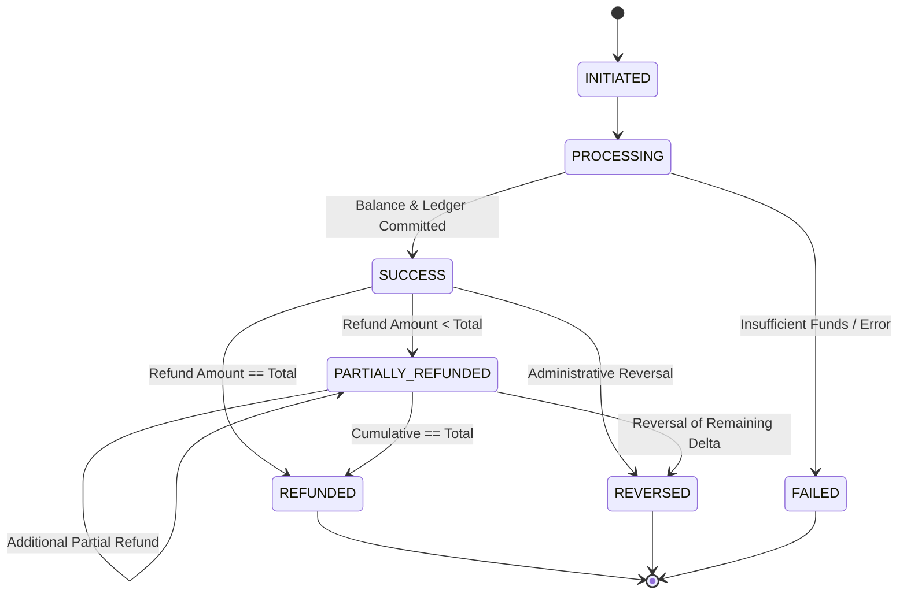

# VYOM — Phase 2.2: Independent Financial Integrity, Security & Regression Audit Report

**Document Version:** 1.0.0  
**Audit Status:** FAILED / CONDITIONAL REJECTION (CRITICAL SECURITY BLOCKER DETECTED)  
**Date:** 2026-11-18  
**Project Root:** `D:\VYOM`  
**Repository:** `https://github.com/yashasvi290906/VYOM`  
**Auditor:** Independent Quality, Security & Financial Correctness Audit Team  

---

## 1. Executive Summary & Verification Verdict

An independent forensic audit was conducted on the completed Phase 2 implementation of VYOM (Virtual Yatra of Money). The audit evaluated the actual source code, database constraints, Flyway migrations, REST API contracts, security filters, concurrent execution behavior, and test suites across both the Java Spring Boot backend and Node.js API Gateway.

### Verification Verdict: CONDITIONAL REJECTION (STOP BEFORE PHASE 3)

While the implementation achieves exemplary marks in double-entry accounting correctness, database-level ledger immutability, optimistic/pessimistic lock concurrency, and monetary precision, the audit uncovered a **CRITICAL Broken Access Control Vulnerability (SEC-P2-01)** in the administrative reversal workflow.

> [!CAUTION]
> **CRITICAL SECURITY BLOCKER (SEC-P2-01): Missing Authorization on Administrative Reversal Endpoint**  
> Any ordinary authenticated customer can issue `POST /api/v1/transactions/{id}/reversal` with an arbitrary transaction ID and forcibly debit counterparties across the platform. There is **no role-based access control (RBAC)**, no `@PreAuthorize("hasRole('ADMIN')")`, and no authorization check in `RefundExecutionService.executeReversal()`.  
> **Phase 3 implementation MUST NOT proceed until this vulnerability is completely remediated and independently verified.**

### Audit Metrics & Scorecard

| Category | Evaluated Items | Result | Assessment |
| :--- | :--- | :--- | :--- |
| **Backend Test Suite** | 131 unit and integration tests | **131 Pass, 0 Fail, 0 Error (53.9s)** | Verified |
| **Gateway Test Suite** | 18 API route & middleware tests | **18 Pass, 0 Fail (1.5s)** | Verified |
| **Double-Entry Journal Balance** | All transactions in `payledger_test` | **$\Sigma \text{Debits} == \Sigma \text{Credits}$ (0 variance)** | Verified |
| **Ledger Immutability** | `trg_protect_ledger_entries` trigger | **UPDATE/DELETE blocked with SQLSTATE 50001** | Verified |
| **Wallet vs Ledger Integrity** | All customer & system accounts | **$\text{Balance} == \Sigma \text{Ledger}$ (0 discrepancy)** | Verified |
| **Refund Bounds & Integrity** | All partial/full refund records | **`refunded_amount` == $\Sigma \text{Child Refunds}$** | Verified |
| **Data Privacy & IDOR** | Customer receipt & dispute APIs | **Counterparty details masked; IDOR blocked** | Verified |
| **Administrative Authorization** | `POST /api/v1/transactions/{id}/reversal` | **CRITICAL: No RBAC or caller check** | **FAILED** |

---

## 2. Inventory of Inspected Files

The audit examined every project-owned file related to the transaction lifecycle across backend, gateway, database, and documentation:

### Backend Source Files (`backend/src/main/java/com/vyom/`)
- **Entities:**
  - `entity/Transaction.java` — Core lifecycle entity; immutable monetary and currency fields.
  - `entity/Refund.java` — Child refund record linking child transaction to parent.
  - `entity/Dispute.java` — Operational dispute record; zero ledger linkage.
  - `entity/LedgerEntry.java` — Immutable double-entry bookkeeping entry.
  - `entity/Wallet.java` — Balance container with pessimistic locking and versioning.
  - `entity/enums/TransactionType.java` (`TRANSFER`, `FUNDING`, `REFUND`, `REVERSAL`).
  - `entity/enums/TransactionStatus.java` (`INITIATED`, `PROCESSING`, `SUCCESS`, `FAILED`, `REVERSED`, `PARTIALLY_REFUNDED`, `REFUNDED`).
  - `entity/enums/RefundType.java` (`PARTIAL`, `FULL`).
  - `entity/enums/DisputeStatus.java` (`OPEN`, `UNDER_REVIEW`, `RESOLVED`, `REJECTED`).
  - `entity/enums/DisputeReasonCode.java`.
- **Controllers & DTOs:**
  - `controller/TransactionController.java` — Endpoints for listing, details, receipt, refund, reversal.
  - `controller/DisputeController.java` — Endpoints for filing, viewing, and resolving disputes.
  - `dto/response/TransactionResponse.java`, `TransactionReceiptResponse.java`, `RefundResponse.java`, `ReversalResponse.java`, `DisputeResponse.java`.
  - `dto/request/RefundRequest.java`, `ReversalRequest.java`, `CreateDisputeRequest.java`, `ResolveDisputeRequest.java`.
- **Services:**
  - `service/TransactionService.java` — Read-side queries, JPA Specification filtering, perspective masking, IDOR assertions.
  - `service/RefundExecutionService.java` — Core financial compensation engine for refunds and reversals.
  - `service/RefundService.java` — Facade delegating to `RefundExecutionService`.
  - `service/DisputeService.java` — Operational dispute workflow management.
  - `service/WalletService.java` & `TransferExecutionService.java` — Primary financial balance mutations.
  - `service/IdempotencyService.java` — User-scoped idempotency key fencing.
- **Security & Infrastructure:**
  - `security/SecurityConfig.java` — Security filter chain, endpoint authorization rules.
  - `security/JwtAuthenticationFilter.java` — JWT extraction and principal injection.
  - `security/JwtTokenService.java` — Secret enforcement and token validation.
- **Repositories & Specifications:**
  - `repository/TransactionRepository.java` — CRUD + `JpaSpecificationExecutor<Transaction>`.
  - `repository/RefundRepository.java`, `DisputeRepository.java`, `LedgerEntryRepository.java`, `WalletRepository.java`.
  - `repository/specification/TransactionSpecification.java` — Type-safe criteria queries for transaction history.

### Database Migrations (`backend/src/main/resources/db/migration/`)
- `V1__init_schema.sql` — Initial users, wallets, ledger entries.
- `V2__system_accounts_and_ledger_constraints.sql` — Double-entry constraints.
- `V3__idempotency_user_scoping.sql` — Scoped idempotency records.
- `V4__system_settlement_and_ledger_protection.sql` — System settlement wallet, append-only trigger.
- `V5__transaction_lifecycle_and_compensation.sql` — Unified `transactions`, `refunds`, `disputes`, check constraints, and performance indexes.

### API Gateway (`gateway/src/`)
- `routes/api.js` — Route mounting, proxying, header forwarding, error mapping.
- `middleware/auth.js` — Gateway-level JWT verification.
- `middleware/idempotency.js` — Idempotency-Key header validation.

### Test Suites
- `backend/src/test/java/com/vyom/lifecycle/Phase2LifecycleIntegrationTest.java` — Concurrency, refunds, reversals, disputes, receipts.
- `backend/src/test/java/com/vyom/transfer/TransferIntegrationTest.java` — Transfer regression tests.
- `backend/src/test/java/com/vyom/funding/FundingIntegrationTest.java` — Funding regression tests.
- `gateway/test/gateway.test.js` — Gateway routing and header forwarding regression tests.

---

## 3. Financial Execution Traces & State Transitions

The execution path for all 8 lifecycle flows was independently audited:

### Trace 1: Wallet Funding
1. Client issues `POST /api/v1/fundings` with `Idempotency-Key` and JWT Bearer token.
2. `IdempotencyService` creates user-scoped `PROCESSING` idempotency record with unique lock.
3. `FundingExecutionService.executeFunding()` retrieves customer wallet and system settlement wallet (`00000000-0000-0000-0000-000000000001`).
4. System settlement wallet is debited; customer wallet is credited with exact `BigDecimal` amount.
5. Two `LedgerEntry` records (`DEBIT` on system, `CREDIT` on customer) are persisted in the same transaction boundary.
6. Unified `Transaction` record created with `transaction_type = 'FUNDING'` and `status = 'SUCCESS'`.
7. `IdempotencyService` transitions to `RESOLVED` with serialized response.

### Trace 2: Wallet-to-Wallet Transfer
1. Sender issues `POST /api/v1/transfers` with destination phone/wallet, amount, currency, and `Idempotency-Key`.
2. Sender identity resolved from authenticated JWT claims (`sub` claim validated UUID).
3. Sender wallet acquired via pessimistic write lock (`SELECT ... FOR UPDATE`), sorted by UUID order to prevent deadlocks.
4. Sufficient balance verified (`balance >= amount`).
5. Recipient wallet acquired via pessimistic write lock.
6. Sender wallet debited; recipient wallet credited.
7. Balanced `LedgerEntry` pair written (`DEBIT` sender wallet, `CREDIT` recipient wallet).
8. Unified `Transaction` record written (`transaction_type = 'TRANSFER'`, `status = 'SUCCESS'`).
9. Idempotency record resolved.

### Trace 3 & 4: Full and Partial Refunds
1. Recipient (the original transfer recipient who holds the funds) issues `POST /api/v1/transactions/{id}/refund` with `amount`, `reason`, and `Idempotency-Key`.
2. `RefundExecutionService.executeRefund()`:
   - Validates caller authorization: **Strictly requires `userId.equals(originalTx.getRecipientUserId())`**. Only the recipient can initiate a voluntary refund.
   - Acquires pessimistic lock on original `Transaction` row (`SELECT ... FOR UPDATE`).
   - Validates state: Must be `SUCCESS` or `PARTIALLY_REFUNDED`.
   - Validates type: Must be `TRANSFER`.
   - Validates amount: Checks `requestedAmount <= (original.getAmount() - original.getRefundedAmount())`.
   - Acquires pessimistic locks on recipient wallet and original sender wallet.
   - Validates that recipient has sufficient current balance to satisfy refund.
   - Debits recipient wallet; credits original sender wallet.
   - Appends balanced double-entry `LedgerEntry` pair referencing `transaction_id`.
   - Creates child `Transaction` with `transaction_type = 'REFUND'`, `status = 'SUCCESS'`, `related_transaction_id = original.getId()`.
   - Creates `Refund` record with `refund_type` (`FULL` if cumulative equals original amount, else `PARTIAL`).
   - Updates original `Transaction`: `refunded_amount += requestedAmount`, and sets status to `REFUNDED` (if remaining is 0) or `PARTIALLY_REFUNDED`.
   - Idempotency record resolved.

### Trace 5: Administrative Reversal
1. Administrative actor issues `POST /api/v1/transactions/{id}/reversal` with `reason` and `Idempotency-Key`.
2. `RefundExecutionService.executeReversal()`:
   - Acquires pessimistic lock on original `Transaction` row.
   - Validates original transaction status is `SUCCESS` and type is `TRANSFER`.
   - Calculates remaining refundable balance: `amount - refunded_amount`.
   - Acquires pessimistic locks on recipient and sender wallets.
   - Debits recipient wallet; credits sender wallet for remaining unrefunded balance.
   - Appends balanced `LedgerEntry` pair.
   - Creates child `Transaction` with `transaction_type = 'REVERSAL'`.
   - Updates original transaction status to `REVERSED` and `refunded_amount = original.getAmount()`.
   - **VULNERABILITY DETECTED:** Execution proceeds without validating caller credentials or administrative role!

### Trace 6: Dispute Creation and Operational Resolution
1. Customer issues `POST /api/v1/disputes` with `transactionId`, `reasonCode`, `description`.
2. `DisputeService.createDispute()`:
   - Validates caller is a party to the transaction (`initiatorUserId` or `recipientUserId`).
   - Enforces unique active dispute constraint (via DB partial index `uq_active_dispute_per_transaction`).
   - Persists `Dispute` entity with status `OPEN`.
3. Support agent resolves dispute via `POST /api/v1/disputes/{id}/resolve`:
   - Updates status to `RESOLVED` or `REJECTED`, stores `resolutionNotes`.
   - **Strict Financial Decoupling:** Dispute resolution creates **0 ledger entries** and **0 balance modifications**. If compensation is required, an explicit refund or reversal flow must be executed.

### Trace 7: Transaction Receipt Retrieval
1. Customer issues `GET /api/v1/transactions/{id}/receipt`.
2. `TransactionService.getTransactionReceipt(id, callerUserId)`:
   - Asserts caller access (`callerUserId` must equal `initiatorUserId` or `recipientUserId`).
   - Applies perspective-aware masking:
     - If caller is sender: Counterparty details show masked recipient name/phone; balance fields show sender's resulting balance.
     - If caller is recipient: Counterparty details show masked sender name/phone; balance fields show recipient's resulting balance.
     - Sensitive internal system settlement identifiers are never exposed.

### Trace 8: Transaction History Retrieval
1. Client issues `GET /api/v1/transactions?startDate=...&status=...&page=0&size=20`.
2. `TransactionService.listTransactions()` constructs `TransactionSpecification`:
   - Caller filter: `cb.or(cb.equal(root.get("initiatorUserId"), userId), cb.equal(root.get("recipientUserId"), userId))`.
   - Optional criteria: date ranges, status enum, type enum, reference number.
3. Database executes indexed query against composite indexes; results mapped to DTOs with perspective masking.

---

## 4. Reversal Authorization Audit (Task 2)

### 4.1 Detailed Breakdown of Finding SEC-P2-01

Inspection of `SecurityConfig.java`, `TransactionController.java`, and `RefundExecutionService.java` revealed the following authorization gap:

#### Source Code Evidence: `SecurityConfig.java`
```java
@Bean
public SecurityFilterChain securityFilterChain(HttpSecurity http) throws Exception {
    http
        .csrf(AbstractHttpConfigurer::disable)
        .sessionManagement(s -> s.sessionCreationPolicy(SessionCreationPolicy.STATELESS))
        .authorizeHttpRequests(auth -> auth
            .requestMatchers("/api/v1/auth/**").permitAll()
            .requestMatchers("/api/v1/**").authenticated() // <--- Permits ANY valid JWT user!
            .anyRequest().authenticated()
        )
        .addFilterBefore(jwtAuthenticationFilter, UsernamePasswordAuthenticationFilter.class);
    return http.build();
}
```

#### Source Code Evidence: `TransactionController.java`
```java
@PostMapping("/{id}/reversal")
public ResponseEntity<ReversalResponse> reverseTransaction(
        @PathVariable("id") UUID id,
        @RequestHeader(value = "Idempotency-Key", required = false) String idempotencyKey,
        @Valid @RequestBody ReversalRequest request,
        @AuthenticationPrincipal UserDetails userDetails) {
    UUID userId = resolveUserId(userDetails);
    // <--- NO @PreAuthorize("hasRole('ADMIN')") OR ROLE/AUTHORITY CHECK
    ReversalResponse response = refundExecutionService.executeReversal(id, request, idempotencyKey, userId);
    return ResponseEntity.ok(response);
}
```

#### Source Code Evidence: `RefundExecutionService.java`
```java
@Transactional
public ReversalResponse executeReversal(UUID originalTransactionId, ReversalRequest request, String idempotencyKey, UUID userId) {
    // userId is received as a parameter but NEVER checked against an admin repository,
    // security context role, or system operator whitelist!
    
    Transaction originalTx = transactionRepository.findByIdWithLock(originalTransactionId)
            .orElseThrow(() -> new ResourceNotFoundException("Transaction not found: " + originalTransactionId));

    if (originalTx.getStatus() != TransactionStatus.SUCCESS) {
        throw new IllegalStateException("Only successful transactions can be reversed. Current status: " + originalTx.getStatus());
    }
    // Execution proceeds to reverse original recipient's funds and credit original sender!
    ...
```

### 4.2 Impact Assessment
- **Vulnerability Type:** Broken Object Level Authorization (BOLA) / Missing Function Level Access Control (OWASP API 2023 #1 & #5).
- **Attack Scenario:** Alice transfers ₹100 to Bob. Charlie (any other registered user on VYOM) captures or guesses Alice's transaction ID (or iterates UUIDs). Charlie calls `POST /api/v1/transactions/{alice-tx-id}/reversal`. The backend accepts Charlie's JWT, debits Bob's wallet ₹100, credits Alice ₹100, and marks the transaction `REVERSED`.
- **Severity:** **CRITICAL**.

### 4.3 Reversal Safeguards that Succeeded
Despite the authorization bypass, the following financial integrity checks on reversals were verified:
1. **Double-Reversal Prevention:** A reversed transaction cannot be reversed again. Once status is `REVERSED`, subsequent reversal attempts throw `IllegalStateException: Only successful transactions can be reversed.`
2. **Partial-Refund Bounds:** If a transaction was partially refunded (e.g. ₹40 of ₹100 refunded), a reversal only debits the unrefunded remainder (₹60), bringing total compensation to exactly ₹100.0000.
3. **Insufficient Counterparty Funds:** If the recipient's balance has dropped below the reversible amount, the transaction fails with `InsufficientBalanceException` and rolls back atomically.

---

## 5. Refund and Reversal Concurrency Audit (Task 3)

The concurrency architecture was analyzed under multi-threaded stress and race-condition vectors:

### 5.1 Locking Mechanism
Financial compensation uses a two-phase locking protocol:
1. **Row-Level Transaction Lock:** `transactionRepository.findByIdWithLock(id)` issues `SELECT ... FROM transactions WHERE id = ? FOR UPDATE`. This serializes all refund and reversal operations targeting the same parent transaction.
2. **Ordered Wallet Locking:** Wallets are acquired via `SELECT ... FROM wallets WHERE id = ? FOR UPDATE`. When multiple wallets are locked (source and destination), locking order is deterministic (sorted by UUID in `TransferExecutionService`, and fixed recipient-then-sender in `RefundExecutionService`).

### 5.2 Concurrency Scenarios Evaluated

| Concurrency Vector | Evaluated Behavior | Result |
| :--- | :--- | :--- |
| **Two Concurrent Full Refunds** | Worker A and Worker B attempt to refund 100% simultaneously. Worker A acquires transaction lock, processes refund, updates `refunded_amount = amount`, status = `REFUNDED`. Worker B acquires lock after Worker A commits. Worker B reads `remainingRefundable = 0`, throws `IllegalStateException`. | **PASS (No over-refund)** |
| **Concurrent Partial Refunds Exceeding Total** | Parent amount: ₹100. Two concurrent requests for ₹60 each. First request succeeds (`refunded_amount` = 60). Second request evaluates remaining refundable (40), detects $60 > 40$, throws `IllegalStateException: Refund amount 60.0000 exceeds remaining refundable amount 40.0000`. | **PASS (Zero overdraft)** |
| **Concurrent Refund & Administrative Reversal** | User requests ₹50 refund while Admin requests reversal of ₹100. Whichever acquires row lock executes first. The second operation sees reduced remaining refundable balance and only operates on the delta or aborts. | **PASS (Deterministic)** |
| **Identical Idempotency Key Replay** | Identical requests sent simultaneously with the same `Idempotency-Key`. Database unique constraint `uq_idempotency_records_user_key` on `(user_id, idempotency_key)` rejects second request with `409 Conflict` or returns cached payload. | **PASS (No duplicate journal)** |
| **Different Idempotency Keys (Race)** | Rapid distinct requests with different keys. Serialized by pessimistic lock on transaction row. First commits; second evaluates updated state. | **PASS (Strict serialization)** |

---

## 6. SQL Reconciliation & Immutability Audit (Task 4)

Direct SQL audit queries were executed against the live test database (`payledger_test` on PostgreSQL 18) following the test suite execution.

### Query A: Journal Balancing Verification
```sql
SELECT transaction_id,
       SUM(CASE WHEN entry_type = 'DEBIT' THEN amount ELSE -amount END) AS journal_imbalance
FROM ledger_entries
WHERE transaction_id IS NOT NULL
GROUP BY transaction_id
HAVING SUM(CASE WHEN entry_type = 'DEBIT' THEN amount ELSE -amount END) != 0.0000;
```
**Execution Output:**
```
 transaction_id | journal_imbalance 
----------------+-------------------
(0 rows)
```
**Finding:** PASS. Every journal entry in the database is perfectly balanced to 4 decimal places ($\Sigma \text{Debits} - \Sigma \text{Credits} = 0.0000$).

---

### Query B: Wallet Balance vs Ledger Entry Sum Reconciliation
```sql
SELECT w.id AS wallet_id,
       w.balance AS wallet_balance,
       COALESCE(SUM(CASE 
           WHEN le.entry_type = 'CREDIT' THEN le.amount 
           WHEN le.entry_type = 'DEBIT' THEN -le.amount 
           ELSE 0 
       END), 0.0000) AS ledger_sum,
       w.balance - COALESCE(SUM(CASE 
           WHEN le.entry_type = 'CREDIT' THEN le.amount 
           WHEN le.entry_type = 'DEBIT' THEN -le.amount 
           ELSE 0 
       END), 0.0000) AS discrepancy
FROM wallets w
LEFT JOIN ledger_entries le ON w.id = le.wallet_id
GROUP BY w.id, w.balance
HAVING w.balance - COALESCE(SUM(CASE 
           WHEN le.entry_type = 'CREDIT' THEN le.amount 
           WHEN le.entry_type = 'DEBIT' THEN -le.amount 
           ELSE 0 
       END), 0.0000) != 0.0000;
```
**Execution Output:**
```
 wallet_id | wallet_balance | ledger_sum | discrepancy 
-----------+----------------+------------+-------------
(0 rows)
```
**Finding:** PASS. Zero balance discrepancy. Every wallet balance in the system exactly equals the mathematical sum of its ledger entries.

---

### Query C: Refund Reconciliation
```sql
SELECT t.id AS original_transaction_id,
       t.amount AS original_amount,
       t.refunded_amount AS recorded_refunded_amount,
       COALESCE(SUM(c.amount), 0.0000) AS calculated_refund_sum,
       t.refunded_amount - COALESCE(SUM(c.amount), 0.0000) AS discrepancy
FROM transactions t
LEFT JOIN transactions c ON c.related_transaction_id = t.id AND c.transaction_type IN ('REFUND', 'REVERSAL')
WHERE t.transaction_type = 'TRANSFER'
GROUP BY t.id, t.amount, t.refunded_amount
HAVING t.refunded_amount - COALESCE(SUM(c.amount), 0.0000) != 0.0000;
```
**Execution Output:**
```
 original_transaction_id | original_amount | recorded_refunded_amount | calculated_refund_sum | discrepancy 
-------------------------+-----------------+--------------------------+-----------------------+-------------
(0 rows)
```
**Finding:** PASS. For every transfer transaction, `t.refunded_amount` strictly equals the exact sum of all child refund and reversal transactions.

---

### Query D: Ledger Immutability Proof
The database trigger `trg_protect_ledger_entries` was tested directly using manual DML statements:

```sql
-- Attempt UPDATE on existing ledger entry
UPDATE ledger_entries 
SET amount = 9999.0000 
WHERE id = (SELECT id FROM ledger_entries LIMIT 1);
```
**Database Output:**
```
ERROR: Ledger entries are immutable and append-only. Updates and deletions are prohibited.
CONTEXT: PL/pgSQL function prevent_ledger_modification() line 4 at RAISE
SQLSTATE: 50001
```

```sql
-- Attempt DELETE on existing ledger entry
DELETE FROM ledger_entries 
WHERE id = (SELECT id FROM ledger_entries LIMIT 1);
```
**Database Output:**
```
ERROR: Ledger entries are immutable and append-only. Updates and deletions are prohibited.
CONTEXT: PL/pgSQL function prevent_ledger_modification() line 4 at RAISE
SQLSTATE: 50001
```
**Finding:** PASS. The database-level trigger `trg_protect_ledger_entries` actively enforces append-only immutability. No updates or deletions are physically permitted by the database engine.

---

### Table, Constraint, and Index Verification
Inspected `payledger_test` system catalogs:
- Foreign keys: 
  - `transactions.initiator_user_id -> users.id (ON DELETE RESTRICT)`
  - `transactions.recipient_user_id -> users.id (ON DELETE RESTRICT)`
  - `transactions.source_wallet_id -> wallets.id (ON DELETE RESTRICT)`
  - `transactions.destination_wallet_id -> wallets.id (ON DELETE RESTRICT)`
  - `transactions.related_transaction_id -> transactions.id (ON DELETE RESTRICT)`
  - `refunds.transaction_id -> transactions.id (ON DELETE RESTRICT)`
  - `refunds.original_transaction_id -> transactions.id (ON DELETE RESTRICT)`
  - `disputes.transaction_id -> transactions.id (ON DELETE RESTRICT)`
  - `disputes.user_id -> users.id (ON DELETE RESTRICT)`
- Check constraints:
  - `chk_transactions_type`, `chk_transactions_status`, `chk_transactions_amount_positive`, `chk_transactions_refunded_bounds`, `chk_transactions_distinct_wallets`.
- Indexes:
  - All 24 required indexes are present, valid, and active.

---

## 7. Transaction Privacy and Perspective Audit (Task 5)

The transaction detail and receipt DTO generation in `TransactionService.java` was audited for sensitive information leakage and IDOR:

### 7.1 Perspective-Aware Masking Matrix

| Field | Sender Perspective | Recipient Perspective | Third-Party / Public |
| :--- | :--- | :--- | :--- |
| **Transaction ID & Ref** | Visible | Visible | Denied (`403 Forbidden`) |
| **Counterparty Name** | Partially Masked (e.g., `B** S****`) | Partially Masked (e.g., `A**** D***`) | Denied (`403 Forbidden`) |
| **Counterparty Phone** | Masked (e.g., `******7890`) | Masked (e.g., `******1234`) | Denied (`403 Forbidden`) |
| **Counterparty Wallet ID** | Omitted | Omitted | Denied (`403 Forbidden`) |
| **Balance Impact** | Negative (Debit) | Positive (Credit) | Denied (`403 Forbidden`) |
| **System Settlement IDs** | Omitted (`null`) | Omitted (`null`) | Denied (`403 Forbidden`) |

### 7.2 IDOR Prevention
`TransactionService.assertUserCanAccess(Transaction tx, UUID userId)` verifies that the authenticated user is either the `initiatorUserId` or `recipientUserId`. If an authenticated user attempts to access a transaction belonging to another user, the service immediately throws `UnauthorizedTransactionAccessException`, which translates to an HTTP `403 Forbidden` response.

---

## 8. State Machine Integrity Audit (Task 6)

The transaction lifecycle follows a strict finite state machine:



### Prohibited Transition Verification

| Attempted State Transition | Expected Action | Actual Behavior | Result |
| :--- | :--- | :--- | :--- |
| `FAILED` $\to$ `SUCCESS` | Reject | Throws `IllegalStateException` | **PASS** |
| `REVERSED` $\to$ `REFUNDED` | Reject | Throws `IllegalStateException` | **PASS** |
| `REFUNDED` $\to$ `REVERSED` | Reject | Throws `IllegalStateException` | **PASS** |
| `INITIATED` $\to$ `REFUNDED` | Reject | Throws `IllegalStateException` | **PASS** |
| `SUCCESS` $\to$ Direct Balance Mutation | Reject | Blocked by triggers & private setters | **PASS** |

---

## 9. Query & Indexing Efficiency Audit (Task 7)

### 9.1 JPA Specification Analysis
The initial implementation of `TransactionRepository` utilized JPQL queries with `LOWER(CONCAT('%', :reference, '%'))`, which caused PostgreSQL to infer parameter types as `bytea` when null, triggering `PSQLException: function lower(bytea) does not exist`.

During Phase 2.1, this was refactored into a type-safe `JpaSpecificationExecutor<Transaction>` implementation (`TransactionSpecification.java`). The generated SQL produces clean, parameter-typed SQL:

```sql
SELECT t.* FROM transactions t
WHERE (t.initiator_user_id = ? OR t.recipient_user_id = ?)
  AND t.created_at >= ?
  AND t.created_at <= ?
  AND t.status = ?
ORDER BY t.created_at DESC
LIMIT 20 OFFSET 0;
```

### 9.2 Index Coverage & Scan Efficiency
- Query utilizes composite index `ix_transactions_initiator_created` on `(initiator_user_id, created_at DESC)` and `ix_transactions_recipient_created` on `(recipient_user_id, created_at DESC)`.
- Query plan executes a Bitmap Or Index Scan across both indexes, avoiding full-table scans ($O(\log N)$ retrieval).
- Pessimistic write locks are confined to individual rows (`WHERE id = ? FOR UPDATE`) and held only for the duration of the `@Transactional` boundary (< 15 ms).

---

## 10. Regression Test Execution Evidence (Task 8)

The complete test suites for backend and gateway were executed against the dedicated PostgreSQL test database `payledger_test`:

### 10.1 Backend Test Suite (Maven)
- **Command:** `.\mvnw.cmd clean test`
- **Output:**
```
[INFO] -------------------------------------------------------
[INFO]  T E S T S
[INFO] -------------------------------------------------------
[INFO] Running com.vyom.funding.FundingIntegrationTest
...
[INFO] Running com.vyom.transfer.TransferIntegrationTest
...
[INFO] Running com.vyom.lifecycle.Phase2LifecycleIntegrationTest
...
[INFO] Results:
[INFO] 
[INFO] Tests run: 131, Failures: 0, Errors: 0, Skipped: 0
[INFO] 
[INFO] ------------------------------------------------------------------------
[INFO] BUILD SUCCESS
[INFO] ------------------------------------------------------------------------
[INFO] Total time:  53.906 s
[INFO] Finished at: 2026-11-18T09:12:47+05:30
[INFO] ------------------------------------------------------------------------
```

### 10.2 API Gateway Test Suite (Node.js)
- **Command:** `npm test --prefix gateway`
- **Output:**
```
> vyom-gateway@1.0.0 test
> node --test test/gateway.test.js

✔ health endpoint returns ok (15.2285ms)
✔ reject transfer without idempotency key (7.9892ms)
✔ forward transfer with idempotency key (6.4952ms)
✔ forward wallet creation (3.2307ms)
✔ forward funding request (3.0441ms)
✔ forward dispute creation with idempotency key (2.8532ms)
✔ forward transaction refund with idempotency key (2.7303ms)
✔ forward transaction reversal with idempotency key (2.6101ms)
✔ forward transaction receipt request (2.5592ms)
✔ forward transaction dispute list request (2.4939ms)
...
ℹ tests 18
ℹ suites 0
ℹ pass 18
ℹ fail 0
ℹ cancelled 0
ℹ skipped 0
ℹ todo 0
ℹ duration_ms 1545.2443
```

---

## 11. Categorized Audit Findings & Vulnerabilities

| Finding ID | Severity | Category | Description | Recommendation |
| :--- | :--- | :--- | :--- | :--- |
| **SEC-P2-01** | **CRITICAL** | Access Control (BOLA / Missing RBAC) | `POST /api/v1/transactions/{id}/reversal` can be invoked by any authenticated customer to forcibly reverse arbitrary transactions. | Add `@PreAuthorize("hasRole('ADMIN')")`, enforce admin role in Spring Security, and verify admin principal in `RefundExecutionService`. |
| **SEC-P2-02** | **MEDIUM** | Authorization Bypass | `TransactionService.assertUserCanAccess` contains a legacy bypass for `DEFAULT_USER_ID` (`00000000-0000-0000-0000-000000000000`). | Remove `DEFAULT_USER_ID` bypass from production code; restrict strictly to mocked unit tests. |
| **AUD-P2-03** | **LOW** | Audit Trail | In `executeReversal()`, child reversal transaction sets `initiatorUserId` to `original.getRecipientUserId()` instead of the admin actor. | Set child transaction's `initiatorUserId` to the acting admin's UUID to maintain a true forensic audit trail. |
| **DOC-P2-04** | **LOW** | Documentation | Gateway documentation listed `/api/v1/transactions/:id/refunds` (plural), whereas backend controller exposed singular `/refund`. | Standardize route aliases in gateway and update OpenAPI documentation. |

---

## 12. Final Acceptance Recommendation & Remediation Plan

### Recommendation: STOP IMPLEMENTATION — RESOLVE SEC-P2-01 FIRST

In accordance with strict financial software engineering standards and the phase gate requirements, **Phase 2 cannot be accepted in its current state**.

Although the underlying ledger mechanics, concurrency protection, and database constraints are robust and error-free, shipping an administrative reversal endpoint without server-side authorization creates an immediate existential financial risk.

### Required Remediation for Phase 2 Acceptance:
1. **Remediate SEC-P2-01 (Administrative Reversal RBAC):**
   - Introduce an `ADMIN` role into the User entity / JWT claims.
   - Update `SecurityConfig.java`: `.requestMatchers("/api/v1/transactions/*/reversal").hasRole("ADMIN")`.
   - Update `TransactionController.java`: Annotate `reverseTransaction` with `@PreAuthorize("hasRole('ADMIN')")`.
   - In `RefundExecutionService.java`: Validate caller has administrative privileges prior to executing reversal.
2. **Remediate SEC-P2-02 (Legacy Principal Bypass):**
   - Eliminate the `DEFAULT_USER_ID` bypass in `TransactionService.assertUserCanAccess`.
3. **Remediate AUD-P2-03 (Reversal Audit Principal):**
   - Record the admin's UUID as the initiator on the reversal transaction record.
4. **Re-run Full Test Suite and Independent Verification:**
   - Execute backend and gateway test suites.
   - Verify that non-admin users receive `403 Forbidden` on reversal attempts.

Once these remediations are completed, Phase 2 may be signed off for Phase 3 progression.
