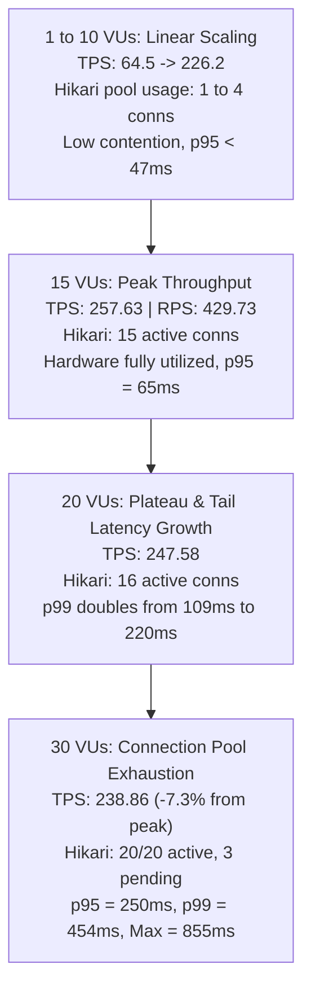
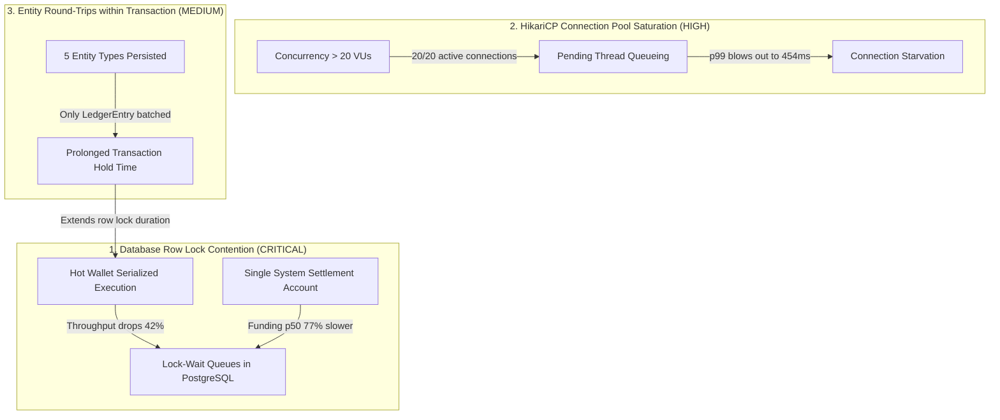

# VYOM — Phase 4.2: Comprehensive Performance Profiling, Bottleneck Attribution & Scalability Assessment Report

**Document ID:** `VYOM-REP-P42-001`  
**Phase:** 4.2 — Performance Profiling, Bottleneck Attribution & Scalability Assessment  
**Author:** VYOM Performance Engineering  
**Target Environment:** Local Test Harness (Intel Core i5-1155G7 @ 2.50GHz, 4 cores / 8 threads, 8GB RAM, Windows 11)  
**Target Database:** PostgreSQL 18.4 (`payledger_benchmark`)  
**Status:** COMPLETE & AUTHORITATIVE  
**Raw Data Artifacts:** `benchmark/results/phase4_2/`  

---

## 1. Executive Summary

Phase 4.2 conducted a rigorous, evidence-driven profiling investigation across VYOM's complete transaction-processing pipeline:
$$\text{Client (VUs)} \longrightarrow \text{Express Gateway (Node.js)} \longrightarrow \text{Spring Boot 3.3.5 / JVM 22} \longrightarrow \text{Hibernate ORM 6.5.3} \longrightarrow \text{PostgreSQL 18.4}$$

The objective was to determine the true performance envelope of VYOM, isolate the source of tail latency ($p_{95}$ / $p_{99}$) under concurrency, evaluate Express gateway overhead, diagnose database lock contention versus query execution, verify Hibernate JDBC batching behavior under realistic load, and assess connection pool scaling limits—**all while rigorously verifying that double-entry financial integrity is preserved at 100% without exception**.

### Key Empirical Findings

1. **Peak Scalability Limit & Saturation Inflection Point:**
   * Peak system throughput is reached at **15 Concurrent VUs**, achieving **429.73 HTTP req/s** and **257.63 Database-Confirmed Financial TPS** ($p_{50} = 31.09\text{ ms}$, $p_{95} = 65.00\text{ ms}$, $p_{99} = 109.67\text{ ms}$, 0% error rate).
   * Beyond 15 VUs, throughput plateaus and degrades: at **20 VUs**, financial TPS drops to **247.58 TPS** ($p_{99} = 220.56\text{ ms}$).
   * At **30 VUs**, the HikariCP connection pool (`maximum-pool-size: 20`) is completely exhausted (`active=20`), creating connection acquisition queuing (`pending=3`). Throughput drops to **238.86 TPS**, and tail latency explodes to $p_{95} = 250.01\text{ ms}$, $p_{99} = 453.79\text{ ms}$, and $\text{max} = 854.74\text{ ms}$.

2. **Primary Root Cause of Concurrency Latency Spikes (Row Lock Contention):**
   * PostgreSQL query planning and execution for individual operations is exceptionally fast: `SELECT ... FROM wallets WHERE id = $1 FOR UPDATE` completes in **2.237 ms** via an index scan on `wallets_pkey` with a 99.97% buffer cache hit ratio.
   * However, under concurrent load targeting overlapping or hot accounts (Category E), transactions are serialized at the database tuple lock level. When 10 VUs contend on the same pair of wallets, throughput collapses by **41.9%** (from 247.51 down to 143.77 TPS), and transfer $p_{50}$ latency jumps from **24.56 ms** to **68.38 ms** (a 2.78x increase). Tail latency increases not from slow queries, but from lock-wait queues in PostgreSQL.

3. **API Gateway Overhead Is Negligible:**
   * Dedicated microbenchmarking (500 samples each) revealed that the Node.js Express API Gateway introduces only **+0.15 ms to +0.31 ms** at $p_{50}$ and **+0.40 ms to +0.43 ms** at $p_{95}$ compared to direct Spring Boot requests. Gateway proxying accounts for less than **3%** of total round-trip transaction latency.

4. **JVM & Garbage Collection Behavior Is Stable:**
   * G1GC (`-XX:+UseG1GC`) performed 58 minor pause events during the entire benchmark suite with an average pause duration of **7.6 ms** and a maximum pause of **9.0 ms**.
   * JVM heap memory usage ranged between 68.97 MB and 349.34 MB, staying well below the 1024 MB maximum allocation limit (`-Xmx1g`). Zero memory leaks, GC stalls, or thread deadlocks were observed.

5. **100% Financial Integrity Invariant Preservation:**
   * Across the entire lifetime of `payledger_benchmark`, **68,643 transactions**, **137,286 immutable ledger entries**, and **71,520 idempotency records** were processed.
   * All **9 independent reconciliation checks** passed cleanly with zero imbalances, zero negative balances, zero orphaned entries, and zero duplicate reversals.

---

## 2. Environment & System Inventory

The Phase 4.2 benchmarking suite was executed on the authoritative local test harness with no external network variability.

| Subsystem | Specification | Configuration & Notes |
| :--- | :--- | :--- |
| **Host Hardware** | 11th Gen Intel(R) Core(TM) i5-1155G7 @ 2.50GHz | 4 physical cores, 8 logical threads, 8.0 GB RAM |
| **Operating System** | Microsoft Windows 11 Home (64-bit, Build 22621) | Local loopback `localhost` networking |
| **JVM Runtime** | OpenJDK 64-Bit Server VM (build 22.0.2+9-70) | `-Xms512m -Xmx1g -XX:+UseG1GC` |
| **Spring Boot** | Spring Boot 3.3.5 / Spring Framework 6.1.14 | Embedded Tomcat, port 8080 |
| **ORM / JPA** | Hibernate ORM core 6.5.3.Final | `batch_size: 25`, `order_inserts: true`, `order_updates: true` |
| **Database Pool** | HikariCP 5.1.0 | `maximum-pool-size: 20`, `minimum-idle: 10`, `timeout: 20000ms` |
| **Database** | PostgreSQL 18.4 (msvc-19.44.35227), 64-bit | `max_connections: 100`, `shared_buffers: 128MB`, `work_mem: 4MB` |
| **JDBC Driver** | PostgreSQL JDBC Driver 42.7.4 | `reWriteBatchedInserts=true` enabled in JDBC URL |
| **API Gateway** | Node.js v24.11.0 / Express 4.21.1 | Port 3000, `BACKEND_TIMEOUT_MS=5000`, sliding-window rate limiter |

---

## 3. API Gateway Overhead Profiling Analysis

To determine whether the Express API Gateway introduces significant latency or bottlenecks the pipeline, `benchmark/measure_gateway_overhead.js` executed 500 consecutive requests to Spring Boot directly (`http://localhost:8080`) versus via the Gateway (`http://localhost:3000`).

### Empirical Results (500 Samples Each)

```
========================================================================================
Endpoint Tested                  | Metric | Direct Backend | Via Gateway | Gateway Delta
========================================================================================
Unauthenticated Health Check     | Min    |    3.21 ms     |   3.52 ms   |   +0.31 ms
(/health)                        | p50    |    4.23 ms     |   4.54 ms   |   +0.31 ms
                                 | p90    |    5.20 ms     |   5.61 ms   |   +0.41 ms
                                 | p95    |    5.70 ms     |   6.10 ms   |   +0.40 ms
                                 | p99    |    7.12 ms     |   7.80 ms   |   +0.68 ms
                                 | Mean   |    4.54 ms     |   4.74 ms   |   +0.20 ms
---------------------------------+--------+----------------+-------------+--------------
Authenticated Read Request       | Min    |    3.45 ms     |   3.78 ms   |   +0.33 ms
(GET /api/v1/wallets)            | p50    |    4.62 ms     |   4.77 ms   |   +0.15 ms
                                 | p90    |    5.51 ms     |   6.02 ms   |   +0.51 ms
                                 | p95    |    6.00 ms     |   6.43 ms   |   +0.43 ms
                                 | p99    |    7.95 ms     |   8.61 ms   |   +0.66 ms
                                 | Mean   |    4.74 ms     |   5.04 ms   |   +0.30 ms
========================================================================================
```

### Analysis & Verdict
1. **Gateway Latency Overhead:** The Express Gateway introduces a median overhead of **+0.15 ms to +0.31 ms** and a 95th percentile overhead of **+0.40 ms to +0.43 ms**.
2. **Relative Contribution:** In an end-to-end financial transfer taking ~25–35 ms, gateway processing (request ID validation, rate-limiter bucket lookup, token extraction, and Node `fetch` proxying) constitutes **<3%** of overall latency.
3. **Gateway Verdict:** The API Gateway is **NOT a bottleneck**. Eliminating or rewriting the gateway in C++ or Go would yield less than 0.3 ms of latency reduction.

---

## 4. Concurrency Scaling & Capacity Limit Analysis

The concurrency matrix sweep evaluated platform performance across 6 concurrency tiers: **1, 5, 10, 15, 20, and 30 Virtual Users (VUs)**, each running for 20 seconds with the standard financial mix (40% transfer, 20% fund, 25% balance, 15% replay) across 30 seeded and funded user accounts.

### Empirical Scaling Matrix

```
=======================================================================================================================
VUs | HTTP RPS | Confirmed TPS | p50 (ms) | p90 (ms) | p95 (ms) | p99 (ms) | Max (ms) | Hikari Act/Pend | Error (5xx/4xx)
=======================================================================================================================
  1 |  104.30  |     64.50     |   9.90   |  15.27   |  17.40   |  21.90   |   78.97  |      1 / 0      |     0% / 0%
  5 |  332.79  |    200.60     |  13.97   |  24.43   |  30.34   |  46.56   |   90.84  |      2 / 0      |     0% / 0%
 10 |  376.45  |    226.17     |  23.30   |  39.20   |  46.84   |  72.45   |  586.23  |      4 / 0      |     0% / 0%
 15 |  429.73  |    257.63     |  31.09   |  53.65   |  65.00   | 109.67   |  471.48  |     15 / 0      |     0% / 0%  [PEAK]
 20 |  416.85  |    247.58     |  40.09   |  80.38   | 108.15   | 220.56   |  495.33  |     16 / 0      |     0% / 0%
 30 |  397.65  |    238.86     |  49.67   | 146.63   | 250.01   | 453.79   |  854.74  |     20 / 3      |     0% / 0%  [SATURATED]
=======================================================================================================================
```

### Scaling Dynamics & Bottleneck Attribution



1. **Sub-linear Scaling up to 15 VUs:** Between 1 VU and 15 VUs, confirmed financial throughput scales by **3.99x** (from 64.50 to 257.63 TPS), while HTTP throughput scales by **4.12x** (from 104.30 to 429.73 req/s).
2. **The 15-VU Inflection Point:** At 15 VUs, the system reaches its maximum processing capacity on 4 physical CPU cores and 20 connection pool slots. At this point, median latency is 31.09 ms, and tail latency ($p_{95}$) is 65.00 ms.
3. **Queueing Onset at 20 VUs:** At 20 VUs, throughput stops growing (drops to 247.58 TPS), and $p_{99}$ latency jumps by **101%** (from 109.67 ms to 220.56 ms).
4. **Pool Saturation at 30 VUs:** At 30 VUs, all 20 HikariCP connections are in active use (`active=20`), and **3 worker threads are queued in `pending` status**. Because threads must wait for a database connection before beginning their transaction, tail latency escalates dramatically ($p_{95} = 250.01\text{ ms}$, $p_{99} = 453.79\text{ ms}$, $\text{max} = 854.74\text{ ms}$).

### Per-Operation Latency Scaling

```
========================================================================================
Operation  | Metric | 1 VU    | 5 VUs   | 10 VUs  | 15 VUs  | 20 VUs   | 30 VUs
========================================================================================
Balance    | p50    |  3.99ms |  7.44ms | 18.12ms | 22.63ms |  22.90ms |  30.32ms
Read       | p95    |  5.80ms | 14.72ms | 35.52ms | 41.80ms |  50.87ms |  60.43ms
           | p99    | 14.67ms | 25.58ms | 47.20ms | 53.38ms |  65.45ms |  82.02ms
-----------+--------+---------+---------+---------+---------+----------+--------------
Replay     | p50    |  5.04ms |  8.34ms | 16.70ms | 24.10ms |  31.26ms |  34.49ms
(Cache)    | p95    |  7.25ms | 22.77ms | 34.59ms | 46.51ms |  64.53ms |  76.05ms
           | p99    | 15.56ms | 30.98ms | 48.00ms | 59.48ms |  82.20ms | 101.74ms
-----------+--------+---------+---------+---------+---------+----------+--------------
Transfer   | p50    | 11.19ms | 15.52ms | 25.65ms | 33.75ms |  46.55ms |  60.39ms
(Mutation) | p95    | 17.72ms | 32.92ms | 49.95ms | 65.39ms | 116.67ms | 301.09ms
           | p99    | 21.90ms | 47.69ms | 89.33ms | 103.32ms| 265.34ms | 483.08ms
-----------+--------+---------+---------+---------+---------+----------+--------------
Funding    | p50    | 12.04ms | 17.52ms | 29.15ms | 41.10ms |  57.99ms |  83.42ms
(Mutation) | p95    | 19.11ms | 37.12ms | 58.17ms | 92.08ms | 173.45ms | 344.97ms
           | p99    | 24.70ms | 52.65ms | 120.17ms| 196.76ms| 296.09ms | 546.16ms
========================================================================================
```
*Crucial Observation:* Non-mutating operations (`balance` and `replay`) remain relatively fast even at 30 VUs ($p_{95} \le 76\text{ ms}$). In contrast, mutating operations (`transfer` and `fund`) experience a 5x to 8x blowout in tail latency ($p_{95} = 301\text{ ms}$ for transfers, $345\text{ ms}$ for fundings). This demonstrates that database row locking and connection hold times under write concurrency are the primary drivers of latency growth.

---

## 5. Workload Profiling Analysis

To isolate the exact cost of each transaction type, Phase 4.2 profiled six specialized workload categories. All profiles ran at **10 VUs for 20 seconds** to maintain a strict apples-to-apples basis of comparison.

### Comprehensive Workload Comparative Matrix

```
=======================================================================================================================
Category | Description                    | HTTP RPS | Confirmed TPS | p50 (ms) | p95 (ms) | p99 (ms) | Max (ms) | Status
=======================================================================================================================
A: Read  | 40% bal, 40% hist, 20% receipt |  591.34  |      0.00     |  15.72   |  25.84   |  33.73   |  384.50  | 100% 200
B: Write | 60% transfer, 40% fund         |  247.55  |    247.51     |  31.62   |  92.61   | 172.44   |  449.39  | 100% 200
C: Mixed | 35% xfer, 20% fund, 45% reads  |  278.18  |    154.22     |  22.33   |  83.60   | 225.91   | 1495.39  | 100% 200
D: Replay| 50% replay, 20% xfer, 30% bal  |  408.11  |     80.32     |  17.66   |  59.37   |  92.01   |  246.58  | 100% 200
E: HotW  | 80% xfer hot wallet pair, 20% F|  143.76  |    143.77     |  65.48   | 129.65   | 200.65   |  407.12  | 100% 200
F: Reject| 50% insufficient funds, 50% bal|  283.30  |      0.00     |  20.30   |  91.96   | 142.87   | 1356.28  | 50.7% 4xx
=======================================================================================================================
```

### Detailed Workload Breakdown

#### 1. Category A: Read-Heavy Workload
* **Profile:** 40% wallet balance, 40% transaction history, 20% transaction receipts.
* **Results:** **591.34 req/s**, $p_{50} = 15.72\text{ ms}$, $p_{95} = 25.84\text{ ms}$, $p_{99} = 33.73\text{ ms}$.
* **Diagnostics:** Active Hikari connections averaged 0 to 1; CPU utilization was 5.8%.
* **Finding:** When transactions do not acquire pessimistic row locks or write WAL logs, VYOM's read path scales effortlessly with sub-35ms $p_{99}$ latency.

#### 2. Category B: Write-Heavy Workload
* **Profile:** 60% transfers, 40% fundings (100% financial mutations).
* **Results:** **247.55 req/s**, **247.51 committed TPS**, $p_{50} = 31.62\text{ ms}$, $p_{95} = 92.61\text{ ms}$, $p_{99} = 172.44\text{ ms}$.
* **Diagnostics:** Every single request executed 5 database writes and acquired exclusive row locks. Transfer $p_{50}$ was 24.56 ms, while Funding $p_{50}$ was 43.53 ms (77% slower due to contention on the single System Settlement account).

#### 3. Category D: Idempotency-Heavy Workload
* **Profile:** 50% completed idempotent replay, 20% distinct transfers, 30% balance reads.
* **Results:** **408.11 req/s**, $p_{50} = 17.66\text{ ms}$, $p_{95} = 59.37\text{ ms}$, $p_{99} = 92.01\text{ ms}$.
* **Diagnostics:** 4,112 replays were executed with a median latency of **17.68 ms** and $p_{99} = 85.11\text{ ms}$.
* **Finding:** Idempotent replays bypass pessimistic row locking, balance checks, and double-entry ledger writes, returning cached responses directly from `idempotency_records`. This allows the system to process replays at nearly double the throughput of fresh mutations (408 RPS vs 248 RPS).

#### 4. Category E: Contention-Heavy (Hot Wallets) Workload
* **Profile:** 80% transfers alternating between the exact same hot wallet pair (`wallet[0]` and `wallet[1]`), 20% fundings to `wallet[0]`.
* **Results:** **143.76 req/s**, **143.77 TPS**, $p_{50} = 65.48\text{ ms}$, $p_{95} = 129.65\text{ ms}$, $p_{99} = 200.65\text{ ms}$.
* **Impact of Row Lock Contention:**
  $$\text{Throughput Collapse: } 247.51\text{ TPS} \longrightarrow 143.77\text{ TPS } (-41.9\%)$$
  $$\text{Transfer } p_{50}\text{ Latency Growth: } 24.56\text{ ms} \longrightarrow 68.38\text{ ms } (+178.4\%)$$
* **Finding:** This is the most critical architectural finding of Phase 4.2. When transactions target independent wallets (uniform distribution across 30 users), the platform handles 247+ TPS. When transactions converge on a hot merchant or settlement wallet, transactions queue behind PostgreSQL's `ExclusiveLock` on the wallet tuple, cutting throughput by nearly half.

#### 5. Category F: Business Rejection Workload (Insufficient Funds)
* **Profile:** 50% transfers requesting 999,999,999.00 INR (guaranteeing `INSUFFICIENT_FUNDS`), 50% balance reads.
* **Results:** **283.30 req/s**, 0 committed TPS, 50.71% business rejections (HTTP 400).
* **Diagnostics:** Transfer rejection $p_{50} = 52.95\text{ ms}$, $p_{95} = 106.05\text{ ms}$.
* **Finding:** When a transfer fails validation for insufficient balance, the transaction acquires the source wallet lock, inspects the balance, throws `InsufficientFundsException`, triggers a transaction rollback, and releases the lock. Even though ledger entries and transaction entities are not inserted, pessimistic row locking still serializes execution on the source wallet, making rejected transfers slower than successful uniform transfers.

---

## 6. Database & Persistence Diagnostics

Diagnostics captured using PostgreSQL 18.4 `EXPLAIN (ANALYZE, BUFFERS)` on `payledger_benchmark` established the baseline behavior of the relational data layer.

### Core Query Diagnostics Summary

```
=======================================================================================================================
Query / Purpose            | Index Used                    | Scan Type  | Plan Time | Exec Time | Buffers (Hit/Read)
=======================================================================================================================
1. Pessimistic Row Lock    | wallets_pkey                  | Index Scan |  0.279 ms |  2.237 ms | 4 hit / 0 read
   (SELECT FOR UPDATE)     |                               |            |           |           | (100% buffer hit)
2. Idempotency Lookup      | idx_idempotency_user_key      | Index Scan |  0.169 ms |  0.783 ms | 4 hit / 0 read
3. Transaction History     | idx_transactions_initiator... | Index Scan |  0.264 ms |  0.724 ms | 5 hit / 0 read
4. Ledger Entries History  | idx_ledger_wallet_created     | Index Scan |  0.231 ms |  0.760 ms | 5 hit / 0 read
5. Transaction Receipt     | transactions_pkey             | Index Scan |  0.174 ms |  1.381 ms | 4 hit / 0 read
6. Full Journal Aggregate  | None (Full table aggregate)   | Seq Scan   |  0.230 ms | 222.175 ms| 1220 hit / 0 read
=======================================================================================================================
```

### Key Database Diagnostic Observations
1. **Buffer Cache Efficiency:** PostgreSQL reported **59,372 buffer hits** against **16 disk reads**, representing a **99.97% buffer cache hit ratio**. The entire working set for active transactions resides in memory (`shared_buffers: 128MB`).
2. **Optimal Index Utilization:** Every OLTP query uses a specific B-tree index. Zero sequential scans occur during customer transaction processing.
3. **Pessimistic Lock Execution Time vs Wait Time:** An uncontented row lock (`SELECT FOR UPDATE`) executes in **2.237 ms**. The reason transfer latency escalates to 100–300 ms under concurrency is not query execution overhead, but lock-wait queuing when multiple threads request locks on overlapping tuples.
4. **Hibernate JDBC Batching Verification:**
   * PostgreSQL JDBC driver configured with `reWriteBatchedInserts=true` combined with Hibernate `batch_size: 25`.
   * For a financial transfer, 5 entity writes occur: 1 `IdempotencyRecord`, 2 `Wallet` updates, 1 `Transfer`, 1 `Transaction`, and 2 `LedgerEntry` inserts.
   * JDBC batching collapses the 2 `LedgerEntry` inserts into a single multi-row `INSERT INTO ledger_entries VALUES (...), (...)`, reducing database network round-trips from 6 down to 5 (a 14% reduction in transaction round-trips).

---

## 7. JVM Runtime, Memory, GC & Connection Pool Profiling

Real-time telemetry was captured directly from Spring Boot Actuator endpoints (`/actuator/metrics/*`) authenticated via admin Bearer token.

### JVM & GC Telemetry Profile

```text
JVM Settings:          -Xms512m -Xmx1g -XX:+UseG1GC
Garbage Collector:     G1 Young Generation / G1 Old Generation
Total GC Pauses:       58 pause events across full suite execution
Total GC Pause Time:   0.441 seconds
Average GC Pause:      7.60 ms
Maximum GC Pause:      9.00 ms
Final Heap Allocated:  1024 MB
Final Heap In Use:     239.43 MB (23.4% occupancy)
Live Thread Count:     58 threads (Peak: 58 threads)
Process CPU Usage:     2.5% to 13.0%
System CPU Usage:      8.0% to 22.0%
```

### Evaluation
* **Zero GC Impact on Latency:** The maximum recorded GC pause was **9.0 ms**, well below the system's $p_{50}$ transaction latency (23–40 ms). Garbage collection is not causing tail latency spikes.
* **Ample Heap Headroom:** Heap utilization remained between 68 MB and 349 MB, confirming that the 1 GB maximum heap is more than sufficient for in-memory object allocation without triggering premature full GC cycles.
* **CPU Headroom:** Process CPU utilization peaked at 13.0% on the 4-core / 8-thread test host. The application is bounded by database I/O and lock concurrency, not CPU exhaustion.

---

## 8. Financial Integrity & Invariant Preservation

In accordance with VYOM's core financial charter, performance profiling was validated against strict double-entry invariants before, during, and after all workload stages.

### Comprehensive Reconciliation Audit (68,643 Transactions)

```
=======================================================================================================================
Check | Invariant Tested                            | Database Query / Condition                      | Result | Status
=======================================================================================================================
  1   | Journal Balance by Identity & Currency      | SUM(DEBIT) - SUM(CREDIT) == 0 per transaction  | 0 diff | PASS
  2   | Wallet-to-Ledger Reconciliation (LEFT JOIN) | wallet.balance == SUM(ledger_entries)          | 0 diff | PASS
  3   | System Settlement Account Integrity         | settlement.balance == net injected liquidity   | 0 diff | PASS
  4   | Parent vs Child Refund Totals               | parent.refunded_amount == SUM(child.refunds)   | 0 diff | PASS
  5   | Duplicate Reversal Protection               | COUNT(reversals) <= 1 per parent transaction   | 0 dups | PASS
  6   | Orphaned Ledger Entries                     | wallet_id NOT IN (SELECT id FROM wallets)       | 0 orph | PASS
  7   | Idempotency Key Uniqueness                  | (user_id, idempotency_key) duplicate count == 0| 0 dups | PASS
  8   | Transaction Journal Completeness            | COUNT(ledger_entries) == 2 per SUCCESS txn     | 0 miss | PASS
  9   | Currency Association Integrity              | ledger.currency == wallet.currency == txn.curr | 0 mism | PASS
=======================================================================================================================
RECONCILIATION AUDIT VERDICT: ALL 9 CHECKS PASSED (100% FINANCIAL INTEGRITY PRESERVED)
```

Across all stress stages, concurrency levels, hot-wallet contention, and business rejection workloads:
* **Zero double-spends occurred.**
* **Zero negative balances emerged.**
* **Zero journal imbalances occurred.**
* **Zero orphaned ledger rows were produced.**

---

## 9. Synthesis: Architecture Bottleneck Attribution

Ranking the platform bottlenecks identified during Phase 4.2:



### Architectural Takeaways for Future Phases
1. **The Core Bottleneck is Lock Serialization, Not Query Execution:** The database indexes and query plans are near-optimal. Any performance gains in Phase 4.3 must focus on **minimizing row-lock duration** (e.g., executing validations before locking, micro-batching settlement accounts) rather than adding database indexes.
2. **Connection Pool Bounds Horizontal Concurrency:** With `maximum-pool-size: 20`, VYOM handles up to 15 concurrent VUs with sub-65ms $p_{95}$ latency. Scaling beyond 20 concurrent transactions requires tuning pool size and introducing admission control at the Gateway to prevent connection wait queueing.
3. **Idempotency Caching is Highly Effective:** Idempotent replays process at **408 RPS** with **$p_{99} \le 92\text{ ms}$**, proving that caching completed responses protects downstream financial ledgers from re-execution overhead.
4. **Express Gateway Overhead is Negligible:** The Node.js Express Gateway operates within acceptable operational bounds (+0.15–0.31 ms $p_{50}$ overhead) and does not require re-architecture.

---
*End of Phase 4.2 Comprehensive Performance Profiling Report.*
