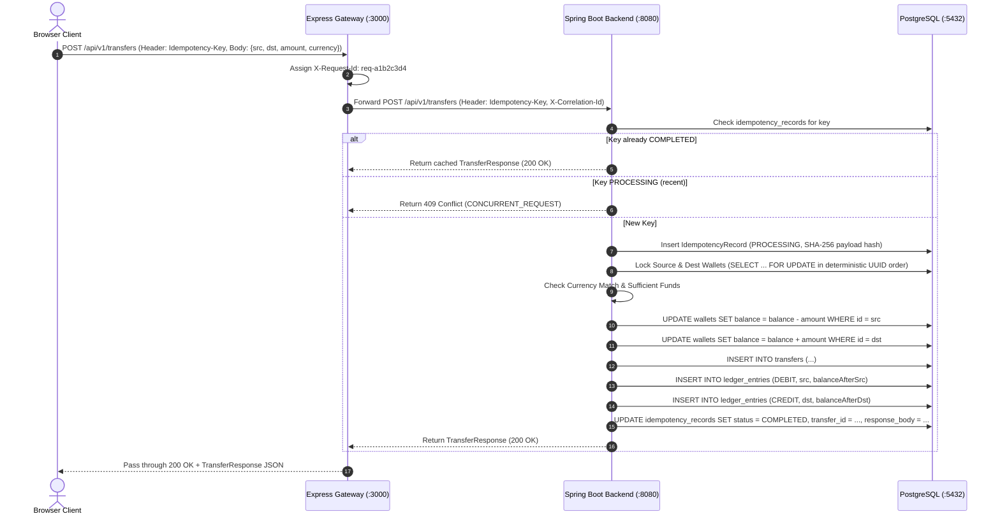

# VYOM Architecture Documentation

## 1. System Overview

**VYOM (व्योम) — Virtual Yatra of Money** is a digital payments and transaction-processing platform designed to demonstrate financial engineering principles, transaction isolation, concurrency safety, persistent idempotency, double-entry bookkeeping, and an append-only ledger audit trail. Tagline: *Every transaction. One trusted space.*

The system is organized into a clean multi-tier architecture:

```
┌─────────────────────────────────────────────────────────────┐
│                 Browser Client (Single Page)                │
│             Native HTML5 / Modern CSS3 / ES2022+            │
└──────────────────────────────┬──────────────────────────────┘
                               │ HTTP / JSON
                               │ Port: 3000
┌──────────────────────────────▼──────────────────────────────┐
│                  Node.js / Express Gateway                  │
│       - Request correlation & ID generation (X-Request-Id)  │
│       - HTTP reverse proxying & header pass-through         │
│       - Upstream timeout (504) & outage (503) containment   │
│       - Static asset serving (public/)                      │
└──────────────────────────────┬──────────────────────────────┘
                               │ HTTP / JSON
                               │ Port: 8080
┌──────────────────────────────▼──────────────────────────────┐
│              Java 21 / Spring Boot 3.3.5 Backend             │
│       - REST Controllers & Request Validation               │
│       - Transaction Management (@Transactional ACID)        │
│       - Pessimistic Row Locking (SELECT ... FOR UPDATE)     │
│       - Persistent Idempotency Service (SHA-256 + Timeout)  │
│       - Double-Entry Ledger Core Engine                     │
└──────────────────────────────┬──────────────────────────────┘
                               │ JDBC (HikariCP)
                               │ Port: 5432
┌──────────────────────────────▼──────────────────────────────┐
│                    PostgreSQL 18 Database                   │
│       - Flyway Schema Migrations (V1, V2)                   │
│       - Append-Only Protection Trigger (No UPDATE/DELETE)   │
│       - CHECK Constraints & Partial Unique Indexes          │
│       - Foreign Keys with Referential Integrity             │
└─────────────────────────────────────────────────────────────┘
```

---

## 2. Layer Responsibilities & Strict Boundaries

### A. Presentation Layer (Native Browser Client)
- **Role:** Interactive dashboard for financial operations and ledger observation.
- **Constraints:** Zero UI frameworks (no React/Vue/Angular), zero jQuery. Safe DOM manipulation (`textContent`, `createElement`) to prevent XSS.
- **Features:** Wallet creation, simulated demo funding top-up, wallet balance lookup, atomic fund transfers, paginated transaction history, and live health monitoring.

### B. Gateway Layer (Node.js / Express on Port 3000)
- **Role:** API entrypoint, static web server, edge security, and protocol mediation.
- **Strict Boundary Rule:** Node.js **does NOT** duplicate business logic, balance arithmetic, database access, or transfer validations.
- **Responsibilities:**
  - Assigns or preserves unique correlation IDs (`X-Request-Id` and `X-Correlation-Id`).
  - Forwards requests to the Spring Boot upstream at `http://localhost:8080`.
  - Passes through client mutation headers (`Idempotency-Key`).
  - Preserves backend HTTP status codes (200, 201, 400, 404, 409, 422, 500) and response bodies verbatim.
  - Translates network failures into controlled, structured error responses (`503 BACKEND_UNAVAILABLE` and `504 GATEWAY_TIMEOUT`).
  - Serves static assets from `gateway/public/`.

### C. Backend Application Layer (Java 21 & Spring Boot 3.3.5 on Port 8080)
- **Role:** Financial domain engine, business invariants enforcement, transaction coordinator.
- **Components:**
  - **Controllers:** Validate inputs using Bean Validation (`@Valid`, `@Positive`, `@Digits`, `@Pattern`).
  - **TransferService & TransferExecutionService:** Orchestrates the transfer lifecycle, lock acquisition, debit/credit execution, and ledger entry creation.
  - **FundingService & FundingExecutionService:** Orchestrates simulated wallet top-up, row-locking, and single-entry credit recording.
  - **IdempotencyService:** SHA-256 request fingerprinting, atomic `PROCESSING` -> `COMPLETED` state transitions, and timeout recovery for orphaned requests.
  - **GlobalExceptionHandler:** Maps domain exceptions to standard RFC-compliant error envelopes.

### D. Persistence Layer (PostgreSQL 18 on Port 5432)
- **Role:** Durable system of record.
- **Integrity Enforcement:**
  - `chk_wallets_balance_non_negative`: Database-level guarantee that wallet balances cannot drop below zero.
  - `trg_protect_ledger_entries`: PostgreSQL trigger prohibiting any `UPDATE` or `DELETE` on the `ledger_entries` table, ensuring immutability.
  - `chk_ledger_operation_reference`: Guarantees each ledger entry points to exactly one operation (`transfer_id` XOR `funding_id`).
  - `chk_ledger_funding_must_be_credit`: Guarantees funding ledger entries are strictly `CREDIT`.

---

## 3. End-to-End Data Flow & Request Tracing

### Request Tracing Strategy
Every inbound HTTP request receives a correlation ID:
1. If the client sends `X-Request-Id` or `X-Correlation-Id`, the gateway preserves it.
2. If omitted, the gateway generates a unique ID with format `req-<uuid8>`.
3. The gateway forwards `X-Correlation-Id` to Spring Boot.
4. Spring Boot binds it to the logging context and includes it in all error response payloads.
5. In the browser UI, any error displays the `Correlation ID` for instantaneous log correlation.

### Transfer Request Walkthrough


---

## 4. Error Propagation & Containment

| Scenario | Layer Detected | HTTP Status | Error Code | Response Payload Style |
| :--- | :--- | :--- | :--- | :--- |
| Gateway JSON parse error | Gateway | 400 | `MALFORMED_JSON` | Standard JSON Envelope |
| Upstream offline / refused | Gateway | 503 | `BACKEND_UNAVAILABLE` | Standard JSON Envelope |
| Upstream timeout (>5000ms) | Gateway | 504 | `GATEWAY_TIMEOUT` | Standard JSON Envelope |
| Validation failed (e.g. negative amount) | Spring Boot | 400 | `VALIDATION_FAILED` | Standard JSON Envelope |
| Wallet ID does not exist | Spring Boot | 404 | `WALLET_NOT_FOUND` | Standard JSON Envelope |
| Insufficient balance | Spring Boot | 409 | `INSUFFICIENT_FUNDS` | Standard JSON Envelope |
| Idempotency key payload mismatch | Spring Boot | 409 | `IDEMPOTENCY_CONFLICT` | Standard JSON Envelope |
| Ledger entry update/delete attempt | PostgreSQL Trigger | 500 / 409 | `INTERNAL_SERVER_ERROR` | Database exception raised |

---

## 5. Architectural Decision Records (ADR) Summary

1. **Why Node.js Gateway alongside Spring Boot?**
   Decouples edge routing, client asset serving, and protocol mediation from core transactional ledger execution. It mirrors modern production microservice topologies without adding heavyweight cloud infrastructure.
2. **Why Native HTML/CSS/JS without Frameworks?**
   Ensures zero runtime build step, zero client vulnerability baggage, fast load times, and transparent inspection of DOM interactions.
3. **Why Deterministic UUID Ordering for Row Locks?**
   Prevents deadlocks in bidirectional concurrent transfers ($A \to B$ and $B \to A$ simultaneously) by enforcing that both transactions always acquire locks in the exact same lexical order ($min(A, B)$ then $max(A, B)$).
4. **Why Trigger-Enforced Append-Only Ledger?**
   Application-level constraints can be bypassed by rogue queries or misconfigured code. A PostgreSQL database trigger unconditionally guarantees the ledger table is strictly immutable.
